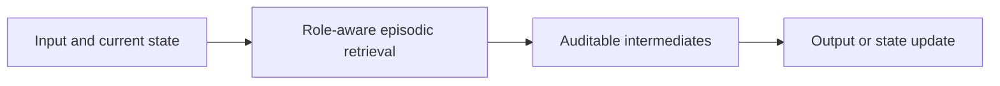
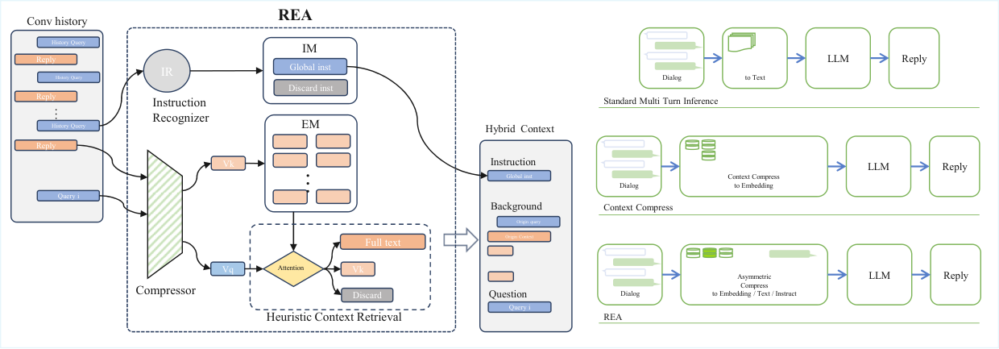

<!-- source-sha256: d2c58b7dbd76749edcf6e1a7ec5d1c161154cb5a1a35afcd7177f419e88e42ff -->

[简体中文](README.md) · English

# Role-aware Heuristic Episodic Attention for Conversational LLMs

> **L1 core mechanism diagnostic.** Role separation and episodic top-k run; no compression LLM is called.

## Paper information

| Field | Details |
|---|---|
| Paper | [arXiv v1](https://arxiv.org/abs/2610.00958) |
| Institution | The first page does not list the first author's affiliation. |
| First public release | 2026-10-01 (arXiv v1) |
| Original source code | No public author implementation found as of 2026-10-03. |
| Adapter | `rea` |
| Local reproduction code | [`src/auto_research/foundation_latest_20261003.py`](https://github.com/daiwk/auto-research/tree/main/src/auto_research/foundation_latest_20261003.py) |

## Original paper summary

### Background and main changes

Put global instructions in a persistent prefix and multi-turn exchanges in episodic memory. When retrieving, use the role to decide whether to keep original text, a compressed representation or nothing.

<!-- paper-figure:start -->
### Key figure from the paper

> **Figure 2:** Overall workflow, stages and data flow. From the [paper](https://arxiv.org/abs/2610.00958); copyright belongs to the authors. Click for the source.
<!-- paper-figure:end -->

### Core equation

$C=I_{persistent}\oplus TopK(E, relevance)$.

### Offline and online results

The paper reports Long-MT-Bench+ judge score 6.32→7.36 and 2.91× lower mean latency.

## Local reproduction

> **Comparison protocol:** Disabled or default mechanism versus its defining operator. L1 does not report formal relative gains; percentages are not applicable.

- Three-seed diagnostic: [`metrics/mechanism-seeds42-44.json`](metrics/mechanism-seeds42-44.json).
- `diagnostic_only=true`; excluded from formal capability rankings.

## Scope

Role separation and episodic top-k run. No compression LLM is called.
