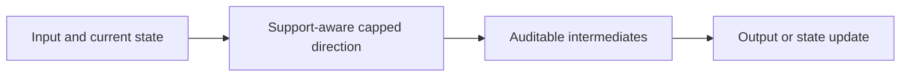
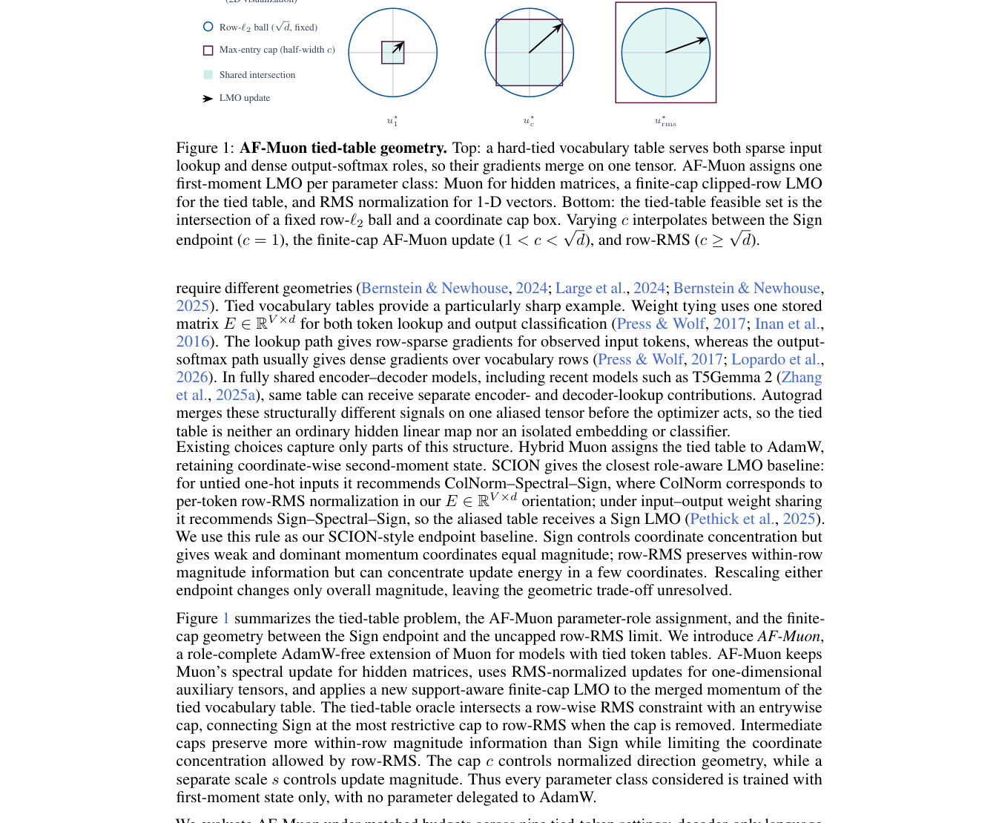

<!-- source-sha256: eff4e72c1ef53b275691373df114f5a6beb42bdf5cc0c140192bd863ebaf7fd9 -->

[简体中文](README.md) · English

# AF-Muon: An AdamW-Free Muon Optimizer for Tied-Embedding Models

> **L1 core mechanism diagnostic.** The vocabulary support-and-cap direction runs. Paper-scale pretraining was not completed.

## Paper information

| Field | Details |
|---|---|
| Paper | [arXiv v1](https://arxiv.org/abs/2610.01395) |
| Institution | The first page does not list the first author's affiliation. |
| First public release | 2026-10-01 (arXiv v1) |
| Original source code | No public author implementation found as of 2026-10-03. |
| Adapter | `af-muon` |
| Local reproduction code | [`src/auto_research/foundation_latest_20261003.py`](https://github.com/daiwk/auto-research/tree/main/src/auto_research/foundation_latest_20261003.py) |

## Original paper summary

### Background and main changes

Ordinary matrices keep the Muon spectral-norm direction. The vocabulary matrix shared by sparse input lookups and the dense output classifier uses a support-aware capped linear minimization oracle (LMO). One-dimensional parameters use RMS updates.

<!-- paper-figure:start -->
### Key figure from the paper

> **Figure 1:** Overall design and components. From the [paper](https://arxiv.org/abs/2610.01395); copyright belongs to the authors. Click for the source.
<!-- paper-figure:end -->

### Core equation

$d_i=1[g_i\ne0]\,g_i/\|g_i\|\min(\|g_i\|,c)$.

### Offline and online results

The method removes AdamW's second-moment state while maintaining tied-embedding training stability in the paper.

## Local reproduction

> **Comparison protocol:** Disabled or default mechanism versus its defining operator. L1 does not report formal relative gains; percentages are not applicable.

- Three-seed diagnostic: [`metrics/mechanism-seeds42-44.json`](metrics/mechanism-seeds42-44.json).
- `diagnostic_only=true`; excluded from formal capability rankings.

## Scope

The vocabulary support-and-cap direction runs. No paper-scale pretraining.
