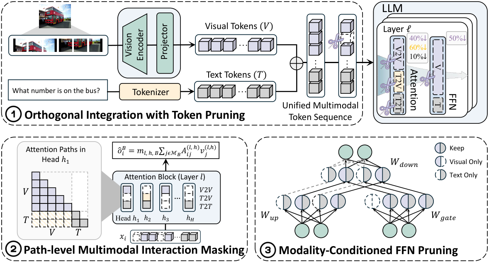

# MWOP: Modality-aware Width-wise Operation Pruning for Efficient MLLMs

<!-- source-sha256: 7a540f19b80471cf19cba211a9375e34a6ba42dd06a09f5ba1ab817078f1b529 -->

[简体中文](README.md)

> **L1 core-mechanism diagnostic.** Executes independent path and channel masks; claims neither kernel speedup nor model-level accuracy.

## Paper information

| Field | Details |
|---|---|
| Paper | [MWOP: Modality-aware Width-wise Operation Pruning for Efficient MLLMs](https://arxiv.org/abs/2610.01434) |
| Organization | No first-author affiliation is listed on the paper's first page. |
| First public release | 2026-10-01 (arXiv v1) |
| Authors' code | No public author implementation was found as of 2026-10-03. |
| Adapter / method | `mwop` |
| Local reproduction code | [`src/auto_research/foundation_latest_20261003.py`](https://github.com/daiwk/auto-research/tree/main/src/auto_research/foundation_latest_20261003.py) |

## Original paper

### Motivation and method

Prune V2V, T2V, and T2T paths separately inside the same attention head and select distinct FFN channels for visual and text processing. Re-estimate FFN importance after attention pruning.

~~~mermaid
flowchart LR
  I[Public input and current state] --> M[mwop mechanism]
  M --> A[Auditable intermediates]
  A --> O[Output or state update]
~~~

<!-- paper-figure:start -->
### Key figure from the paper

> **Figure 2:** Overview of the paper's method and its key components. From the [original paper](https://arxiv.org/abs/2610.01434); copyright remains with the authors. Click the image for the source.
<!-- paper-figure:end -->

### Core equation

$I(w)\approx|w\partial L/\partial w|$, with independent top-k selection for each modality path.

### Paper results

The paper reports accuracy retention and throughput improvements at higher compression ratios on several MLLMs.

## Local reproduction

> **Local comparison:** The baseline disables the mechanism or uses default state; the treatment executes the defining operator. L1 reports no formal relative improvement, and relative percentages are not applicable.

- [Three-seed diagnostic](metrics/mechanism-seeds42-44.json)
- `diagnostic_only=true`, ineligible for formal capability ranking.

## Reproduction boundaries

Independent path and channel masks run locally. No kernel speedup or model-level accuracy claim is made.
