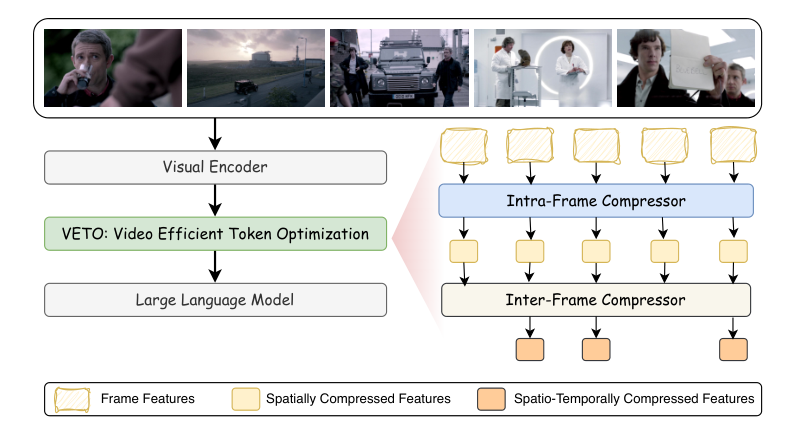

# VETO: Video Efficient Token Optimization for Vision Language Models

<!-- source-sha256: 07aa12ded3b703ee7041559a195bc6fddc34458d3b536f8672e51ba0ee33c473 -->

[简体中文](README.md)

> **L1 core-mechanism diagnostic.** Runs spatial-first, temporal-second compression on GPU. No 7B VLM or real video benchmark is run, and paper throughput is not a local result.

## Paper information

| Field | Details |
|---|---|
| Paper | [arXiv 2610.01785](https://arxiv.org/abs/2610.01785) |
| Organization | First-author affiliation: National Taiwan University |
| First public release | 2026-10-01 (arXiv v1) |
| Authors' code | No public author implementation was found as of 2026-10-02. |
| Adapter | `veto` |
| Local reproduction code | [`src/auto_research/foundation_latest_20261002.py`](https://github.com/daiwk/auto-research/blob/main/src/auto_research/foundation_latest_20261002.py) |

## Original paper

### Motivation and method

Merge semantically neighboring tokens within frames first, then remove cross-frame redundancy from compressed frame representations. Spatial-first processing reduces global temporal matching cost.

~~~mermaid
flowchart LR
  I[Input and current state] --> M[VETO mechanism]
  M --> A[Auditable intermediates]
  A --> O[Output or state update]
~~~

<!-- paper-figure:start -->
### Key figure from the paper

> **Key figure:** Original architecture, training flow, or system protocol. From the [paper](https://arxiv.org/abs/2610.01785); copyright remains with the authors.
<!-- paper-figure:end -->

### Core equation

$X'=C_{time}(C_{space}(X))$. Deterministic farthest-point representatives verify axis order and budget locally.

### Paper results

LLaVA-OneVision-7B inference is up to 45% faster, and accuracy at a 10% token budget is 55.7%.

## Local reproduction

> **Local comparison:** The baseline disables the mechanism or uses default state; the treatment enables the core operator. Relative percentage change is not applicable. This checks invariants, gradients, or state transitions, not paper-scale outcomes.

- [Three-seed diagnostic](metrics/mechanism-seeds42-44.json)
- `diagnostic_only=true`, ineligible for formal capability ranking.
- [GPU validation](https://github.com/daiwk/auto-research/blob/main/docs/gpu-validations/veto-a100-20261002.json)

## Reproduction boundaries

GPU execution covers spatial-first, temporal-second compression only. There is no local 7B VLM, real video benchmark, or reproduction of the paper's throughput.
