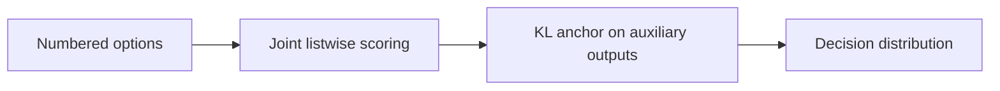
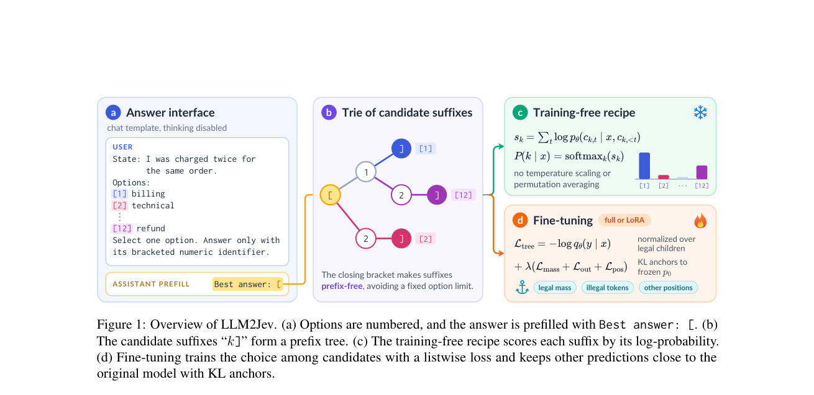

# LLM2Jev: LLMs Are Already Jev-Style Decision Models — When and How to Fine-Tune Them

<!-- source-sha256: 5fb8241b7b4af53bfcef2035c9ab72427d02fafaf7ef86cc180484a92f681019 -->

[简体中文](README.md)

> L1 mechanism diagnostic: joint candidate scoring and KL anchoring. No 4B checkpoint or JevBench run.

## Paper information

| Field | Details |
|---|---|
| Paper | [arXiv v1](https://arxiv.org/abs/2610.02076) |
| Institution | Microsoft, identified by first-author email. |
| First public release | 2026-10-01 (arXiv v1) |
| Author code | No public author implementation found as of 2026-10-03. |
| Local adapter or method key | `llm2jev` |
| Local reproduction code | [`src/auto_research/foundation_latest_20261003.py`](https://github.com/daiwk/auto-research/tree/main/src/auto_research/foundation_latest_20261003.py) |

## Paper method and evidence

Use next-token probabilities over parenthesized numeric options to form a distribution over a finite candidate set. Fine-tune with a listwise decision loss and a KL term that anchors auxiliary outputs to the base model.

<!-- paper-figure:start -->
### Original paper figure

Figure 1 shows the decision-training and optimization path. From the [original paper](https://arxiv.org/abs/2610.02076); copyright remains with the authors.
<!-- paper-figure:end -->

### Core equation

$p(o)\propto\exp\sum_t\log p([o]_t)$ and $L=L_{list}+\lambda KL(p_{base}\|p_{aux})$.

### Reported results

The authors report that untrained Qwen3.5-4B matched same-backbone community Jev models and that fine-tuning helped mainly on weaker tasks.

## Local reproduction

Compare the mechanism-on path with its disabled/default state. The [three-seed diagnostic](metrics/mechanism-seeds42-44.json) is `diagnostic_only=true`; no formal relative improvement, capability ranking, 4B checkpoint run, or JevBench evaluation.
