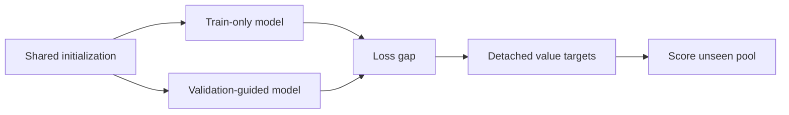
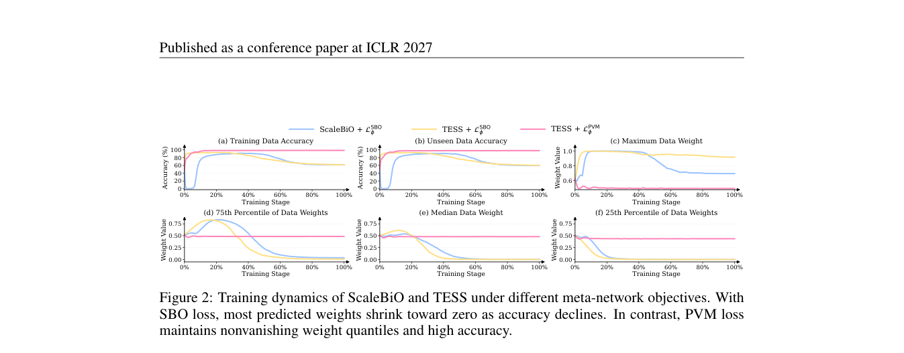

# TESS: A transferable data-selection meta-network

<!-- source-sha256: a55eeba07f32c67aff112f92e5f2fda2333e601534e6c88e387bdba408b486d1 -->

[简体中文](README.md)

> L1 real sequential training of two small classifiers and a selector, not LLM data-selection gains.

## Paper information

| Field | Details |
|---|---|
| Paper | [arXiv 2610.02092](https://arxiv.org/abs/2610.02092) |
| Institution | Nanyang Technological University; Zilin Du. |
| First public release | 2026-10-01 (arXiv v1) |
| Author code | No author code found in full text on 2026-10-04; Alpaca data is not method source. |
| Local adapter or method key | `tess` (Python mechanism API). |
| Local reproduction code | [`src/auto_research/post_training/tess.py`](https://github.com/daiwk/auto-research/blob/main/src/auto_research/post_training/tess.py) |

## Paper method and evidence

Train one model on train only and another with validation guidance. Use their per-example loss gap as a value pseudo-label. Pointwise value matching avoids the poorly behaved direct objective and can transfer the small teachers' selection rules to an unseen pool.

<!-- paper-figure:start -->
### Original paper figure

Figure 2 shows training and selector objective. From the [original paper](https://arxiv.org/abs/2610.02092); copyright remains with the authors.
<!-- paper-figure:end -->

### Core equation

$U=\operatorname{Train}(D_{train})$, $W=\operatorname{Train}(L_{val}+\alpha L_{train})$, $\Delta_i=\ell(U;x_i)-\ell(W;x_i)$ and $L_{PVM}=N^{-1}\sum_i(g_\psi(x_i)-\operatorname{stopgrad}(\Delta_i))^2$. Same initial weights, sequential training and saved per-example losses; release models afterward. Do not use test as validation.

### Reported results

The paper studies cross-pool/model-scale transfer and contrasts PVM with direct meta-objectives. No production A/B; fitting loss is not downstream LLM validation.

## Local reproduction

`PYTHONPATH=src python scripts/run_oct04_seven_papers.py` creates 64 train, 32 validation, and 48 disjoint pool items. Two classifiers train 60 steps each, selector 120, three seeds. [Metrics](metrics/mechanism-seeds42-44.json): PVM 0.0803→0.0129 and nonconstant scores for 48 pool items. No test access or accuracy. `fit_tess` accepts `per_example_loss(model,batch)` including token-average LM loss, preserves source weights and detaches labels. Negative scores are not clamped or treated as sampling probabilities. Synthetic 2D features only, no full LLM scoring/retraining or Evolve promotion.
