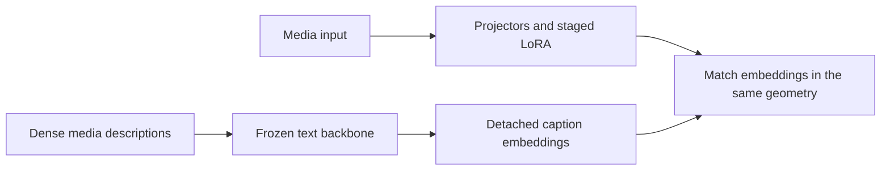
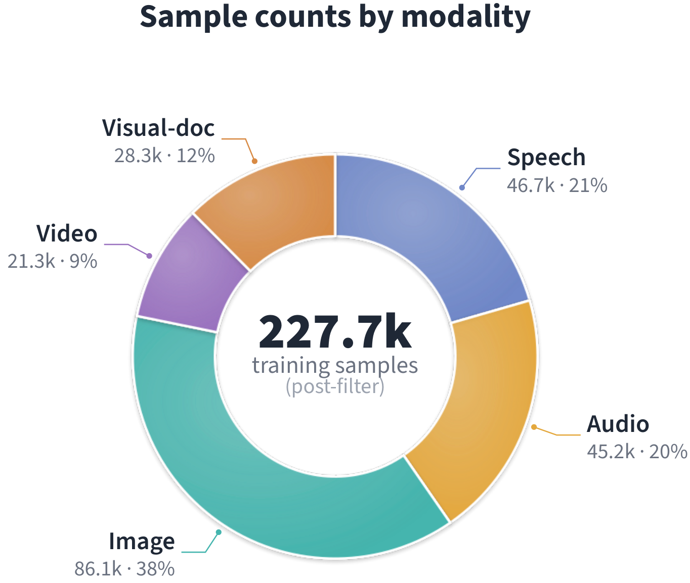

# Omni-Embed-Mini: Binding Modalities Without Forgetting via Dense Distillation

<!-- source-sha256: ec1120aa41f9a5220e1c81153293a81793cfdbd0f9865bf3763acde7f5dffe7e -->

[简体中文](README.md)

> L1 dense description distillation in a common embedding geometry. No modality encoder training or benchmark leaderboard reproduction.

## Paper information

| Field | Details |
|---|---|
| Paper | [arXiv v1](https://arxiv.org/abs/2610.02148) |
| Institution | The paper's first page does not list an affiliation for the first author. |
| First public release | 2026-10-01 (arXiv v1) |
| Author code | No public author implementation found as of 2026-10-03. |
| Local adapter or method key | `omni-embed-mini` |
| Local reproduction code | [`src/auto_research/foundation_latest_20261003.py`](https://github.com/daiwk/auto-research/tree/main/src/auto_research/foundation_latest_20261003.py) |

## Paper method and evidence

Freeze the text backbone and encode dense cascaded descriptions of each media example into teacher targets using that same backbone. Train lightweight projectors and staged LoRA updates to bring six modalities into its geometry.

<!-- paper-figure:start -->
### Original paper figure

Figure 2 is an original figure from the distillation study. From the [original paper](https://arxiv.org/abs/2610.02148); copyright remains with the authors.
<!-- paper-figure:end -->

### Core equation

$L_{distill}=1-\cos(z_{media},stopgrad(z_{caption}))$.

### Reported results

The paper reports a 0.9B model covering text, speech, audio, images, video, and rich documents while retaining text retrieval.

## Local reproduction

Compare against the mechanism disabled or in its default state. The [three-seed diagnostic](metrics/mechanism-seeds42-44.json) is `diagnostic_only=true`; no formal relative gain or capability ranking.
