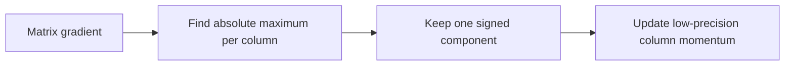
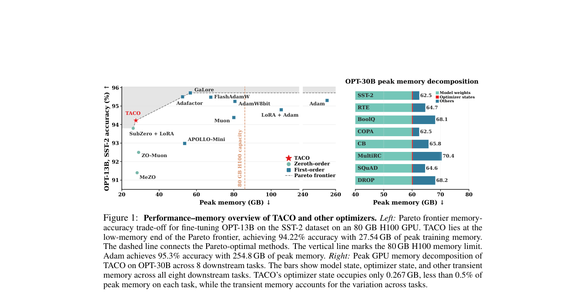

# TACO: Ternary Absolute-max Column-wise One-sparse Optimizer for LLM Fine-Tuning

<!-- source-sha256: 5320893df645d8a44b41461d3e667d4b0e6908f0175bffc6e1786610b2233425 -->

[简体中文](README.md)

> L1 one-sparse direction and column momentum; A100 CUDA updates verified, not full 13B/32B tuning or accuracy.

## Paper information

| Field | Details |
|---|---|
| Paper | [arXiv 2610.02199](https://arxiv.org/abs/2610.02199) |
| Institution | University of Central Florida (first author). |
| First public release | 2026-10-01 (arXiv v1) |
| Author code | [TACO_optimizer](https://github.com/Jichao2357/TACO_optimizer). |
| Local adapter or method key | `taco-optimizer` |
| Local reproduction code | [`src/auto_research/foundation_latest_20261002.py`](https://github.com/daiwk/auto-research/blob/main/src/auto_research/foundation_latest_20261002.py) |

## Paper method and evidence

In each matrix column keep only the gradient component with largest magnitude, retaining its sign. Use low-precision column momentum rather than dense per-parameter optimizer state.

<!-- paper-figure:start -->
### Original paper figure

The paper figure documents the method. From the [original paper](https://arxiv.org/abs/2610.02199); copyright remains with the authors.
<!-- paper-figure:end -->

### Core equation

$D_{ij}=sign(G_{ij})$ when $i=argmax_k|G_{kj}|$; zero otherwise.

### Reported results

OPT-13B paper results: optimizer state 27.7GB→0.16GB (174×), peak memory 80.6GB→27.5GB (2.9×).

## Local reproduction

Compare with the corresponding operator disabled or in its default state. [Three-seed metrics](metrics/mechanism-seeds42-44.json) are diagnostic_only=true: they verify execution and invariants, not formal gains or capability ranking. [A100 GPU validation](https://github.com/daiwk/auto-research/blob/main/docs/gpu-validations/taco-optimizer-a100-20261002.json).
