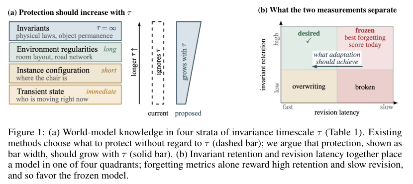

# Stratified Retention: separate what should persist from what should change

<!-- source-sha256: 68efe1fcce0a5bb196bcc3972e212df49356e1f3da325f1000b223acd730d867 -->

[简体中文](README.md)

> **L0 evaluation-protocol component, not a continual-learning algorithm.** The paper is a proposal without new empirical experiments. Local code implements auditable reporting, not world-model training or improved retention/adaptation capability.

## Paper information

| Field | Value |
| --- | --- |
| Paper | [arXiv:2610.03713v2](https://arxiv.org/abs/2610.03713v2); [fixed text](https://arxiv.org/html/2610.03713v2) |
| Institution/company | First author Nishit Anand: University of Maryland, College Park, USA |
| Original release | October 2, 2026, 17:58:14 UTC (arXiv v1); reviewed v2 updated November 12, 2026, 21:35:23 UTC |
| Authors' code | No accompanying author implementation repository is linked in fixed v2; no separate release was found as of November 18, 2026. Referenced continual-learning repositories are not this paper's code |
| Local adapter/key | stratified-retention-protocol; adapter null; not integrated into Evolve |
| Local code | src/auto_research/foundation_models/stratified_retention_protocol.py; tests/test_nov18_data_protocols.py |

## Original paper

### Motivation and changes

A world changes: predicting a chair's old position after it moves is stale knowledge, not good memory. Structural properties such as object permanence should nevertheless survive adaptation. The paper stratifies knowledge by environmental invariance timescale: invariants, long-lived regularities, short-lived instance configurations, and immediate transient state. This timescale is not a cache TTL; transient state should not simply be written into weights. [Sections 3–5](https://arxiv.org/html/2610.03713v2#S3)

Old-task accuracy alone favors a frozen model. The proposal therefore reports invariant retention, post-change revision latency, and false revisions under reverting perturbations separately, without a composite that hides their trade-off.

### Key original figure

Figure 1 and caption, fixed-v2 PDF page 2, rendered and cropped without redrawing. The quadrants are conceptual illustrations, not new author or local experiment points. [Provenance and SHA256](assets/provenance.json). Copyright remains with the authors.

### Equations

A fixed held-out probe panel is evaluated after every adaptation round. Report its worst pass fraction over the stream, not just final recovery:

$$R_{\min}=\min_t |P|^{-1}\sum_{p\in P}\mathbf 1[\hat y_{t,p}=y_p].$$

A negative flip is a previously correct probe becoming incorrect; correcting an old error is not forgetting. After each real change, held-out queries from a new episode compare preference for the new versus old fact. Revision latency counts relevant-region observations until a declared margin is exceeded for several consecutive observations. This notation formalizes the paper's prose protocol; it is not a new training loss from the authors.

### Paper results

The paper trains no new world model and reports no new benchmark measurements or production A/B. Frozen/overwriting quadrants in Figure 1 are explanatory contrasts, not an empirically validated new algorithm.

## Local component

### Inputs and code

ProbeRound/invariant_retention consume external evaluation results, not a model or a gold-to-policy channel. Probe IDs must remain fixed and disjoint from adaptation examples. ChangeTrace/revision_report distinguish regularity and instance strata, require a different evaluation episode, and report latency, never-revised counts, and right-censored counts. false_revision_rate separately reports false alarms under reverting perturbations.

    PYTHONPATH=src python -c 'from auto_research.foundation_models.stratified_retention_protocol import diagnostic; print(diagnostic(42, device="cpu"))'

### Controls and limits

Counterexamples include an invariant that fails then recovers, correction of an old error, a frozen trajectory, and a late censored change. Controls reject adaptation/probe overlap, same-episode queries, and undeclared truncation. Scalars describe these constructed cases, not model capability; repeating seeds adds no statistical evidence.

### Full experiment status

**There is no original full capability experiment to reproduce; no new training campaign is invented here (review DONE).** Real world-model probes, stratum labels, environmental changes, and adaptation methods remain unimplemented. The component is neither a high-cost reproduction nor evidence to promote Evolve candidates.
