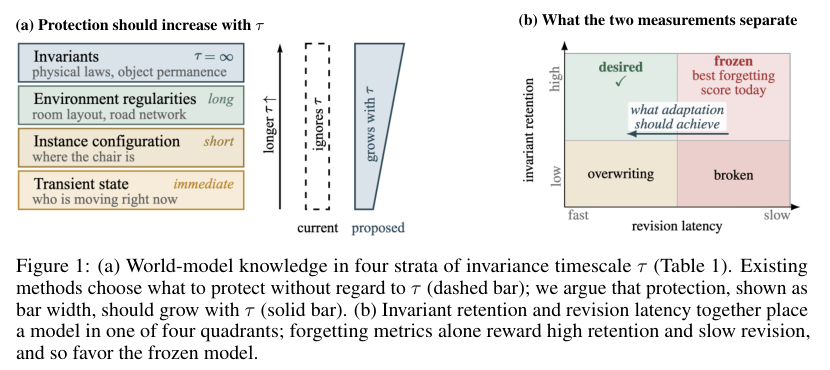

# Stratified Retention：把该保留与该更新的知识分开评测

[English](README-en.md)

> **L0 评测协议组件，非持续学习算法。** 原文是无新实证的研究提案；本地实现审计算术，不训练世界模型，也不声称获得更好的记忆或适应能力。

## 论文信息

| 字段 | 内容 |
| --- | --- |
| 论文链接 | [arXiv:2610.03713v2](https://arxiv.org/abs/2610.03713v2)；[固定全文](https://arxiv.org/html/2610.03713v2) |
| 公司 / 机构 | 一作 Nishit Anand：University of Maryland, College Park, USA |
| 首次公开日期 | 2026-10-02 17:58:14 UTC（arXiv v1）；本次核对 v2，更新时间 2026-11-12 21:35:23 UTC |
| 原作者开源代码 | 固定 v2 原文未提供作者实现仓库；截至 2026-11-18 未查到独立发布的配套代码，不能把引用的持续学习仓库当作本论文代码 |
| 本地 adapter / key | `stratified-retention-protocol`；adapter 为 null，未接入 Evolve |
| 本地复现代码目录 | `src/auto_research/foundation_models/stratified_retention_protocol.py`；专测 `tests/test_nov18_data_protocols.py` |

## 原始论文总结

### 背景与主要改动

世界会变化：椅子移动后继续预测旧位置不是“记忆好”，而是知识过期；但物体永久性等结构知识不应随一次适应丢失。作者按环境知识保持为真的时间尺度分四层：不变量、长期环境规律、短期实例配置、即时状态。这里的时间尺度不是缓存 TTL，即时状态也不应统统写入权重。[§3—5](https://arxiv.org/html/2610.03713v2#S3)

单看旧任务准确率会奖励冻结模型。论文因此要求分别报告不变量保持、变化后的修订延迟，以及短暂扰动引起的假修订，不合成一个掩盖取舍的总分。

<!-- paper-figure:start -->
### 原论文关键图

固定 v2 第 2 页 Figure 1 及图注，原图直接裁切渲染，无重绘。二维象限是概念示意，不是本地或作者的新实验散点。[来源、裁切与 SHA256](assets/provenance.json)。版权归原作者。
图片来自[原论文](https://arxiv.org/html/2610.03713v2)，版权归原作者所有。
<!-- paper-figure:end -->

### 核心公式

用固定 held-out probe 面板在每轮适应后评测，保留整个过程中最差的通过比例，而非只看最终恢复点：

$$
R_{\min}=\min_t |P|^{-1}\sum_{p\in P}\mathbf 1[\hat y_{t,p}=y_p].
$$

负翻转统计前一轮正确、后一轮错误；把原来错误的不变量纠正不算遗忘。对每次真实变化，用新 episode 的 held-out 查询测新事实相对旧事实的偏好差，连续若干次超过预先声明的 margin 后，记已观察到的相关区域次数为修订延迟。此式是本地对原文口头协议的记号化，不是作者新增损失函数。

### 论文离线与线上效果

原文没有训练新世界模型，没有给出新 benchmark 的实测分数或线上 A/B；Figure 1 的冻结/覆写象限是解释性对照。不能把“冻结保持率高”说成已验证的新算法优势。

## 本地复现

### 数据协议与代码映射

`ProbeRound`/`invariant_retention` 接收外部评测结果，不接收模型、标签到策略的通路；要求 probe ID 固定且与适应样本不重叠。`ChangeTrace`/`revision_report` 显式区分 regularity、instance，要求评测 episode 不同于适应 episode，输出延迟、从未修订数与右删失数。`false_revision_rate` 单列回退扰动的假报警。

    PYTHONPATH=src python -c 'from auto_research.foundation_models.stratified_retention_protocol import diagnostic; print(diagnostic(42, device="cpu"))'

### 结果、负控与边界

诊断输入包含先失效后恢复的不变量、改正旧错误、一直不改的冻结轨迹和临近结束的删失变化。负控拒绝适应/probe 重叠、相同 episode 和未声明的截断。返回的标量是这些人工反例的计算结果，不是任何模型能力；重复 seed 不增加统计证据。

### 完整实验状态

**原文无完整能力实验可复现，本轮不创造训练试验（审查 DONE）。** 真实世界模型的 probe 构造、分层标注、环境变化与适应方法均未在本地实现；不是“高成本已复现”，也不以此组件自动促进 Evolve 候选。
