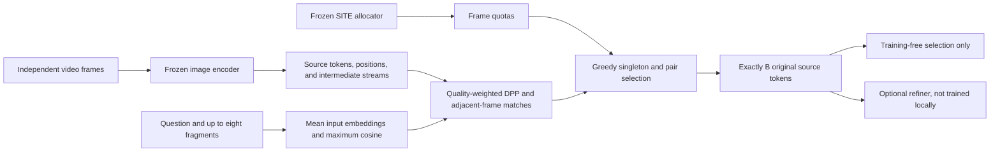
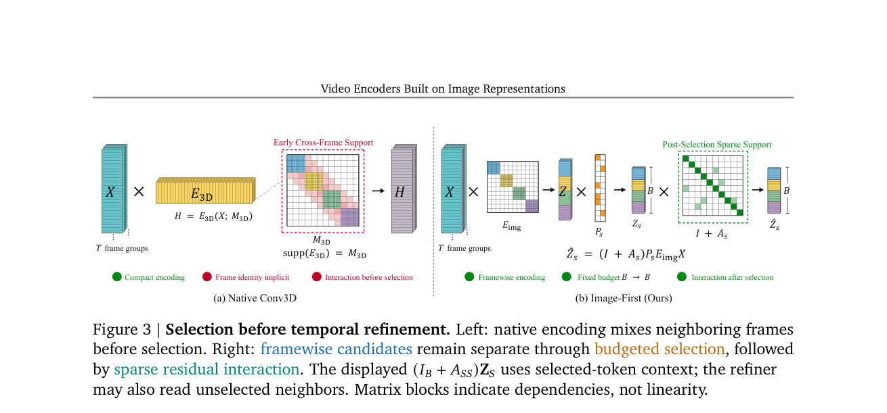

# Video Encoders: Conditional Training-Free Selection over Frozen Image Representations

<!-- source-sha256: ad0de2da03e97ede85d0c299a56ab5a2eb9438a870496eb886ba39652061d1fb -->

[简体中文](README.md)

## Paper information

| Field | Value |
| --- | --- |
| Paper | [arXiv 2610.06616](https://arxiv.org/abs/2610.06616); [pinned v1 full text](https://arxiv.org/html/2610.06616v1) |
| Original title | Video Encoders Built on Image Representations |
| Affiliations | First author Jusheng Zhang: Stanford University; co-first author Wenhao Wang: Vast Intelligence Lab. Google DeepMind coauthor participated as an adviser; this is not a Google-first-author paper. |
| First public release | 2026-10-05 16:18:06 UTC |
| Authors' code | No implementation repository linked in the official arXiv v1 HTML or abstract. This does not establish worldwide absence. |
| Adapter / key | `video-encoder-selection`; `adapter: null`, not an executable Evolve operator |
| Local code | `src/auto_research/foundation_models/video_encoder_selection.py`; `scripts/run_video_encoder_selection.py`; `scripts/curate_video_encoder_selection.py` |
| Status | `component_only`; Appendix I conditional selector with L1 real-feature validation, not complete SITE selection-only or reproduction of paper results |
| Full experiment | Too costly; not reproduced (review DONE), `not_reproduced_high_cost` |

## Original paper

### Background and contribution

Framewise image encoding keeps individual frames addressable but produces long visual sequences. The paper freezes the frame encoder and selects original tokens under a fixed budget using question relevance, within-frame diversity, and cross-frame correspondences. An optional learned refiner accesses extra neighboring-frame context after selection and updates retained anchors without increasing output length.



<!-- paper-figure:start -->
### Key figure from the paper

[](https://arxiv.org/pdf/2610.06616#page=6)

**Original Figure 3:** Architecture and components from the [paper](https://arxiv.org/abs/2610.06616); copyright belongs to the authors.
<!-- paper-figure:end -->

### Core equations

[Appendix I](https://arxiv.org/html/2610.06616v1#A9) specifies implementation. Main-text Equation 6 gives intuition; a motion heuristic is not the exact objective. Average the LM input embeddings $q_r$ for the full question and up to eight question/option fragments. Use normalized $\bar z_i,\bar q_r$:

$$
m_i=\max_r\bar z_i^\top\bar q_r,\quad
\widetilde a_i=\max(10^{-6},\|z_i\|_2[1+0.8m_i]),\quad
a_i=\widetilde a_i/\operatorname{mean}_{j\in I_t}\widetilde a_j.
$$

The frame kernel is $L_t(i,j)=a_i a_j\bar z_i^\top\bar z_j+\epsilon_t\mathbf1[i=j]$, with $\epsilon_t=10^{-3}\operatorname{mean}_{i\in I_t}a_i^2$. The exact objective is:

$$
J(S)=\sum_t\log\det L_t[S_t,S_t]+2\sum_{\{i,j\}\in E}w_{ij}\mathbf1[i,j\in S],\qquad |S_t|=b_t,\quad\sum_t b_t=B.
$$

Edges are mutual top-1 matches between adjacent frames: cosine ≥0.65, minimum forward/reverse top-1/top-2 margin ≥0.005, normalized spatial distance ≤0.5, and scene similarity ≥0.65. Equations 53–55 multiply confidence by spatial/feature state change for nonnegative $w_{ij}$. Use Cholesky for Schur residual $\rho_i=L_{ii}-L_{iU}L_{UU}^{-1}L_{Ui}$:

$$
g_i=\log\max(\rho_i,10^{-14})+2\sum_{j\in S:\{i,j\}\in E}w_{ij},\qquad
g_{ij}=(g_i+g_j+2w_{ij})/2.
$$

Add both endpoints only if the best pair's per-token score strictly exceeds the best singleton, otherwise add the singleton. Honor remaining quotas at every step, selecting exactly $B$ distinct indices even with negative gains, odd budgets, or no correspondence edges. This is not globally optimal. Apply the same indices to embeddings, positions, and intermediate streams without averaging, merging, or reassigning coordinates.

### Paper results

[Appendix C.1, Table 4](https://arxiv.org/html/2610.06616v1#A3.SS1): training-free selection-only (refiner disabled) scores Avg.(13) of 59.37, 62.64, and 66.22 across three backbones, +2.49, +2.78, and +2.36 percentage points against the strongest earlier training-free baselines. Qwen3-VL-8B Full Image: 62.58/4424 tokens; selection: 62.64/1535; with refiner: 62.75. These are paper results, not local measurements. No production A/B was reported.

## Local reproduction

### Fidelity and unavailable inputs

The conditional selector implements Equations 40–60 with real frozen visual features, same-space question vectors, source positions, external frame quotas, and scene statistics. `quotas_from_representatives` implements Equations 45–48, deriving quotas from upstream SITE representative indices. It does **not** implement SITE allocation.

Appendix I.3 gives SITE settings and quota inheritance; I.4 does not define how to compute scene statistics. Reviewed primary sources provide no implementation. The runner explicitly substitutes external uniform quotas and a mean-pooled visual-cosine scene proxy. This is L1 conditional selection, not the full paper's selection-only path.

The runner loads only locally cached frozen SmolVLM/Idefics3, executing the actual `vision_model` and `connector` per frame. Question fragments average `get_input_embeddings()` in the form of Equation 38. No random-feature fallback, labels, generation, training, teacher, or refiner. SmolVLM substitutes for Qwen. Square bicubic resize to native image size is not original preprocessing. Positions represent the projected patch grid and original timestamps. The same source indices retain the connector's corresponding intermediate features.

### Data and run protocol

Use small existing public unlabeled videos only: at most 4 examples, 1–8 frames, budget 1–64, ≤16 MiB, 30 seconds, and 1000 decoded frames per video, checkpoint ≤2 GiB. Uniformly sample distinct original frames and preserve indices/timestamps. No downloads, training, validation/test capability selection, or video-QA answers. Do not report test accuracy. The manifest rejects unknown fields such as `answer` or `gold`:

```json
{
  "dataset_id": "public-video-runtime-sample",
  "dataset_revision": "public-release-or-content-revision",
  "examples": [{
    "id": "clip-1", "video": "cached-clip.mp4",
    "question": "What changes across the visible frames?", "fragments": [],
    "source_url": "https://example.org/public-source"
  }]
}
```

```bash
PYTHONPATH=src python scripts/run_video_encoder_selection.py \
  --checkpoint <cached-SmolVLM-local-snapshot> \
  --checkpoint-id HuggingFaceTB/SmolVLM-256M-Instruct \
  --checkpoint-revision 7e3e67edbbed1bf9888184d9df282b700a323964 \
  --manifest <unlabelled-public-video-manifest.json> \
  --output-dir <new-run> --device cuda --frames 4 --budget 32 --seed 42
```

CUDA must be available with no automatic CPU fallback. All weights load with `local_files_only=True`. Results bind checkpoint, video, source, and manifest hashes, seed, and protocol. Output directories cannot be reused. Persist every success and failure immediately. An ablation disables correspondence edges under the same quotas; a changed mask is not a QA metric.

This example uses cached `SmolVLM-256M-Instruct` with `model_type=idefics3`, not an additional SmolVLM2 download. By default source revision comes from `git rev-parse HEAD`. A source-only sync may supply `--source-commit <frozen-40-hex-commit>`; a declared commit does not prove provenance. The runner records executed source SHA256s, and the curator verifies every file against local `git show`.

### Measurements and acceptance limits

CPU tests cover maximum cosine, normalization, the DPP kernel, independent determinant ratios, Schur residuals, edge thresholds, pair complementarity/ties, odd/zero/full budgets, exact position and stream identity, and invalid quotas, NaNs, duplicates, and the no-answer contract. Artificial tensors are formula tests, not visual capability evidence.

A real **NVIDIA A100** ran cached `SmolVLM-256M-Instruct` revision `7e3e67edbbed1bf9888184d9df282b700a323964` on public `vjepa.gif` from Hugging Face documentation revision `1bade87e4c4e41d80d5f72ba2d7b38ab3194f044`. This was not a video-QA benchmark and read no answers.

| Seed-42 check | Measurement |
| --- | ---: |
| Source frames / actual tokens per frame | 4 / 64 |
| Candidate / retained tokens | 256 / 32 |
| Retention | 12.5% |
| Max embedding / position / intermediate-stream error | 0 / 0 / 0 |
| Correspondence edges / paired steps | 60 / 5 |
| Mask symmetric difference with graph off | 8 |
| Objective vs. accumulated gain error | 0 |

The independent curator checked frozen source, all public model-file hashes, video hash, original times/grid positions, and quotas. See [metrics](metrics/component-a100-seed42.json), [CUDA receipt](../../gpu-validations/video-encoder-selection-a100-20261021.json), and [raw run](../../research-audits/google-meta-closeout-20261021/evidence/video-selection-raw-a100-seed42.json). To reconstruct the [answer-free input](../../research-audits/google-meta-closeout-20261021/evidence/video-source-manifest.json), download its pinned public `source_url` as `vjepa.gif` beside the manifest. It includes the question and fragments, not answers. These numbers verify L1 real-feature budgeted selection, not 13-benchmark accuracy, speedup, or Evolve promotion.

### Cost and unreproduced scope

Appendix C.3's refiner has about 18M trainable parameters and trains two epochs on 65K Video-ChatGPT examples with **8 A100s for 12 hours, about 96 GPU-hours**. The full study also uses 7B/8B/32B backbones, 13 benchmarks, and multiple budgets/seeds. This campaign is too costly on one A100/A30 or a Mac; **full refiner and benchmark experiments were not reproduced (review DONE)**. This does not invalidate the bounded training-free component or reopen expensive retries.

Not reproduced: SITE, the original scene statistic, Qwen source MRoPE/DeepStack, learned refinement, and the 13 benchmarks. No measured QA accuracy, original compression gains, or end-to-end speedup. Determinism or more seeds would not make this small run a capability benchmark.
