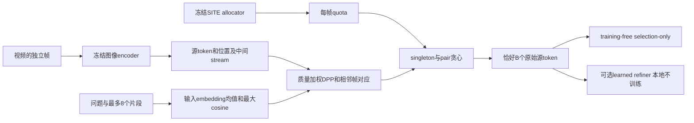
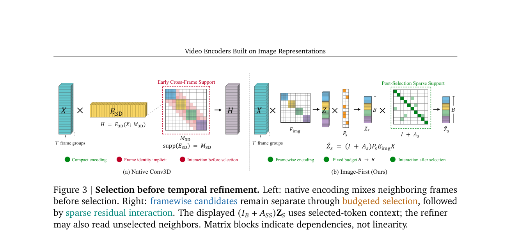

# Video Encoders：冻结图像表征上的条件式训练免费选择

## 论文信息

| 字段 | 内容 |
| --- | --- |
| 论文链接 | [arXiv 2610.06616](https://arxiv.org/abs/2610.06616)；[固定 v1 全文](https://arxiv.org/html/2610.06616v1) |
| 原文标题 | Video Encoders Built on Image Representations |
| 公司 / 机构 | 一作 Jusheng Zhang：Stanford University；共同一作 Wenhao Wang：Vast Intelligence Lab；Google DeepMind 共同作者仅以顾问身份参与，非 Google 一作论文 |
| 首次公开日期 | 2026-10-05 16:18:06 UTC |
| 原作者代码 | 官方 arXiv v1 HTML 与摘要页未找到/未发布实现仓库链接；不据此声称全网均无源码 |
| 本地 adapter / 稳定键 | `video-encoder-selection`；`adapter: null`，不注册 Evolve 执行算子 |
| 本地复现代码目录 | `src/auto_research/foundation_models/video_encoder_selection.py`；`scripts/run_video_encoder_selection.py`；`scripts/curate_video_encoder_selection.py` |
| 实现状态 | `component_only`；Appendix I 条件式 selector 的 L1 机制/真实特征运行验证，不是完整 SITE selection-only 或论文效果复现 |
| 完整实验 | 成本过高，不复现（审查 DONE）；`not_reproduced_high_cost` |

## 原始论文总结

### 背景与主要改动

逐帧图像编码保留可寻址的单帧证据，却产生很长的视觉序列。论文先逐帧冻结编码，再结合问题相关性、帧内多样性和跨帧对应，在固定预算内选择原始 token；可选 learned refiner 在选择完成后读取额外邻帧上下文，只更新已保留的锚点，不增加输出长度。



<!-- paper-figure:start -->
### 原论文关键图

[](https://arxiv.org/pdf/2610.06616#page=6)

> **原论文 Figure 3（关键图）**：展示原论文方法的总体设计和关键组成。图片来自[原论文](https://arxiv.org/abs/2610.06616)，版权归原作者所有；点击图片可查看来源。
<!-- paper-figure:end -->

### 核心公式

[Appendix I](https://arxiv.org/html/2610.06616v1#A9) 才是实现级规格；主文 Eq.6 只是设计直觉，不能拿一个 motion heuristic 替代精确选择目标。

对完整问题及最多八个问题/选项片段，先取各片段的 LM 输入 embedding 均值 $q_r$。令 $\bar z_i,\bar q_r$ 为单位化向量：

$$
m_i=\max_r\bar z_i^\top\bar q_r,\quad
\widetilde a_i=\max(10^{-6},\|z_i\|_2[1+0.8m_i]),\quad
a_i=\widetilde a_i/\operatorname{mean}_{j\in I_t}\widetilde a_j.
$$

帧内核为 $L_t(i,j)=a_i a_j\bar z_i^\top\bar z_j+\epsilon_t\mathbf1[i=j]$，其中 $\epsilon_t=10^{-3}\operatorname{mean}_{i\in I_t}a_i^2$。精确目标是

$$
J(S)=\sum_t\log\det L_t[S_t,S_t]+2\sum_{\{i,j\}\in E}w_{ij}\mathbf1[i,j\in S],\qquad |S_t|=b_t,\quad\sum_t b_t=B.
$$

跨帧边只连接相邻帧的双向 top-1 对应；要求 cosine≥0.65、正反 top-1/top-2 最小 margin≥0.005、归一化空间距离≤0.5、scene similarity≥0.65。原文 Eq.53–55 将匹配 confidence 乘以空间/特征 state change，作为非负 $w_{ij}$。

每步用 Cholesky 求 Schur residual $\rho_i=L_{ii}-L_{iU}L_{UU}^{-1}L_{Ui}$，计算

$$
g_i=\log\max(\rho_i,10^{-14})+2\sum_{j\in S:\{i,j\}\in E}w_{ij},\qquad
g_{ij}=(g_i+g_j+2w_{ij})/2.
$$

仅当最佳 pair 的每 token 得分**严格大于**最佳 singleton 时同时加入两个端点，否则加入 singleton。所有步骤遵守剩余 quota；因此负增益、奇数预算或无对应边仍能完成恰好 $B$ 个互异索引，不声称全局最优。最终对 embeddings、source positions 和 intermediate streams 使用同一索引，不平均、合并或重分配坐标。

### 论文离线与线上效果

[Appendix C.1 Table 4](https://arxiv.org/html/2610.06616v1#A3.SS1) 的 training-free selection-only（关闭 learned refiner）在三底座的 Avg.(13) 分别为 59.37、62.64、66.22；相对最强先前 TF baseline 为 +2.49、+2.78、+2.36 个百分点。Qwen3-VL-8B 的 Full Image 为 62.58/4424 tokens，selection 为 62.64/1535 tokens，完整含 refiner 为62.75。上述均是论文报告，不是本地测量。生产用户线上 A/B：未报告。

## 本地复现

### 保真范围与未公开输入

条件式 selector 精确实现 Eq.40–60：输入真实冻结视觉特征、同空间问题向量、源位置、外部 frame quotas 与 scene statistic。`quotas_from_representatives` 实现 Eq.45–48，从上游已有 SITE 代表源索引继承 quota；它**不实现或假冒 SITE allocator**。

原文 I.3 只给 SITE 配置及 quota 继承规则，I.4 没有定义 scene statistic 的具体计算；所读主源也未提供作者实现。因此本地 runner 显式采用外部均匀 quota 和 mean-pooled visual cosine scene proxy。这是有标注差异的 L1 条件选择器验证，**不是完整原文 selection-only 路径的重现**。

runner 仅加载本地缓存的冻结 SmolVLM/Idefics3：每帧独立执行真实 `vision_model` 与 `connector`；问题使用该模型 `get_input_embeddings()` 的片段均值，保持原文 Eq.38 形式。没有随机特征回退、答案标签、语言模型生成、训练、teacher 或 refiner。SmolVLM 替换 Qwen 底座；单帧采用 native image size 的方形 bicubic resize，不冒称论文原始预处理；源位置指该真实冻结 encoder 的 projected patch 网格和原视频时间戳。connector pixel-shuffle 的对应中间特征使用相同源索引保留。

### 数据与运行协议

只允许少量已有公开无标签视频：最多4例、1–8帧、预算1–64；单视频≤16MiB、30秒、1000解码帧，本地 checkpoint≤2GiB。均匀取互不重复的原始帧，保留原 frame index 和 timestamp。没有下载、训练或可计作 validation/test 的能力选择；不读取视频 QA benchmark 标准答案，不能把此运行写成 test accuracy。

manifest 严格白名单，`answer`、`gold` 等未知字段直接拒绝：

```json
{
  "dataset_id": "public-video-runtime-sample",
  "dataset_revision": "public-release-or-content-revision",
  "examples": [{
    "id": "clip-1", "video": "cached-clip.mp4",
    "question": "What changes across the visible frames?", "fragments": [],
    "source_url": "https://example.org/public-source"
  }]
}
```

```bash
PYTHONPATH=src python scripts/run_video_encoder_selection.py \
  --checkpoint <cached-SmolVLM-local-snapshot> \
  --checkpoint-id HuggingFaceTB/SmolVLM-256M-Instruct \
  --checkpoint-revision 7e3e67edbbed1bf9888184d9df282b700a323964 \
  --manifest <unlabelled-public-video-manifest.json> \
  --output-dir <new-run> --device cuda --frames 4 --budget 32 --seed 42
```

CUDA 显式要求真实可用，不自动回退 CPU；所有权重读取固定 `local_files_only=True`。结果绑定全部相关 checkpoint 文件 hash、视频 hash、代码源码 hash、manifest hash、seed 与协议。输出目录不可复用；每例成功或失败立即持久化，失败例不静默丢弃。选择器还执行同配额、禁用对应图的结构消融，但 mask 是否改变不是 QA 能力指标。

上述示例使用已有公开缓存 `SmolVLM-256M-Instruct`（`model_type=idefics3`），不要求另下 SmolVLM2。默认源码版本取执行目录的 `git rev-parse HEAD`；远端只同步源码、不含 Git 仓库时，可额外传入 `--source-commit <frozen-40-hex-commit>`。该值只记录冻结版本，不代替源码真实性验证：runner 同时写出实际执行源码 SHA256，curator 必须在本地用该提交的 `git show` 逐文件核对。

### 本地结果与验收边界

CPU 单元测试核验最大 cosine、质量归一化、DPP 核、独立 determinant ratio、Schur residual、对应边阈值、pair complementarity/平局、奇数/零/满预算、原始源位置与中间 stream 恒等，以及非法 quota、NaN、重复身份、无答案输入合同。人工张量只用于这些公式测试，不作为视觉能力证据。

已在真实 **NVIDIA A100** 上运行缓存的 `SmolVLM-256M-Instruct`，固定模型版本 `7e3e67edbbed1bf9888184d9df282b700a323964`。输入为 HuggingFace 文档集固定版本 `1bade87e4c4e41d80d5f72ba2d7b38ab3194f044` 的 `vjepa.gif` 公开动态图序列，**不是视频QA benchmark**；不读取答案。

| 运行检查（seed 42） | 实测 |
| --- | ---: |
| 原始帧 / 每帧真实token | 4 / 64 |
| 候选 / 选中token | 256 / 32 |
| 保留比例 | 12.5% |
| embedding / source position / intermediate stream最大误差 | 0 / 0 / 0 |
| 对应边 / 双token选择步 | 60 / 5 |
| 关闭对应图后mask对称差 | 8 |
| 目标值与逐步增益累加误差 | 0 |

独立curator已核对冻结源码提交、全部公开模型文件hash、视频hash、原始时间/网格位置和逐帧quota。
[稳定指标](metrics/component-a100-seed42.json)、[CUDA回执](../../gpu-validations/video-encoder-selection-a100-20261021.json)、[原始运行](../../research-audits/google-meta-closeout-20261021/evidence/video-selection-raw-a100-seed42.json)均保留。
这些数字只支持 L1 真实特征/固定预算运行，不是原论文13基准准确率、速度收益或 Evolve 晋级证据。

### 成本判断与未复现范围

原文 Appendix C.3 的 refiner 有约18M可训练参数，在65K Video-ChatGPT子集训练2 epochs，**8×A100×12小时，约96 GPU-hours**；另有三个7B/8B/32B底座、13 benchmarks与多预算/多seed全表。单张A100/A30或Mac不适合该完整campaign，因此完整 refiner/全表实验**成本过高，不复现（审查 DONE）**。这不否定当前有界条件式 training-free 核心的独立实现，但不恢复高成本实验为自动重试队列。

未复现 SITE、论文原始 scene statistic、Qwen source MRoPE/DeepStack路径、learned refiner和原始13 benchmark；未测真实 QA accuracy、原论文 compression收益或端到端 speedup。确定性小样本也不靠多seed升级为能力结论。
