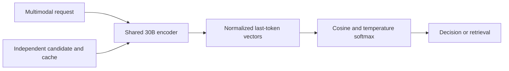
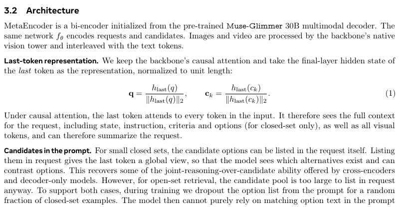

# MetaEncoder: A dual encoder for natural-language multimodal decisions

<!-- source-sha256: 1da67427bf6e35e892b84a7539d8a72c7c5ab9ecee11771fed618ee2fbe2b0ee -->

[简体中文](README.md)

> High-priority Meta literature entry; full experiment not reproduced due to cost, review complete.

## Paper information

| Field | Details |
|---|---|
| Paper | [arXiv 2610.11316](https://arxiv.org/abs/2610.11316) |
| Institution | Meta AI; first author Jianpeng Cheng. |
| First public release | 2026-10-08 06:22:48 UTC (arXiv v1) |
| Author code | [Official evaluation code](https://github.com/facebook/meta-encoder-eval), Apache-2.0; [released weights](https://huggingface.co/facebook/meta-encoder). Full training source/data are not implied. |
| Local adapter or method key | `metaencoder` (literature only); `adapter: null`. |
| Local reproduction code | None; this document and `src/auto_research/paper_specs/catalog/foundation-models/metaencoder.json`. |

## Paper method and evidence

Turn Muse-Glimmer30B into a shared dual encoder for requests and candidates containing text, images, or video. Keep causal attention and normalize the final token vector. Independently encoded candidates can be cached. Closed-set prompts may list options; partial option dropout discourages literal matching. [Section 3](https://arxiv.org/html/2610.11316v1#S3)

<!-- paper-figure:start -->
### Original paper figure

Capture of Section 3.2 and Equation 1, not a separate author architecture drawing. The flowchart is a local explanation. From the [original paper](https://arxiv.org/abs/2610.11316); copyright remains with the authors.
<!-- paper-figure:end -->

### Core equation

`q=normalize(h_last(request))`, `c=normalize(h_last(candidate))`, `score=q·c/tau`. Contrast request→candidate only; negatives are other options for closed set and deduplicated global batch candidates for open set.

### Reported results

The authors evaluate 11 suites and 190 tasks and identify limits on complex reasoning. Not local and no production A/B.

## Local reproduction

[Official setup](https://github.com/facebook/meta-encoder-eval#setup) targets eight 80GB GPUs, about 62GB/card for 30B BF16 replicas, and hundreds of GB of image/video data. Fitting on one card does not make 190 tasks cheap. No download, test, random-vector proxy, local metric, GPU receipt, or Evolve promotion.
