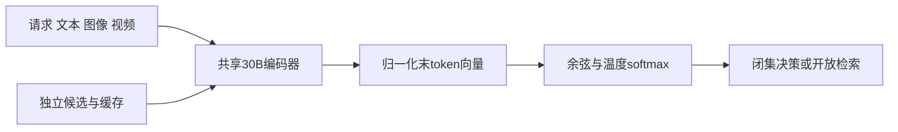
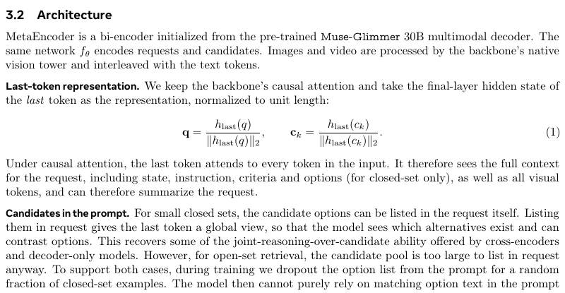

# MetaEncoder：自然语言接口的多模态决策双塔

> Google/Meta优先资料。**成本过高，不复现（审查 DONE）**；只整理原文与开源评测，不下载30B权重。

## 论文信息

| 字段 | 内容 |
| --- | --- |
| 论文链接 | [arXiv 2610.11316](https://arxiv.org/abs/2610.11316) |
| 公司 / 机构 | 一作Jianpeng Cheng，Meta AI |
| 首次公开日期 | 2026-10-08 06:22:48 UTC，arXiv v1；PDF落款不替代提交时间 |
| 原作者代码 / 权重 | [官方评测代码](https://github.com/facebook/meta-encoder-eval)，Apache-2.0；[facebook/meta-encoder权重](https://huggingface.co/facebook/meta-encoder)。不等于完整训练源码与数据已公开 |
| 本地 adapter / 稳定键 | 无可执行adapter（`adapter: null`）；资料键`metaencoder` |
| 本地复现代码 | 无；仅本文和`src/auto_research/paper_specs/catalog/foundation-models/metaencoder.json` |

## 原始论文总结

### 背景与主要改动

将Muse-Glimmer30B变为共享双塔，请求和候选均可含自然语言及图像/视频；保留因果注意力，取归一化末token向量。候选独立编码可缓存；闭集允许将选项加入请求，训练时部分dropout选项，防止仅依赖文字匹配。[原文§3](https://arxiv.org/html/2610.11316v1#S3)

<!-- paper-figure:start -->
### 原论文关键图

> 原文§3.2和Equation1截图，不是作者另绘的架构图。图片来自[原论文](https://arxiv.org/abs/2610.11316)，版权归原作者所有；Mermaid是本页重绘。
<!-- paper-figure:end -->

### 核心公式与原文效果

`q=normalize(h_last(request))`，`c=normalize(h_last(candidate))`，`score=q·c/tau`。只在request→candidate方向做对比：闭集负例为本题其他选项，开放集为去重的全局batch候选。作者评测11套/190任务，亦指出双塔复杂推理局限；原文分数不是本地测量，未报告生产线上A/B。

## 本地复现与成本决策

[官方评测README](https://github.com/facebook/meta-encoder-eval#setup)为30B BF16副本约62GB/卡，目标8张80GBGPU，数据含数百GB图像/视频。单卡可能装载不等于190任务便宜。**成本过高，不复现（审查 DONE）**；不下载、不试跑，不将随机向量余弦函数称MetaEncoder实现。无本地指标/GPU回执，无evolve晋级资格。
