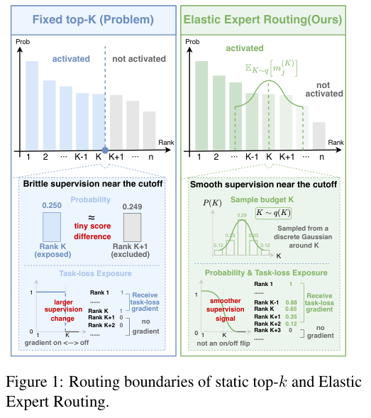

# Elastic Expert Routing: Smoothing the Sparse Top-k Boundary

<!-- source-sha256: 9d38b4b090125035e8e99f28c950371bed84fff552841ad2c17349dc1084b3e1 -->

[简体中文](README.md)

## Paper information

| Field | Value |
| --- | --- |
| Paper | [Smoothing the Top-k Exposure Boundary for Sparse Mixture-of-Experts](https://arxiv.org/abs/2610.11575) |
| Affiliations | First author Yunkai Chai; Shanghai AI Laboratory / Shanghai Jiao Tong University |
| First public release | 2026-10-08 (arXiv v1) |
| Authors' code | No public author implementation found; third-party code is not official. |
| Adapter | `elastic-expert-routing` |
| Local code | `src/auto_research/foundation_models/elastic_expert_routing.py` |
| Entry point | `scripts/run_elastic_expert_lm.py` |

## Original paper

### Background and contribution

Fixed top-k starves experts just below the ranking boundary. During training sample a nearby budget independently for each token and layer. This exposes near-boundary experts to actual sparse computation at unchanged expected budget. Deploy fixed k.


<!-- paper-figure:start -->
### Key figure from the paper

[](https://arxiv.org/pdf/2610.11575#page=1)

Architecture from the [paper](https://arxiv.org/abs/2610.11575); copyright belongs to the authors.
<!-- paper-figure:end -->

### Core equation and paper evidence

$P(r)\propto\exp(-(r-k)^2/(2\sigma^2))$ on a valid support symmetric about k, so $\mathbb E[r]=k$. Inference fixes k. Load balancing counts actual dispatches rather than assuming equal expert count per token. The paper studies pretrained and fine-tuned MoEs, with no production A/B. Its scale, tokenization, and budget differ from the local character model.

## Local reproduction

Train an actual autoregressive causal Transformer with sparse experts, router and expert gradients, auxiliary balance loss, and fixed-k inference. Unselected experts are not computed and masked after the fact. Match shapes, initialization, training positions, and budget for `radius=0` and `radius=1`.

```bash
PYTHONPATH=src python scripts/run_elastic_expert_lm.py \
  --text-file data/shakespeare.txt \
  --dataset-id karpathy/char-rnn/tinyshakespeare \
  --dataset-revision sha256:86c4e6aa9db7c042ec79f339dcb96d42b0075e16b8fc2e86bf0ca57e2dc565ed \
  --steps 100 --seed 42 --device cuda --output runs/elastic-42.json
```

### Data and results

Public Tiny Shakespeare in original order, 90%/5%/5% train/validation/test. Vocabulary is shared but not targets; no test-based selection. Character PPL is not paper token PPL.

| Seed | Fixed-k validation character PPL | Elastic validation character PPL | Elastic mean experts in training |
| --- | ---: | ---: | ---: |
| 42 | 24.4923 | 24.5578 | 2.99755 |
| 43 | 24.0827 | 24.1720 | 3.00089 |
| 44 | 25.1088 | 25.1332 | 3.00318 |

Both arms ran 100 steps on A30. Retain the negative result; three seeds establish only the reduced comparison. Inference uses three experts per token.

### Code and limits

`ElasticExpertRouting`: Gaussian budgets, dispatch, and balancing. `ElasticMoELanguageModel`: actual training/inference. `tests/test_elastic_expert_routing.py`: expected budget, invalid bounds, gradients, dispatch counts. No large Qwen MoE, FineWeb-Edu pretraining, multi-node dispatch, matched wall time, or executed Evolve integration.
