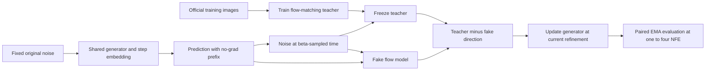
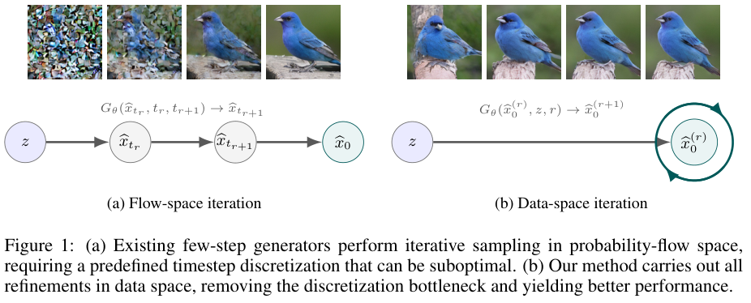

# Data-Space Iteration: A shared generator with genuine distribution-matching distillation

<!-- source-sha256: 346250a4450eef15a45bc519ab35068f813efae5b8ac72cf9a84a91308910907 -->

[简体中文](README.md)

> L1 training mechanism diagnostic. An NVIDIA A100 trained a flow teacher on public images and ran alternating DMD with that frozen teacher, a trainable fake model, and a shared generator. This is neither a random-teacher proxy nor a fixed synthetic reward. One of three seeds improved and two worsened.

## Paper information

| Field | Details |
|---|---|
| Paper | [arXiv 2610.12102v1](https://arxiv.org/abs/2610.12102v1); [full text](https://arxiv.org/html/2610.12102v1) |
| Institution | ByteDance Seed; first author Shanchuan Lin |
| First public release | 2026-10-08 (arXiv v1) |
| Author code | [Appendix E, Algorithms 1–2](https://arxiv.org/html/2610.12102v1#A5) publishes core PyTorch code, not a complete training repository; no complete external author repository found as of 2026-10-11. |
| Local adapter | `data-space-iteration` |
| Local reproduction code | `data_space_iteration.py` under [`src/auto_research/foundation/`](https://github.com/daiwk/auto-research/tree/main/src/auto_research/foundation/); runner `scripts/run_data_space_iteration.py` |
| Local teacher | Small two-scale U-Net trained from scratch on CIFAR-10, not the author's SongUNet-55M or a pretrained checkpoint. |

## Paper method and evidence

Instead of advancing along a discretized noising/denoising trajectory, use the same input noise at each refinement and update a data prediction with shared weights. The step index is not flow time. For DMD, a real frozen teacher and a fake model tracking the generated distribution give the update direction. Prefix rollouts do not build a gradient graph. [Method and appendix](https://arxiv.org/html/2610.12102v1#S2)



<!-- paper-figure:start -->
### Original paper figure

[](https://arxiv.org/pdf/2610.12102#page=1)

[Figure 1](https://arxiv.org/html/2610.12102v1#S1) compares the two iteration spaces. Copyright remains with the [paper](https://arxiv.org/abs/2610.12102v1) authors.
<!-- paper-figure:end -->

### Core equations

$$
\hat x_0^{(0)}=0,\qquad
\hat x_0^{(r+1)}=z-g(\hat x_0^{(r)},z,r,t=1).
$$

For selected $r$, detach the preceding $r$ steps and optimize only the last. Draw $\tau\sim\operatorname{Beta}(2.5,1)$ and set $x_\tau=(1-\tau)\hat x+\tau\epsilon$:

$$
\mathcal L_{fake}=\operatorname{MSE}(v_{fake}(x_\tau,\tau,r),\epsilon-\hat x),\qquad
\mathcal L_G=\operatorname{mean}\left[\hat x\,\operatorname{stopgrad}(v_{real}-v_{fake})\right].
$$

Fake training uses detached current generated samples; teacher and fake do not accumulate gradients during the generator update. There is no direct regression of the generator to a real image at each step.

### Reported results

The paper compares shared few-step generation on ImageNet. On CIFAR-10 with a 55M SongUNet teacher, [Appendix G](https://arxiv.org/html/2610.12102v1#A7) reports 2-NFE FID 8.28 versus DMD 11.14, and 4-NFE FID 8.62 versus 10.03. Data-space is worse at 1 NFE. These are not local pooled-pixel Fréchet distances.

## Local reproduction

Install `python -m pip install -e '.[data-space-gpu]'` (includes SciPy). Compare `flow-renoise` and `data-space` with the same genuinely trained teacher, split, and budget per seed. Retain both EMA trajectories at 1/2/3/4 NFE, including negative or failed seeds.

The scaled unconditional two-scale residual U-Net keeps the flow-matching and alternating DMD chain, but is not the author's class-conditional ImageNet model or SongUNet-55M. Verify official MD5 hashes for all five CIFAR-10 training batches before deserialization. Class-balanced train/holdout splits (1,024/256 images) are disjoint; official test is not read. Seeds 42/43/44 each train a teacher for 200 steps, then share it across both recipes; generator 128 steps each, four fake updates per step, batch 32, width 32, depth 2. Record held-out velocity MSE before and after teacher training, verify parameter change, and verify unchanged teacher hash during distillation.

```bash
PYTHONPATH=src python scripts/run_data_space_iteration.py \
  --data data/cifar10 --offline \
  --teacher-steps 200 --distill-steps 128 \
  --batch-size 32 --width 32 --depth 2 \
  --seeds 42,43,44 --output runs/data-space-cifar.json
```

Fetch the [official pinned archive](https://www.cs.toronto.edu/~kriz/cifar-10-python.tar.gz) if missing; an empty directory is not a cache. Without `--offline` the runner downloads and verifies it. PyTorch, NumPy, and SciPy are required. Adam uses `lr=1e-4, betas=(0,.95)`, no weight decay or clipping, EMA `0.9999`, 4:1 fake/generator updates, and `r=step%4`. Non-finite loss or gradients fail before updates. `pixel_feature_frechet_distance` uses mean-pooled pixel features, not Inception FID. Short training and high EMA decay can leave outputs close to initialization; this is not L2 benchmark evidence.

### Measured A100 results

| Seed | Teacher held-out velocity MSE before → after | Flow-renoise 4-NFE pixel Fréchet | Data-space 4-NFE pixel Fréchet | Relative change (lower is better) |
|---|---|---:|---:|---:|
| 42 | 1.2854 → 0.3138 | 35.1885 | 22.1266 | -37.12% |
| 43 | 1.2822 → 0.3125 | 17.0755 | 18.7147 | +9.60% (worse) |
| 44 | 1.3046 → 0.3003 | 16.5652 | 19.8272 | +19.69% (worse) |

Each recipe had 128 actual generator updates and 512 fake updates; both backbone hashes changed, not only a new step embedding. All paired 1–4 NFE results and training gradients are retained. A lower teacher loss proves the teacher was trained, not that it matches the author's teacher. One improved seed and two worse seeds do not show a stable gain.

Initial GPU backward exposed inherited `requires_grad=False` when copying the frozen teacher. Separate student/fake backbones now explicitly enable gradients; the original teacher stays frozen. A regression runs four-prefix DMD after training/freezing a real network. All three full-budget runs were repeated after the fix; the failed run is not a pass. `scripts/curate_data_space_evidence.py` verifies initial/final teacher hashes, measured losses, frozen pairing, actual student/fake backbone changes, four fake updates per step, nonzero generator gradients, every NFE, and all seeds before producing metrics and a receipt.

## Boundaries

No 674M SiT-XL/2, 40-epoch ImageNet run, 55M SongUNet, class-conditional CFG, Inception FID-50k, or original schedule search was reproduced. Matched-budget, rollout, and gradient tests are not a substitute for real GPU verification. A future refinement operator counts as Evolve integration only when the controller runs it and evaluates on independent validation.
