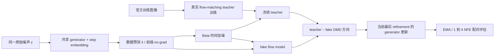
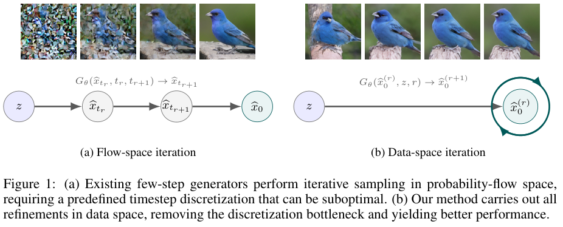

# Data-Space Iteration：共享生成器的数据空间迭代与真实 DMD

> **本地定位：L1 实际训练核心机制诊断。** 已在真实 A100 从公开图像训练 flow teacher，再执行冻结 teacher、可训练 fake model 与共享 generator 的交替 DMD；不是随机教师、固定合成 reward 或只画迭代示意图。三个种子有正有负，不能宣称稳定质量提升。

## 论文信息

| 项目 | 内容 |
| --- | --- |
| 论文链接 | [arXiv 2610.12102v1](https://arxiv.org/abs/2610.12102v1)；[官方全文](https://arxiv.org/html/2610.12102v1) |
| 公司/机构 | ByteDance Seed；一作 Shanchuan Lin |
| 首次公开日期 | 2026-10-08（arXiv v1） |
| 原文开源代码 | 是：[官方附录 E / Algorithm 1–2 核心 PyTorch 代码](https://arxiv.org/html/2610.12102v1#A5) |
| Adapter | `data-space-iteration` |
| 本地复现代码 | [`src/auto_research/foundation/`](https://github.com/daiwk/auto-research/tree/main/src/auto_research/foundation/) 中的 `data_space_iteration.py`；运行入口 `scripts/run_data_space_iteration.py` |
| 本地 teacher | 本轮 CIFAR-10 缩比两尺度 U-Net 从头实际训练，不冒充公开预训练 checkpoint 或作者 SongUNet-55M |

原作者公开的是附录核心代码，不等于完整训练仓库；截至 2026-10-11 未找到作者完整外部仓库链接。

## 原始论文总结

### 背景与主要改动

常规 few-step flow generator 需要预设时间离散化，每步在加噪/去噪轨迹上前进。Data-Space Iteration 改为固定同一份噪声，用共享网络反复改进数据预测；每步 index 只表示 refinement，不是 flow time。训练沿用 distribution matching distillation：真实冻结 teacher 与逐步拟合生成分布的 fake 给出方向，前缀 rollout 无梯度，仅当前 refinement 更新 generator。[正文方法与附录代码](https://arxiv.org/html/2610.12102v1#S2)。



原文 [Figure 1](https://arxiv.org/html/2610.12102v1#S1) 对照 flow-space 与 data-space 迭代；原图与版权属于作者。

<!-- paper-figure:start -->
### 原论文关键图

[](https://arxiv.org/pdf/2610.12102#page=1)

> **原论文 Figure 1（关键图）**：展示原论文方法的总体设计和关键组成。图片来自[原论文](https://arxiv.org/abs/2610.12102v1)，版权归原作者所有；点击图片可查看来源。
<!-- paper-figure:end -->

### 核心公式

$$
\hat x_0^{(0)}=0,\qquad
\hat x_0^{(r+1)}=z-g(\hat x_0^{(r)},z,r,t=1).
$$

对选定 $r$，前 $r$ 步不建梯度图，只优化最后一步。令 $\tau\sim\operatorname{Beta}(2.5,1)$，$x_\tau=(1-\tau)\hat x+\tau\epsilon$，两种实际训练目标为：

$$
\mathcal L_{fake}=\operatorname{MSE}(v_{fake}(x_\tau,\tau,r),\epsilon-\hat x),\qquad
\mathcal L_G=\operatorname{mean}\left[\hat x\,\operatorname{stopgrad}(v_{real}-v_{fake})\right].
$$

不是把真实图片直接回归成每步 generator target。local fake 训练使用当前生成样本且将其 detach，generator 训练时 teacher/fake 均不积累梯度。

### 论文离线与线上效果

原文 ImageNet 比较共享 few-step 生成方法，并在附录 G 给出真实 CIFAR-10 teacher（55M SongUNet）。CIFAR-10 的 2 NFE FID 为 Data-Space 8.28、DMD 11.14，4 NFE 为 8.62、10.03；1 NFE Data-Space 反而较差。不存在“任何步数都提升”的结论。本地像素特征距离不是这些 FID，不直接横向比较。[原文附录 G](https://arxiv.org/html/2610.12102v1#A7)。

## 本地复现

安装实际运行依赖（包含距离计算所需的 SciPy）：`python -m pip install -e '.[data-space-gpu]'`。

> **本地对照口径：** 同一实际训练 teacher、同一数据划分和同预算的 `flow-renoise` / `data-space`。每个 seed 都保留两条 recipe 的 1/2/3/4 NFE EMA 输出指标，负结果和失败 seed 不能筛掉。

本地模型是无类别条件的缩小二尺度残差 U-Net；它保留真实 flow matching → teacher/fake/generator → 交替 DMD 链路，但不是原文 class-conditional ImageNet 模型或 SongUNet-55M。公开 CIFAR-10 五个训练 batch 必须先逐文件校验官方 MD5，才反序列化；类均衡训练 1,024 张 / 留出 256 张固定划分不重叠，官方 test 不读取。

预设验证预算为 teacher 200 steps、每条 generator 128 steps、每步四次 fake 更新、batch 32、width 32、depth 2；seed 42/43/44 各自真正训练 teacher，两条 recipe 共用对应 teacher。teacher 从初始参数实际变化后冻结，并在 distillation 后核对其 hash 未变。记录训练前后的固定留出 velocity MSE，而非用随机教师伪造能力提升。

```bash
PYTHONPATH=src python scripts/run_data_space_iteration.py \
  --data data/cifar10 --offline \
  --teacher-steps 200 --distill-steps 128 \
  --batch-size 32 --width 32 --depth 2 \
  --seeds 42,43,44 --output runs/data-space-cifar.json
```

没有数据时先从 [CIFAR 官方固定归档](https://www.cs.toronto.edu/~kriz/cifar-10-python.tar.gz) 下载并校验；一个空目录不算缓存成功。脚本没有 `--offline` 时会执行归档下载与校验。环境需要 PyTorch、NumPy 和 SciPy。

训练保留 Adam `lr=1e-4, betas=(0,.95)`、无 weight decay/gradient clipping、EMA `0.9999`、4:1 fake/gen 更新和 `r=step%4`。teacher/fake/generator 的非有限 loss 或梯度在 optimizer 更新前报错，不能以跳过问题 seed 获得好看均值。

验证采用 EMA，并给出从平均池化像素特征计算的 `pixel_feature_frechet_distance`：**不是 Inception FID**，不构成正式图像能力/论文规模对比。较小距离只是同一个本地固定特征空间的描述；短预算与高 EMA decay 可能使输出仍接近初始化，应保留原始负结果，不因数据真实就升级为 L2 benchmark 复现。

### 真实 GPU 三种子结果

所有种子的 teacher 均实际训练，随后冻结；每个配方实际更新 generator 128 次、fake 512 次，两个 student/fake 主干参数 hash 都发生改变。不能仅凭新增 step embedding 改变就宣称主网络已训练。

| Seed | 留出 teacher velocity MSE（训练前 → 后） | Flow-renoise 4 NFE 像素 Fréchet | Data-space 4 NFE 像素 Fréchet | 相对变化（越低越好） |
| --- | --- | --- | --- | --- |
| 42 | 1.2854 → 0.3138 | 35.1885 | 22.1266 | -37.12% |
| 43 | 1.2822 → 0.3125 | 17.0755 | 18.7147 | +9.60%（变差） |
| 44 | 1.3046 → 0.3003 | 16.5652 | 19.8272 | +19.69%（变差） |

全部 1–4 NFE、各 seed 的配对结果和训练梯度轨迹保留在实跑产物。**一个 seed 更好、两个更差，不能宣传稳定收益；这些也不是论文 Inception FID 数字。** teacher loss 下降证明该训练链不是随机 teacher，并不证明它达到作者 teacher 的质量。

初次 GPU backward 暴露了冻结 teacher 拷贝时学生 `requires_grad=False` 被继承的问题。现已在学生/fake 的独立主干上显式重新启用梯度，同时保持原 teacher 冻结；真实网络先训练 teacher 再冻结后执行完整四-prefix DMD 的回归覆盖此路径。修正后重新完成上述三个种子的全预算实跑，失败运行不算通过回执。

`scripts/curate_data_space_evidence.py` 校验 teacher 初末不同 hash、实际 loss、冻结配对、student/fake 主干实际变化、完整四倍 fake 更新、非零 generator 梯度、全部 1–4 NFE 和各 seed；只有合格实跑产物才生成指标与 GPU 回执。

## 复现边界与 Evolve

当前未实现作者 674M SiT-XL/2、40-epoch ImageNet 训练、55M SongUNet、类条件 CFG、Inception FID-50k 或原文 schedule search；不能把微型无条件 U-Net 的数字称为原实验复现。参考 rollout 与 DMD 机制、匹配预算以及梯度隔离均有测试，但通过测试并不替代真实 GPU 验证。

可供后续 generator refinement operator 执行与评估；只有多轮控制器实际调用并完成独立 validation 才能宣称已接入 Evolve。
