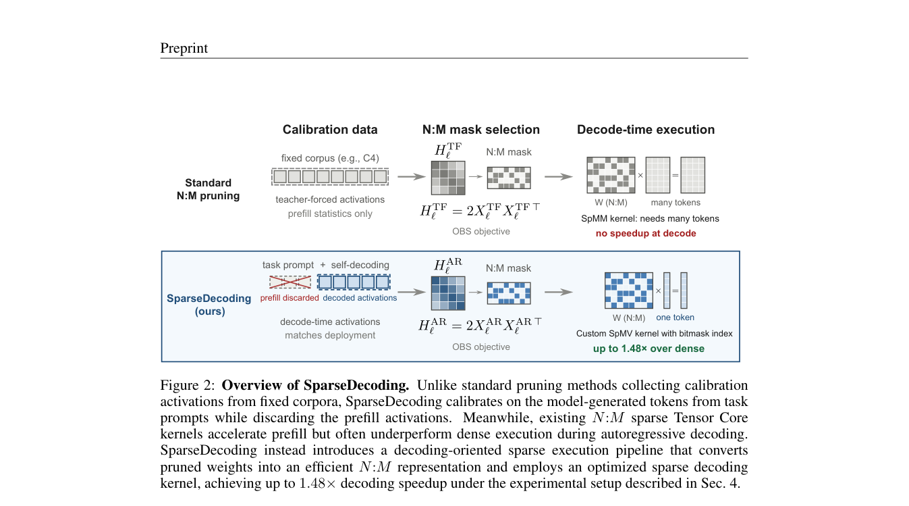

# SparseDecoding: sparse inference calibrated only on decoding activations

<!-- source-sha256: a4eb5c1cba9ad95589743891d1eb8a037ac1390a76b0d10a166ec6cf647f2ca3 -->

[简体中文](README.md)

> Implements decoding-only calibration, Wanda N:M pruning, and real Triton bitmask SpMV, tested on Qwen3-4B with an A100. This L1 mechanism diagnostic reduced local quality and did not improve speed. It is not a reproduction of the original large-model experiments.

## Paper information

| Field | Details |
|---|---|
| Paper | [SparseDecoding: Decoding-Aware Pruning for Accurate and Efficient LLM Inference](https://arxiv.org/abs/2610.12327) |
| Organization | Westlake University (co-first authors Qitong Wang and Xinwei Niu); collaborator Ant Group |
| First public release | 2026-10-08 (arXiv v1) |
| Authors' code | Not yet released; the [project page](https://wang-qitong.github.io/SparseDecoding/) says “Code (soon).” This repository implements it independently. |
| Local adapter | `sparse-decoding` |
| Local reproduction code | `src/auto_research/foundation/sparse_decoding.py`, `sparse_decoding_cuda.py`, and `sparse_decoding_triton.py`; entry point `scripts/run_sparse_decoding_public.py` |

## Original paper

### Motivation and method

Teacher-forced activations on fixed text differ from activations during autoregressive generation. The dense model generates answers to task questions, retaining per-token decoding activations while excluding prefill. Pruning uses those statistics. The calibration protocol is separate from the pruning backend; the paper uses SparseGPT primarily and reports a Wanda ablation.

For batch-one decoding matrix–vector multiplication, each group of 32 consecutive columns uses a 32-bit word marking retained positions. At 50% sparsity, exactly 16 bits are set. Values are packed in increasing column order and traversal takes 16 iterations. The local implementation does not pass a dense zero-filled matrix off as sparse CUDA computation.

~~~mermaid
flowchart LR
  A[Training questions] --> B[Dense autoregressive generation]
  B --> C[Skip prefill and collect decoding activations]
  C --> D[Wanda N:M pruning]
  D --> E[32-bit mask and 16 retained values]
  E --> F[Real Triton SpMV decoding]
  D --> G[Dense pruned matrix for prefill]
~~~

<!-- paper-figure:start -->
### Key figure from the paper

> **Figure 2:** Fixed-text calibration versus autoregressive calibration without prefill, and traditional sparse SpMM versus per-token bitmask SpMV. Speedups and the OBS backend in the figure belong to the paper. The local implementation uses a Wanda substitute and an independent kernel. From the [original paper](https://arxiv.org/abs/2610.12327); copyright remains with the authors. Click the image for the source.
<!-- paper-figure:end -->

### Core equations

The reconstruction objective is $\min_{\widehat W}\|(W-\widehat W)X_{decode}\|_F^2$. Local Wanda scores $s_{ij}=|W_{ij}|\sqrt{\sum_tX_{decode,jt}^2}$ and keeps N entries per group of M columns. It does not run SparseGPT Hessian inversion or error compensation. Metadata takes 32 bits per 32 columns and 16 retained values, or two bits per retained value.

### Paper results

The [paper](https://arxiv.org/html/2610.12327v1) evaluates larger Llama and Qwen models on WritingBench and ClassEval, and reports up to 1.48× A100 decoding speedup from its optimized kernel. No online A/B test is reported. Those results are not the local results below.

## Local reproduction

### Installation and run instructions

~~~bash
python -m pip install -e '.[sparse-decoding-gpu]'
PYTHONPATH=src python scripts/run_sparse_decoding_public.py \
  --checkpoint-path checkpoints/qwen3-4b \
  --checkpoint-id Qwen/Qwen3-4B-Instruct-2507 \
  --checkpoint-revision cdbee75f17c01a7cc42f958dc650907174af0554 \
  --train-path data/gsm8k-holdout/train.jsonl \
  --validation-path data/gsm8k-holdout/validation.jsonl \
  --split-manifest data/gsm8k-holdout/split.json \
  --dataset-revision 3101c7d5072418e28b9008a6636bde82a006892c \
  --calibration-examples 4 --validation-examples 4 --max-tokens 512 \
  --seed 42 --output runs/sparse-decoding-42-512.json
~~~

This runner requires NVIDIA CUDA and Linux Triton. A Mac can run formula and packing unit tests, but not the sparse GPU path. See the [run guide](../../post-training/oct11-checkpoint-guide.md) for public checkpoint download and the train-derived holdout.

### Data protocol and results

Four training questions supply decoding activations; the fixed-text control uses only training questions and their answers. Validation input contains questions only, while answers go only to the external scorer. The runner verifies revision, split hashes, and question disjointness, and does not read official test data. Each recipe warms up two generated tokens on training questions; kernel compilation is excluded from validation decoding time.

| Same four validation questions, seed 42 | Budget-limited answer match | EOS completion | 512-token truncation |
|---|---:|---:|---:|
| Dense baseline | 4/4 | 4/4 | 0 |
| Fixed-text Wanda + bitmask | 2/4 | 1/4 | 3 |
| Decoding-calibrated Wanda + bitmask | 1/4 | 1/4 | 3 |

Truncated responses can contain the correct number. Answer match and normal completion are reported separately; matching does not establish a completed answer. BF16 kernels for all four N:M patterns have zero relative error against reference products using their pruned matrices. The 4B model calls sparse kernels layer by layer. The sparse path runs at about 20 tokens/s versus 26 tokens/s dense. Outputs differ in length, so this is a throughput log, not a fair same-output speedup ratio.

See the [per-example metrics](metrics/checkpoint-a100-seed42.json) and [GPU receipt](../../gpu-validations/sparse-decoding-a100-20261011.json). The original run, where all outputs hit 128 tokens, and the initial Triton compile failure remain in the [runtime audit](../../research-audits/oct11-runtime-audit.md).

### Code mapping and reproduction limits

`DecodeCalibration` uses explicit phases and does not infer decoding merely from a single-token input. `wanda_nm` and `pack_bitmask` perform structured selection and packing. The Triton module reads masks and traverses retained values. The runner manually decodes token by token to verify call counts and EOS, with no discarded extra forward pass.

This covers only the Wanda substitute and independent kernel, not the author's optimized kernel, main SparseGPT experiments, WritingBench/ClassEval, paper-scale multiple seeds, or evolve promotion. A dense copy remains for prefill, so packed bytes do not establish total VRAM savings. The small negative result neither refutes the paper nor establishes local effectiveness or speedup.
