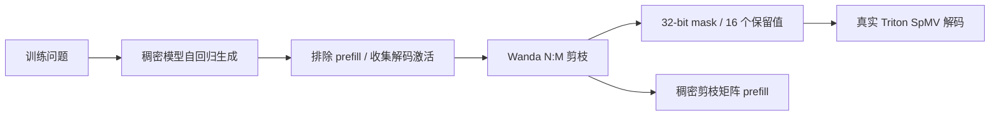
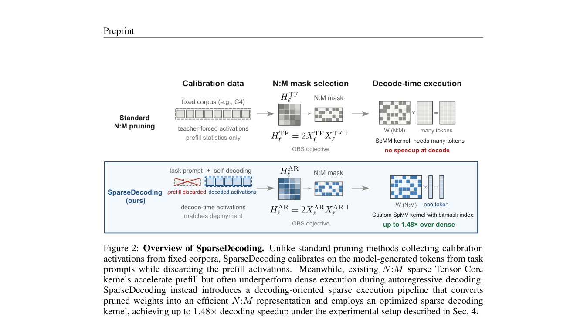

# SparseDecoding：只用解码激活校准的稀疏推理

> 已实现 decoding-only 校准、Wanda N:M 剪枝和真实 Triton bitmask SpMV，并在 A100 运行 Qwen3-4B。当前是 L1 机制诊断；本地结果质量下降且没有加速，不代表原论文大模型实验复现。

## 论文信息

| 字段 | 内容 |
|---|---|
| 论文链接 | [SparseDecoding: Decoding-Aware Pruning for Accurate and Efficient LLM Inference](https://arxiv.org/abs/2610.12327) |
| 公司 / 机构 | Westlake University（共同第一作者 Qitong Wang、Xinwei Niu）；合作机构 Ant Group |
| 首次公开日期 | 2026-10-08（arXiv v1） |
| 原作者代码 | 尚未发布；[项目页](https://wang-qitong.github.io/SparseDecoding/)标注 Code (soon)。本库为独立实现 |
| 本地 Adapter | `sparse-decoding` |
| 本地复现代码 | `src/auto_research/foundation/sparse_decoding.py`、`sparse_decoding_cuda.py`、`sparse_decoding_triton.py`；入口 `scripts/run_sparse_decoding_public.py` |

## 原始论文总结

### 背景与主要改动

固定文本的 teacher-forcing 激活不等于模型自回归生成时的激活。该方法让稠密模型先从任务问题生成回答，只保存逐 token 解码激活、排除 prefill，再用这些统计量执行剪枝。校准协议与剪枝后端分离：原文主要使用 SparseGPT，也报告 Wanda 消融。

系统部分针对 batch-one 解码的矩阵向量乘法：每连续 32 列用一个 32-bit word 标记保留位置；50% 稀疏时恰有 16 个 set bit，按递增列位置打包数值并固定遍历 16 次。本库没有用 dense zeros 冒充稀疏 CUDA 运算。



<!-- paper-figure:start -->
### 原论文关键图

[](https://arxiv.org/pdf/2610.12327#page=3)

> **原论文 Figure 2（关键图）**：对比固定文本校准与排除 prefill 的自回归校准，以及传统稀疏 SpMM 和逐 token bitmask SpMV。图中加速与 OBS 后端属于原论文；本地为 Wanda 替代后端和独立 kernel。图片来自[原论文](https://arxiv.org/abs/2610.12327)，版权归原作者所有；点击图片可查看来源。
<!-- paper-figure:end -->

### 核心公式

重构目标为 $\min_{\widehat W}\|(W-\widehat W)X_{decode}\|_F^2$。本地 Wanda 后端按 $s_{ij}=|W_{ij}|\sqrt{\sum_tX_{decode,jt}^2}$ 在每个 M 列组保留 N 项，不执行 SparseGPT 的 Hessian 逆和误差补偿。元数据每 32 列 32 bit、16 个保留值，即每个保留值 2 bit。

### 论文离线与线上效果

[原文](https://arxiv.org/html/2610.12327v1)在 WritingBench、ClassEval 评估更大的 Llama/Qwen 模型，并报告其优化 kernel 在 A100 上最高 1.48× 解码加速。未报告线上 A/B。这些是作者结果，不是下表的本地结果。

## 本地复现

### 安装与运行

```bash
python -m pip install -e '.[sparse-decoding-gpu]'
PYTHONPATH=src python scripts/run_sparse_decoding_public.py \
  --checkpoint-path checkpoints/qwen3-4b \
  --checkpoint-id Qwen/Qwen3-4B-Instruct-2507 \
  --checkpoint-revision cdbee75f17c01a7cc42f958dc650907174af0554 \
  --train-path data/gsm8k-holdout/train.jsonl \
  --validation-path data/gsm8k-holdout/validation.jsonl \
  --split-manifest data/gsm8k-holdout/split.json \
  --dataset-revision 3101c7d5072418e28b9008a6636bde82a006892c \
  --calibration-examples 4 --validation-examples 4 --max-tokens 512 \
  --seed 42 --output runs/sparse-decoding-42-512.json
```

此入口要求 NVIDIA CUDA 与 Linux Triton；Mac 可以运行公式和打包单测，不能运行稀疏 GPU 路径。公开 checkpoint 下载、训练集派生 holdout 见[运行指南](../../post-training/oct11-checkpoint-guide.md)。

### 数据协议与结果

4 个训练问题采集解码激活；固定文本对照仅使用训练问题及训练答案。验证输入只有问题，答案只进入外部评分器；执行前核验 revision、分区哈希和问题不重叠，不读取官方 test。每个配方先用训练问题预热 2 个生成 token，不把 kernel 编译计入验证解码时间。

| 同一批 4 个验证问题，seed 42 | 有限预算答案匹配 | EOS 完成 | 512-token 截断 |
|---|---:|---:|---:|
| 稠密基线 | 4/4 | 4/4 | 0 |
| 固定文本 Wanda + bitmask | 2/4 | 1/4 | 3 |
| 解码校准 Wanda + bitmask | 1/4 | 1/4 | 3 |

截断回答仍可能含正确数值，因此“答案匹配”和“正常完成”分开报告；不能把匹配当作完整回答成功。四种 N:M 模式的 BF16 kernel 与对应剪枝矩阵参考乘法相对误差均为 0；4B 模型确实逐层调用稀疏 kernel。但稀疏版本约 20 token/s，稠密约 26 token/s；输出长度不同，这只是吞吐记录，不是公平的同输出加速比。

[逐例指标](metrics/checkpoint-a100-seed42.json)、[GPU 回执](../../gpu-validations/sparse-decoding-a100-20261011.json)。第一轮 128-token 全部截断，以及最初 Triton 编译失败保留在[运行审计](../../research-audits/oct11-runtime-audit.md)。

### 代码映射与复现边界

`DecodeCalibration` 使用显式 phase，不因输入只有一个 token 就把 prefill 当成解码；`wanda_nm`、`pack_bitmask` 执行结构选择与打包；Triton 模块实际读取 mask 并遍历保留值。运行器以逐 token 手动解码验证调用次数与 EOS，不生成额外丢弃的末步 forward。

这里只复现 Wanda 替代后端和独立 kernel，不包含作者优化 kernel、SparseGPT 主实验、WritingBench/ClassEval、原规模多种子或 Evolve 晋级。保留 dense prefill 副本，因此 packed bytes 不等于模型显存减少。小样本负结果不能否定原论文，但也不能支持本实现有效或更快。
