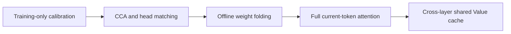
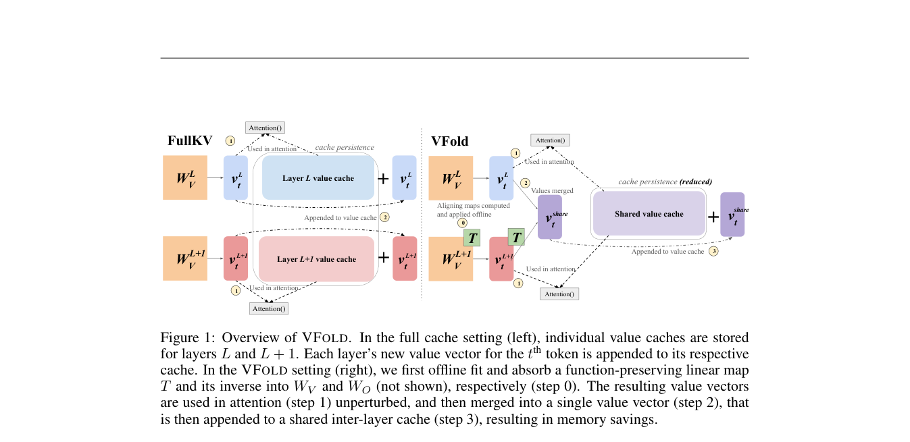

# VFold: Aligning and Sharing Value Caches Across Layers

<!-- source-sha256: ef6ac8bb11e380e39765e7880d44ee0d57c2a72e6c30254940c06f32ba18f5e6 -->

[简体中文](README.md)

> Actual weight folding and persistent shared storage; L1 runtime diagnostic, not LongBench/RULER capability reproduction or speed evidence.

## Paper information

| Field | Value |
| --- | --- |
| Paper | [VFold: Symmetry-Aware Cross-Layer Value Cache Compression](https://arxiv.org/abs/2610.12338) |
| Affiliation | Johns Hopkins University; first author Neha Verma |
| First public release | 2026-10-08 (arXiv v1) |
| Authors' code | [Released](https://github.com/nverma1/vfold); local code is independent. |
| Adapter | `vfold` |
| Local code | `src/auto_research/foundation/vfold.py`, `vfold_cache.py`; `scripts/run_vfold_checkpoint.py` |

## Original paper

### Background and contribution

Adjacent Value spaces need not align. VFold uses full-rank CCA and Hungarian head matching, folds transformations into Value/output weights offline, and uses each current token's full Value before averaging it into shared adjacent-layer storage. Keys are not merged; important prefix/recent tokens remain separate.



<!-- paper-figure:start -->
### Key figure from the paper

[](https://arxiv.org/pdf/2610.12338#page=2)

Left: per-layer caches. Right: absorb invertible maps into weights, then use full current Values before cross-layer merging. From the [paper](https://arxiv.org/abs/2610.12338); copyright belongs to the authors.
<!-- paper-figure:end -->

### Core equation and results

Per head, $[A(XW_V)T][T^{-1}W_O]=A(XW_V)W_O$. Matched shared state is $V_{merge}=(V_l+V_{l+1}PT)/2$. GQA inverses must cover all query output segments for the KV head. The [paper](https://arxiv.org/html/2610.12338v1) reports halving Value storage, about 25% total KV reduction, and over 98% full-cache performance on LongBench/RULER across three models. Can combine with quantization and Key pruning. No live A/B; these are not local measurements.

## Local reproduction

Qwen3-4B on A100, seed 42, 32 training calibration questions and four separate training-derived validation questions, output up to 256 tokens. See the [run guide](../../post-training/oct11-checkpoint-guide.md).

```bash
python scripts/run_vfold_checkpoint.py --help
```

Only questions enter the model; answers go to the external scorer. Verify public revision, split hashes, and disjoint questions; official test remains unopened. BF16 folding caused **1.73%** relative logits error. Three matched-length comparisons reduced persistent KV about 15%; one unequal-length case was excluded. The first 4 and latest 128 tokens are not compressed, so short sequences do not achieve theoretical 25%. See [per-example metrics](metrics/checkpoint-a100-seed42.json) and [GPU receipt](../../gpu-validations/vfold-a100-20261011.json).

### Code and boundaries

`vfold.py` handles CCA, head permutations, biased GQA folding, and shared storage. `vfold_cache.py` integrates Transformers Cache and tests one/two-argument initialization. Supports batch one, even layers, full-attention Qwen3 only; no beam, rollback, or sliding window. Eager attention still materializes full Values temporarily. No low-latency kernel, peak-memory gain, formal capability retention, or Evolve integration. The first four-question calibration's 2.12% error was rejected; cache API failures are retained in the [run audit](../../research-audits/oct11-runtime-audit.md), separate from passing receipts.
