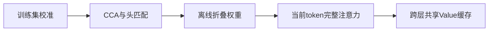
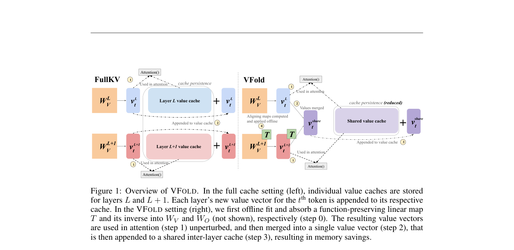

# VFold：对齐后共享跨层 Value 缓存

> 已实现真实权重折叠和持久共享缓存；当前结果是 L1 运行诊断，不是 LongBench/RULER 能力复现或推理加速证明。

## 论文信息

| 字段 | 内容 |
|---|---|
| 论文链接 | [VFold: Symmetry-Aware Cross-Layer Value Cache Compression](https://arxiv.org/abs/2610.12338) |
| 公司 / 机构 | Johns Hopkins University（第一作者 Neha Verma） |
| 首次公开日期 | 2026-10-08（arXiv v1） |
| 原作者代码 | [已发布](https://github.com/nverma1/vfold)；本库为独立实现 |
| 本地 Adapter | `vfold` |
| 本地复现代码 | `src/auto_research/foundation/vfold.py`、`vfold_cache.py`；入口 `scripts/run_vfold_checkpoint.py` |

## 原始论文总结

### 背景与主要改动

相邻层的 Value 不一定在同一坐标系。VFold 用满秩 CCA 对齐和 Hungarian 头匹配，离线把变换折进 Value/输出投影；当前 token 先以完整 Value 参与注意力，随后才与相邻层平均共享。Key 不合并，首尾重要 token 独立保存。



<!-- paper-figure:start -->
### 原论文关键图

[](https://arxiv.org/pdf/2610.12338#page=2)

> **原论文 Figure 1（关键图）**：左侧为每层独立缓存；右侧先离线吸收可逆映射，当前 Value 完整参与注意力后，再合并进跨层共享缓存。图片来自[原论文](https://arxiv.org/abs/2610.12338)，版权归原作者所有；点击图片可查看来源。
<!-- paper-figure:end -->

### 核心公式

对每个头，$[A(XW_V)T][T^{-1}W_O]=A(XW_V)W_O$。匹配后的共享状态为 $V_{merge}=(V_l+V_{l+1}PT)/2$；GQA 的逆变换须覆盖该 KV 头对应的全部 Query 输出段。

### 论文离线与线上效果

[原文](https://arxiv.org/html/2610.12338v1)报告：Value 减半对应约 25% 总 KV 缩减，在三种模型的 LongBench/RULER 上保留超过 98% 全缓存表现；还可组合量化和 Key 剪枝。未报告线上 A/B。这些数字不是本库实测。

## 本地复现

使用 Qwen3-4B、A100、seed 42；32 个训练问题校准，4 个训练集派生的独立验证问题解码，最多生成 256 token。数据来源、安装及参数见[运行说明](../../post-training/oct11-checkpoint-guide.md)。

```bash
python scripts/run_vfold_checkpoint.py --help
```

### 数据协议与结果

模型输入只有问题；答案只进入外部评分器。执行前校验公开数据 revision、分区哈希及问题不重叠，不读取官方 test。

BF16 折叠前后 logits 相对误差为 **1.73%**，不是数值精确相等。3 组缓存长度相同的比较中，持久 KV 存储约减少 15%；另一组生成长度不同，排除出存储收益统计。首 4/近 128 个 token 不压缩，因此短序列不能直接获得理论 25%。[逐例指标](metrics/checkpoint-a100-seed42.json)、[GPU 回执](../../gpu-validations/vfold-a100-20261011.json)。

### 代码映射与复现边界

`vfold.py` 实现 CCA、头置换、带 bias 的 GQA 权重折叠和实际共享存储；`vfold_cache.py` 连接真实 Transformers Cache，测试同时覆盖单/双参数初始化接口。只支持 batch-one、偶数层、全注意力 Qwen3，不支持 beam、回滚或滑动窗口。

eager 注意力仍临时物化完整 Value，未声称低延迟 kernel、峰值显存减少、正式能力保持或 Evolve 集成。首次 4 题校准误差 2.12% 被拒绝；缓存接口兼容失败也保留在[运行审计](../../research-audits/oct11-runtime-audit.md)，不混入通过的回执。
