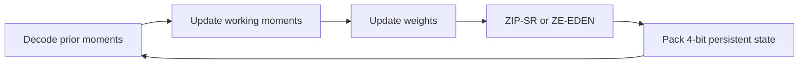
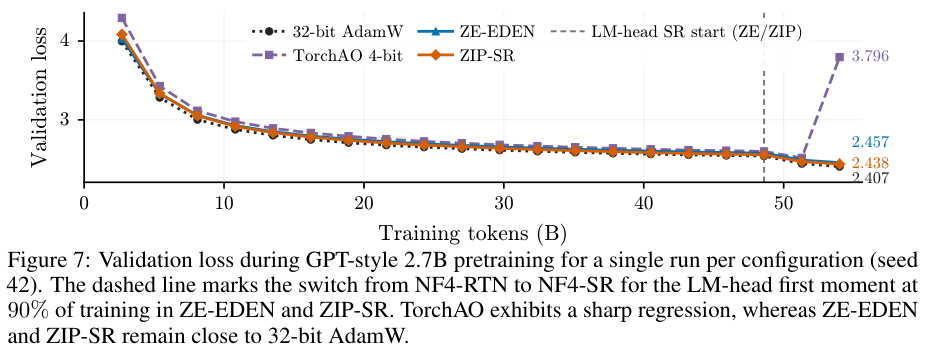

# ZIP-SR / ZE-EDEN: 4-bit AdamW state quantization

<!-- source-sha256: fce200e7299b584a01615bad280f005698f18dfaa6e9ab4c25ebb02352479d55 -->

[简体中文](README.md)

> Bounded A100 public WikiText-2 diagnostic.

## Paper information

| Field | Details |
|---|---|
| Paper | [Rounding in Preconditioner Space](https://arxiv.org/abs/2610.12444) |
| Institution | Hanyang Li, UC Berkeley / Nubank (internship). |
| First public release | 2026-10-08 (arXiv v1) |
| Author code | [nubank/adamw4bit](https://github.com/nubank/adamw4bit), Apache-2.0. |
| Local adapter or method key | `adamw4bit`; Evolve optimizers `optimizer:zip-sr` / `optimizer:ze-eden`. |
| Local reproduction code | `src/auto_research/foundation/adamw4bit.py`; runner `scripts/run_adamw4bit_public.py`. |

## Paper method and evidence

ZIP-SR rounds the second moment stochastically in preconditioner space. ZE-EDEN removes zero codepoints and recalibrates block scales. Both store the first moment in NF4, with stochastic rounding on the LM head over the final 10%. [Method](https://arxiv.org/html/2610.12444v1)

<!-- paper-figure:start -->
### Original paper figure

Figure 7 shows 2.7B validation curves and the LM-head rounding switch, not local WikiText outcomes. From the [original paper](https://arxiv.org/abs/2610.12444); copyright remains with the authors.
<!-- paper-figure:end -->

### Core equation

$h(v)=1/(\sqrt{v/(1-\beta_2^t)}+\epsilon)$. ZIP-SR chooses the lower codepoint between $a,b$ with probability $[h(v)-h(b)]/[h(a)-h(b)]$. ZE-EDEN scale correction is $\|x\|^2/\max(\langle x,Q(x)\rangle,10^{-12}s^2)$. Update weights before quantizing the working moments.

### Reported results

The paper reports 130M–2.7B pretraining and full-parameter SFT, narrowing validation-loss gaps to FP32 AdamW. No online A/B; local budgets differ.

## Local reproduction

~~~bash
PYTHONPATH=src python scripts/run_adamw4bit_public.py \
  --data data/wikitext-2 --output runs/adamw4bit.json \
  --steps 200 --seeds 42,43,44 --device cuda
~~~

Official WikiText-2 train/valid/test; byte tokenizer, first million training bytes, 16 fixed 64-token snippets on validation and test. Match initialization, batches, learning rate, 200 steps, and independent LM head. Select on validation before opening test.

| Method | Mean validation loss | Persistent moment bytes |
|---|---:|---:|
| FP32 AdamW | 2.93307 | 1,095,680 |
| ZIP-SR | 3.12056 | 157,952 |
| ZE-EDEN | 2.97083 | 157,952 |

A100 state savings about 85.6%, with both methods worse on validation; FP32 was selected. Actual uint8 nibble packing, FP32 block scales and fallback below 4096 elements, BF16 restore regression, CPU/CUDA. Eager decode workspace and no fused kernel, so neither speed nor 85.6% total memory gain is claimed. Evolve can execute both and evaluate validation; its MicroLM ties embeddings/head, unlike this independent-head run. No FineWeb-Edu, complete TorchAO ablations, or large SFT. [Metrics](metrics/public-wikitext.json), [GPU receipt](../../gpu-validations/adamw4bit-a100-20261011.json).
