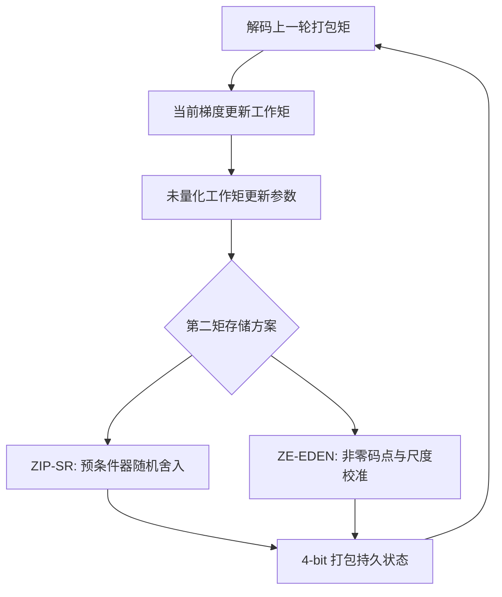
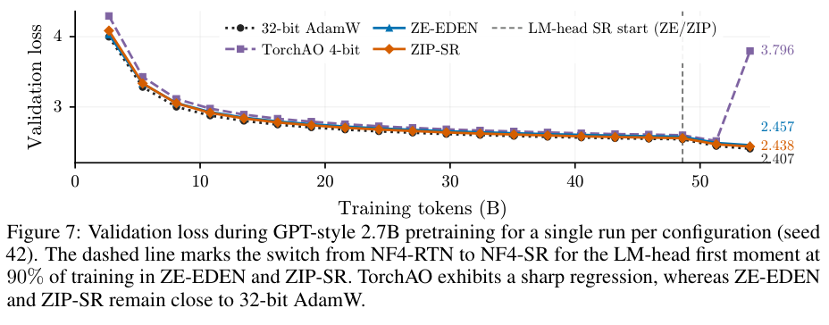

# ZIP-SR / ZE-EDEN：4-bit AdamW 状态量化

## 论文信息

| 字段 | 内容 |
|---|---|
| 论文链接 | [Rounding in Preconditioner Space](https://arxiv.org/abs/2610.12444) |
| 一作机构/公司/学校 | Hanyang Li；加州大学伯克利分校 / Nubank（实习期间研究） |
| 首次公开日期 | 2026-10-08（arXiv v1） |
| 原作者代码 | [nubank/adamw4bit](https://github.com/nubank/adamw4bit)，Apache-2.0 |
| Adapter | `adamw4bit`；Evolve 算子 `optimizer:zip-sr` / `optimizer:ze-eden` |
| 本地代码 | `src/auto_research/foundation/adamw4bit.py` |
| 运行入口 | `scripts/run_adamw4bit_public.py` |

## 原始论文总结

### 背景与主要改动

AdamW 的量化误差会进入后续矩递推。ZIP-SR 在预条件器空间随机舍入第二矩；ZE-EDEN 排除零码点并校准块尺度。两者使用 NF4 第一矩，训练末尾 10% 对 LM head 第一矩随机舍入。[原文](https://arxiv.org/html/2610.12444v1)



<!-- paper-figure:start -->
### 原论文关键图

[](https://arxiv.org/pdf/2610.12444#page=21)

> **原论文 Figure 7（关键图）**：2.7B 预训练中三种低精度方案与 FP32 的验证曲线；虚线处为 LM-head 随机舍入切换。图中是原论文结果，不是本库 WikiText 负结果。图片来自[原论文](https://arxiv.org/abs/2610.12444)，版权归原作者所有；点击图片可查看来源。
<!-- paper-figure:end -->

### 核心公式

$h(v)=1/(\sqrt{v/(1-\beta_2^t)}+\epsilon)$。ZIP-SR 在相邻码点 $a,b$ 间取低码点的概率为 $[h(v)-h(b)]/[h(a)-h(b)]$；ZE-EDEN 的尺度修正为 $\|x\|^2/\max(\langle x,Q(x)\rangle,10^{-12}s^2)$。参数更新发生在当前工作矩量化之前。

### 论文离线与线上效果

原文报告 130M–2.7B 预训练及全参数 SFT，降低相对 FP32 AdamW 的验证损失差距；没有工业线上 A/B。本地预算与原文不同，不直接比较。

## 本地复现

```bash
PYTHONPATH=src python scripts/run_adamw4bit_public.py \
  --data data/wikitext-2 --output runs/adamw4bit.json \
  --steps 200 --seeds 42,43,44 --device cuda
```

### 数据协议与结果

WikiText-2 官方 train/valid/test；字节 tokenizer，训练前 100 万字节，验证和测试仅评估固定 16 个 64-token 片段。相同初始化、批次、200 步、学习率和模型结构；所有方案统一使用独立 LM head。仅以验证集选方案，选定后才打开 test。

| 方案 | Validation loss 三种子均值 | 持久矩字节数 |
|---|---:|---:|
| FP32 AdamW | 2.93307 | 1,095,680 |
| ZIP-SR | 3.12056 | 157,952 |
| ZE-EDEN | 2.97083 | 157,952 |

A100 实跑，状态约节约 85.6%；两种量化方案均未改善验证损失。验证选择的方案为 FP32 AdamW；不根据 test 重新挑选。真实训练使用公开数据，但本批产物按 L1 有界机制诊断登记；三种子不自动升级为正式能力比较。这不是原文大规模效果复现或稳定提升证据。

### 代码映射与边界

- 真实 uint8 半字节打包、FP32 块尺度、4096 元素以下的 FP32 回退，支持 CPU/CUDA；包含 BF16 恢复回归测试。
- 本地 eager 实现有解码工作区，没有融合 CUDA kernel；不宣称墙钟加速或训练总显存下降 85.6%。
- Evolve 可执行这两种优化器并评价 validation；现有 MicroLM 共享 embedding/head，末尾舍入影响共享参数，报告明确区别于独立 head 方案。
- 未复刻 FineWeb-Edu、TorchAO 完整消融或大型 SFT。完整指标与 GPU 回执分别见 `metrics/public-wikitext.json` 和 `docs/gpu-validations/adamw4bit-a100-20261011.json`。
