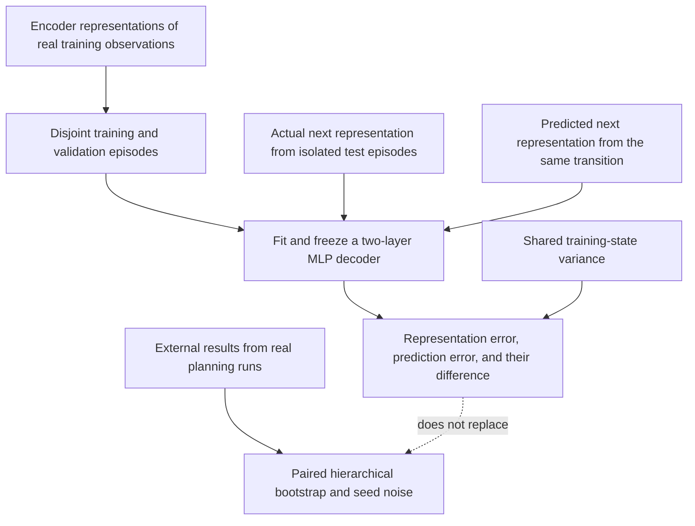
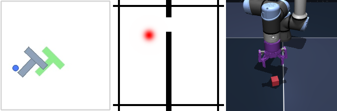

<!-- source-sha256: 754eb348792674a6a8916439d927bc1f9895d8166a55b1cc9da92c1b44248778 -->

[简体中文](README.md) · English

# JEPA prediction and planning evaluation: Lower one-step error does not imply better planning

## Paper information

| Field | Details |
| --- | --- |
| Paper | [arXiv 2610.19375v1](https://arxiv.org/abs/2610.19375v1) |
| Institution | The paper lists no affiliation. Authors are Joshua Cheung and Zhang He; the first author's affiliation is not inferred. |
| First public release | 2026-10-14 (arXiv v1, 01:19:50 UTC) |
| Original source code | No separate author implementation for this evaluation was found when v1 was checked on 2026-10-15. LeWorldModel is used in the paper but is not a separate code release for this study. |
| Adapter | None. `jepa-prediction-planning` is a standalone CPU evaluation protocol, not a trainable world-model adapter. |
| Local reproduction code | [`src/auto_research/jepa_evaluation.py`](https://github.com/daiwk/auto-research/blob/main/src/auto_research/jepa_evaluation.py), [`scripts/run_jepa_prediction_planning.py`](https://github.com/daiwk/auto-research/blob/main/scripts/run_jepa_prediction_planning.py) |
| Evidence level | L0/L1 protocol interface and controlled-array diagnostic; no new JEPA checkpoint or environment planning run. |

## Original paper summary

### Background and main changes

JEPA predicts the next observation in its latent space. Lower one-step loss need not translate into better long-horizon actions. The paper freezes a physical-state decoder fitted solely to encodings of actual observations. It decodes both the actual and predicted next representations, separating the encoder's readability from the predictor's added error. Planning is evaluated separately with matching checkpoints, tasks and paired seeds. Success rates cannot be inferred from prediction metrics.

### Architecture and data flow

This diagram describes the local protocol. Only the small decoder is fitted here; the caller supplies the encoder, predictor, and real planning trajectories.



<!-- paper-figure:start -->
### Key figure from the paper

[](https://arxiv.org/html/2610.19375v1/figures/envs.png)

> **Figure 1 from the paper:** The study's overall design and components. From the [paper](https://arxiv.org/abs/2610.19375v1); copyright belongs to the authors. Click the image for the source.
<!-- paper-figure:end -->

### Core equations

With shared training variance $\sigma_j^2$ and angles converted to sine/cosine, the state error is

$$
d(\hat s,s)=\frac1k\sum_j\frac{(\hat s_j-s_j)^2}{\sigma_j^2}.
$$

The same frozen decoder $D$ is used for

$$
E_{repr}=d(D(z_{t+1}),s_{t+1}),\quad
E_{pred}=d(D(\hat z_{t+1}),s_{t+1}),\quad
E_{excess}=E_{pred}-E_{repr}.
$$

The difference may be negative and must not be clipped at zero. Identical predicted and actual latents must give zero difference, even with a poor decoder. Report latent drift directly as well so the protocol does not rely entirely on decoder extrapolation. Current-state persistence and constant-velocity extrapolation are separate physical baselines, not learned predictors. See [Sections 3–4](https://arxiv.org/html/2610.19375v1#S3).

### Paper results

On PushT, TwoRoom and OGBench-Cube, the authors compare prediction with planning. For example, TwoRoom one-step error drops 93% while planning changes by −0.7 percentage points; PushT error drops 40% while planning changes by +4.9 points. Matched continued-training controls also absorbed gains previously attributed to the auxiliary objective. The authors caution that bootstrap intervals are poorly calibrated with only three top-level training seeds. They do not report a production A/B test. See the [paper's experiments](https://arxiv.org/html/2610.19375v1#S4); these are not local measurements.

## Local reproduction

> **Comparison protocol:** Use a shared state specification and normalization, one frozen decoder, and inputs from the same transition. Evaluate world-model prediction and external planning separately. No automatic Evolve selection is enabled.

### Usage

Run the no-download interface example:

```bash
PYTHONPATH=src python scripts/run_jepa_prediction_planning.py \
  --input docs/foundation-models/2610.19375-jepa-prediction-planning/examples/controlled-input.json \
  --output runs/jepa-protocol/result.json
```

This is a **controlled-array interface example**, not PushT, TwoRoom or OGBench data. It does not contain fabricated successful plans. For your own world model, supply these five input parts:

| Input | Contents |
| --- | --- |
| `training_normalization` | Training-time physical states and episode IDs shared by all models for this environment |
| `decoder_fit` | Encoder representations of actual observations, physical states, and training-time fit episode IDs |
| `decoder_validation` | Actual encoder representations from a disjoint training-time validation subset |
| `test` | Aligned actual and predicted next representations, actual next states, and fully isolated test episode IDs |
| `planning_baseline` / `planning_candidate` (optional) | Real planning records with environment, training_seed, evaluation_seed, episode_id, and binary `value`. Both arms must have exactly the same keys. |

The caller may also provide `shuffled_action_latents` from genuine inference with shuffled actions, plus previous/current states. The interface does not generate predictions, rewards, plans, or success rates on the caller's behalf.

### Budget and implementation differences

The two-layer ReLU MLP decoder defaults to hidden width 512, up to 60 epochs, and patience 10. The NumPy runner uses bounded full-batch SGD, at most 4096 rows per fit or validation partition, and at most 256 dimensions per vector. These are low-cost CPU component choices, not a rerun of all paper settings. Inputs are limited to 16 MB and outputs are not overwritten. Zero-variance states, non-finite values and training/test episode leakage are errors; clipping or renaming cannot hide them.

The decoder is fitted only on actual training-time encoder representations, never on predicted representations or test states. The best epoch is selected only on validation. Normalization, decoder parameters and inputs are hashed; arrays are copied and frozen. For cross-model comparisons the caller must enforce a shared physical-state specification, normalization hash and paired data.

### Aggregation, results, and scope

First average within each episode, then give every episode equal weight. External planning comparisons further stratify by evaluation seed and training seed and resample paired differences at all three levels. Comparisons are restricted to the same environment; state scales are not pooled. The seed range of an unchanged baseline is an observational noise check, not a confidence bound for the population. With three or fewer top-level seeds the runner explicitly warns that intervals are indicative only.

The [CPU interface measurement](metrics/controlled-cpu.json) stores actual decoder fitting and diagnostic metrics on controlled inputs, not a world-model capability result. Tests also cover zero excess error for perfect prediction, retention of negative differences, equal weighting for unequal episode lengths, angle wrapping, paired keys, retention of failures, and frozen parameters.

World-model retraining in all three environments, multiple training/decoder/planning seeds per environment and full MPC are **too costly to reproduce (review DONE)**. This component has no CUDA path and does not claim GPU world-model validation.

### Code map

- `StateNormalization` / `FrozenDecoder`: fixed state specification, training statistics, and immutable decoder.
- `fit_frozen_decoder` / `evaluate_fidelity`: fit an actual two-layer network; evaluate isolated test metrics and physical baselines.
- `paired_hierarchical_bootstrap` / `planning_noise_floor`: paired statistics for externally supplied planning results.
- `scripts/run_jepa_prediction_planning.py`: bounded JSON input and traceable output.
