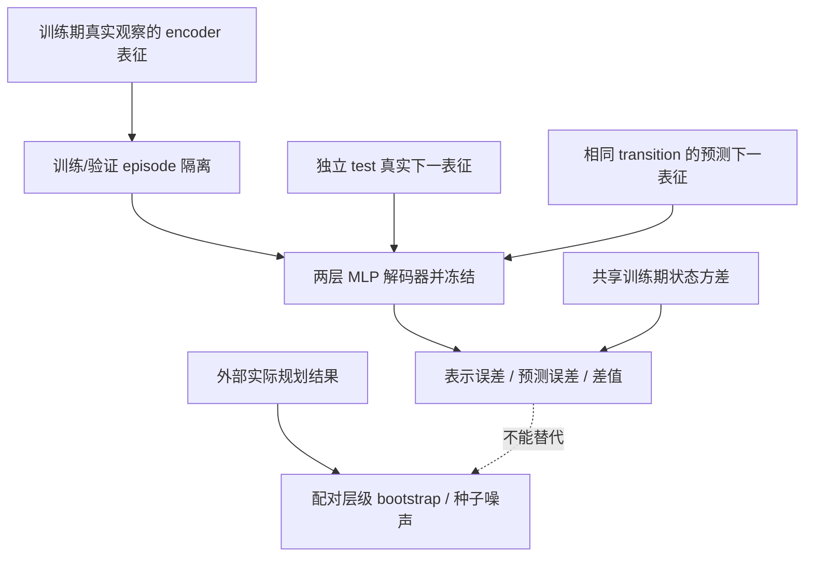
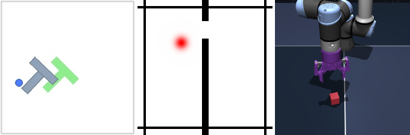

# JEPA 预测—规划评测：不要把一步误差下降等同于规划能力提升

## 论文信息

| 项目 | 内容 |
| --- | --- |
| 论文链接 | [arXiv 2610.19375v1](https://arxiv.org/abs/2610.19375v1) |
| 公司/机构 | 论文未列机构；作者为 Joshua Cheung、Zhang He，不猜测一作单位 |
| 首次公开日期 | 2026-10-14（arXiv v1，01:19:50 UTC） |
| 原文开源代码 | 未找到该评测研究的独立原作者公开实现；2026-10-15 核对 v1。文中使用的 LeWorldModel 不是本研究独立代码发布 |
| Adapter | 无；独立 CPU 评测协议 `jepa-prediction-planning`，不伪装成可训练世界模型 adapter |
| 本地复现代码 | [`src/auto_research/jepa_evaluation.py`](https://github.com/daiwk/auto-research/blob/main/src/auto_research/jepa_evaluation.py)、[`scripts/run_jepa_prediction_planning.py`](https://github.com/daiwk/auto-research/blob/main/scripts/run_jepa_prediction_planning.py) |
| 实现/评测层级 | L0/L1 协议接口与受控数组诊断；无新 JEPA checkpoint、无环境规划实跑 |

## 原始论文总结

### 背景与主要改动

JEPA 在自己的潜空间预测下一观察，较小的一步 loss 不一定表示更好的长程行动。论文固定一个只在真实观察编码上拟合的物理状态解码器，分别解码真实下一表征与预测下一表征，把编码器本身的可读性和预测器新增的误差拆开。规划仍用相同 checkpoint、相同任务和配对种子单独执行，不能由预测指标推导成功率。

### 架构与数据流

以下是本地协议重绘。只有解码器小网络被拟合；encoder、predictor 与真实规划轨迹由调用方提供。



<!-- paper-figure:start -->
### 原论文关键图

[](https://arxiv.org/html/2610.19375v1/figures/envs.png)

> **原论文 Figure 1（关键图）**：展示原论文方法的总体设计和关键组成。图片来自[原论文](https://arxiv.org/abs/2610.19375v1)，版权归原作者所有；点击图片可查看来源。
<!-- paper-figure:end -->

### 核心公式

共享训练集方差为 $\sigma_j^2$，角度先转为 sine/cosine，状态误差为

$$
d(\hat s,s)=\frac1k\sum_j\frac{(\hat s_j-s_j)^2}{\sigma_j^2}.
$$

同一冻结解码器 $D$ 分别计算

$$
E_{repr}=d(D(z_{t+1}),s_{t+1}),\quad
E_{pred}=d(D(\hat z_{t+1}),s_{t+1}),\quad
E_{excess}=E_{pred}-E_{repr}.
$$

差值可能为负，不能截零。如果预测表征恰好等于真实表征，差值必须为零，即使解码器本身很差。另报不经过解码器的 latent drift，避免只观察解码器外推。当前状态持久性和匀速外推是独立的物理基线，不冒充学习预测器。依据[原文 §3–4](https://arxiv.org/html/2610.19375v1#S3)。

### 论文离线与线上效果

论文在 PushT、TwoRoom 和 OGBench-Cube 上比较预测与规划：例如 TwoRoom 一步误差下降 93%，规划却为 −0.7 个百分点；PushT 误差下降 40%，规划为 +4.9 个百分点。配对 continued-training 对照还吸收了原先归于辅助目标的收益。作者明确提醒：仅三个顶层训练种子时 bootstrap 区间校准有限；未报告工业线上 A/B。详见[原文实验](https://arxiv.org/html/2610.19375v1#S4)，这些不是本地测量。

## 本地复现

> **本地对照口径**：共享状态规范与归一化、同一冻结解码器；输入必须来自相同 transition。世界模型预测与外部规划分别评价，不自动接入 Evolve 选择。

### 如何使用

先运行不下载数据的接口示例：

```bash
PYTHONPATH=src python scripts/run_jepa_prediction_planning.py \
  --input docs/foundation-models/2610.19375-jepa-prediction-planning/examples/controlled-input.json \
  --output runs/jepa-protocol/result.json
```

该文件是**受控数组接口样例**，不是 PushT/TwoRoom/OGBench 数据；不含伪造的规划成功轨迹。用于自有世界模型时，替换输入的五部分：

| 输入 | 应填写的内容 |
| --- | --- |
| `training_normalization` | 同环境所有待比较模型共用的训练期物理状态和 episode ID |
| `decoder_fit` | 真实观察的 encoder 表征、物理状态和训练期拟合 episode ID |
| `decoder_validation` | 真实 encoder 表征；与拟合 episode 不重叠的训练期验证部分 |
| `test` | 对齐的真实/预测下一表征、真实下一状态和全隔离的 test episode ID |
| `planning_baseline` / `planning_candidate`（可选） | 实际规划运行记录，含 environment、training_seed、evaluation_seed、episode_id、二元 `value`；两臂键须严格一致 |

可另外提供 `shuffled_action_latents`（调用方真的打乱动作后重新推理）及 previous/current states。接口不会自行制造这些预测、奖励、规划或成功率。

### 预算与实现差异

解码器为两层 ReLU MLP，默认隐藏宽度 512、最多 60 epoch、patience 10。当前 NumPy 入口使用有界 full-batch SGD，每个拟合/验证部分最多 4096 行、每个向量最多 256 维；这是低成本 CPU 组件选择，不复现原文全部训练设置。输入最多 16 MB，输出拒绝覆盖；零方差状态、非有限值、训练/test episode 泄漏直接失败，不能靠裁剪或重新命名抹去。

解码器只用训练期真实 encoder 表征，不能用预测表征或 test 状态拟合；最佳 epoch 只看验证。归一化、解码器参数与输入都有 hash，数组复制并冻结。跨模型比较还须由调用方确保相同物理状态规范、归一化 hash 和配对数据。

### 聚合、结果与边界

先在 episode 内均值，再等权平均 episode；外部规划比较再按 evaluation seed、training seed 分层，并在这三层重采样配对差值。只有同一环境可比较，不混合不同状态尺度。未改变基线的种子极差只作观测噪声审计，不是总体置信上界；三个或更少顶层种子明确警告区间仅供指示。

[CPU 接口实测](metrics/controlled-cpu.json)保存真实解码器拟合与受控输入的诊断指标，不代表世界模型能力。单测另外验证完美预测差值为零、负差值保留、不同长度 episode 等权、角度回绕、配对键/失败结果保留与冻结参数。

原文三个环境的世界模型重训、每环境多训练/解码/规划种子和完整 MPC：**成本过高，不复现（审查 DONE）**。本项没有 CUDA 路径，也没有声称做过 GPU 世界模型验证。

### 代码映射

- `StateNormalization` / `FrozenDecoder`：固定状态规范、训练期统计和不可变解码器。
- `fit_frozen_decoder` / `evaluate_fidelity`：真实两层网络拟合、独立 test 指标与物理基线。
- `paired_hierarchical_bootstrap` / `planning_noise_floor`：外部实际规划结果的配对统计。
- `scripts/run_jepa_prediction_planning.py`：有界 JSON 输入与可追踪结果文件。
