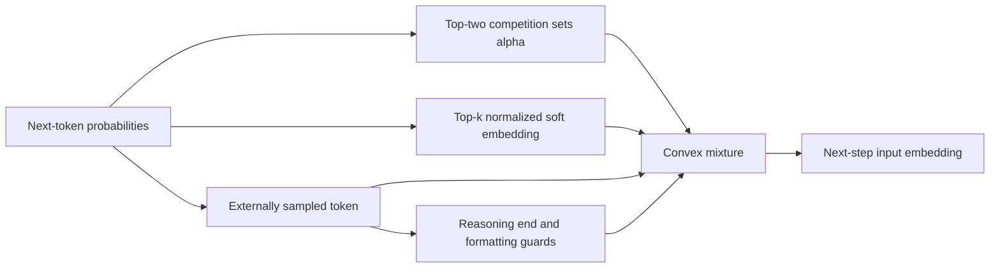
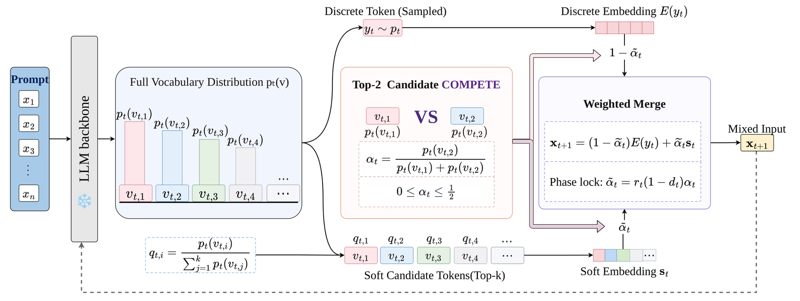

# CoTS: Probability Competition and Soft-to-Discrete Phase Lock

<!-- source-sha256: 11e6c01ccf2ece813d732e847de6cf528323f96bd7208e0cf776e2c1b8a58ca2 -->

[简体中文](README.md)

## Paper information

| Field | Value |
| --- | --- |
| Paper | [arXiv 2610.20642](https://arxiv.org/abs/2610.20642); [v1 full text](https://arxiv.org/html/2610.20642v1) |
| Original title | CoTS: Competitive Token Selection for Latent Reasoning in Large Language Models |
| Affiliations | Jie Yu: Xiaomi AI Lab and Nanyang Technological University (PDF affiliations 1 and 2); grouped under Xiaomi AI Lab, the first affiliation. Work performed during a Xiaomi internship. |
| First public release | 2026-10-08 (arXiv v1), `2026-10-08T02:47:16Z` |
| Authors' code | [OkinoYu/CoTSReasoning](https://github.com/OkinoYu/CoTSReasoning); no clear license identified, so implemented from equations without vendoring. |
| Adapter | Catalog key `cots`, `adapter: null` |
| Local code | `src/auto_research/foundation_models/cots.py`; `scripts/run_oct16_foundation_components.py` |
| Status | `component_only`, L1 mechanism diagnostic; `evolve_integrated: false` |
| Full study | Too costly; not reproduced (review DONE), `not_reproduced_high_cost` |

## Original paper

### Background and contribution

Continuous soft tokens may drift from a discrete reasoning trajectory. CoTS uses top-two probability competition to control soft mixing, retains at least half the sampled token's weight, and irreversibly switches to discrete output after reasoning. See Sections 3.1–3.3, Equations 1–6 and Section 4 for experiments and ablations.



<!-- paper-figure:start -->
### Key figure from the paper

[](https://arxiv.org/html/2610.20642v1/CoTS_overview.png)

**Original Figure 1:** Competition and convex mixing in the [paper](https://arxiv.org/abs/2610.20642), not local generation. Copyright belongs to the authors.
<!-- paper-figure:end -->

### Core equations

$q(v)=p(v)/\sum_{u\in S}p(u)$ and $s=\sum_{v\in S}q(v)E(v)$. For top-two $p_1\ge p_2$, $\alpha=p_2/(p_1+p_2)\in[0,0.5]$, $\widetilde\alpha=r(1-d)\alpha$, and $x=(1-\widetilde\alpha)E(y)+\widetilde\alpha s$. Even for $y\notin S$, $1-\widetilde\alpha\ge0.5$ and $\|x-E(y)\|\le0.5\|s-E(y)\|$. Emitting `</think>` sets $r=0$ immediately and permanently. Protected math/format tokens set $d=1$ for that step only.

### Paper results

| Table 1: mean Pass@1 over six tasks | CoT sampling | CoTS |
| --- | --- | --- |
| Qwen3.5-9B | 76.27% | 81.48% |
| Gemma-4-12B-IT | 81.85% | 86.76% |

Not every task improves: Qwen3.5-9B GPQA trails sampling. Fixed mixture and removed-anchor ablations are separate. No online A/B was reported.

## Local reproduction

Implement competition, top-k soft embedding, discrete anchor, per-item irreversible phase lock, and EOS state. Sampling outside top-k is supported. Probabilities and embeddings remain differentiable, without NumPy or straight-through substitutes. Callers explicitly supply protection and end-think IDs.

### Data and execution

Seeds 42/43/44 use synthetic `synthetic-formula-tensors@oct16-component-v1`: 8×31 probabilities, 31×12 embeddings, top-k=9. No checkpoint, actual tasks, gold, or paid API.

```bash
PYTHONPATH=src python scripts/run_oct16_foundation_components.py \
  --papers cots --device cpu --seeds 42,43,44 \
  --output runs/oct16-foundation/cots-cpu.json
```

CUDA runs the same operator and requires an available device; CPU results do not substitute for a separate receipt.

### Results

[CPU metrics](metrics/component-cpu-seeds42-44.json) report minimum discrete weights `0.5612643 / 0.5542747 / 0.5258285`, all ≥0.5. Half-drift, immediate and irreversible end-think, one-step format protection, and sticky EOS passed. Logit and embedding gradients were finite and nonzero. These are formula contracts, not reasoning accuracy.

### Code map and limits

| Interface | Implementation |
| --- | --- |
| Distribution and sampling | Caller supplies `competitive_token_selection(probabilities,embeddings,sampled_tokens,state,...)` inputs |
| Equations 1–5 | `CotsStep` returns soft/discrete embeddings, alpha, sampled coefficient, and support weights |
| Equation 6 and stopping | `CotsState.reasoning/finished`; caller stops decoding when finished |
| Consumer | Pass `CotsStep.next_embedding` to the model; no fabricated full loop |
| Tests | `tests/foundation_models/test_cots.py`: closed form, outside-top-k anchor, support/competition independence, double-precision gradcheck, control tokens |

### Cost and unreproduced scope

Section 4 uses 4B/9B/12B models, 2,107 questions across six benchmarks, output up to 38,912 tokens, multiple baselines/ablations, and eight A100s. Training-free does not make the full inference study cheap. **Not reproduced for cost (review DONE)** on the one-A100/A30 or Mac budget; no checkpoint/task download or full probe. No actual reasoning outputs. `diagnostic_only: true`, `promotion_eligible: false`, `adapter: null`; no Evolve entry.
