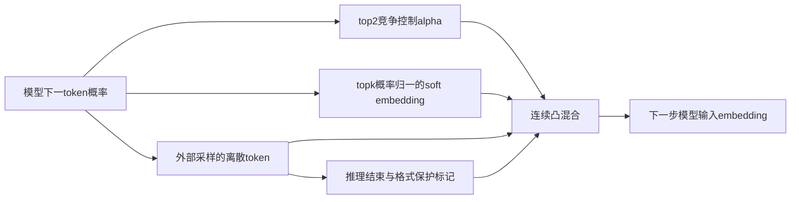
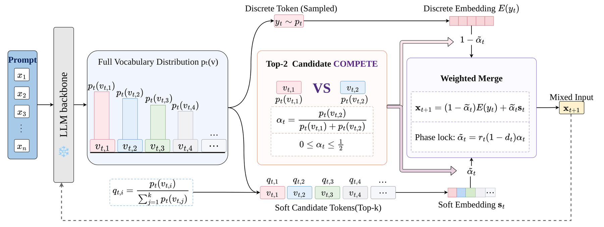

# CoTS：概率竞争与 soft/discrete phase-lock 组件

## 论文信息

| 字段 | 内容 |
| --- | --- |
| 论文链接 | [arXiv 2610.20642](https://arxiv.org/abs/2610.20642)；[v1 全文](https://arxiv.org/html/2610.20642v1) |
| 原文标题 | CoTS: Competitive Token Selection for Latent Reasoning in Large Language Models |
| 公司/机构 | 一作 Jie Yu；PDF 首页上标 1,2 对应 Xiaomi AI Lab 与 Nanyang Technological University，按第一署名 Xiaomi AI Lab 聚合；本工作完成于 Xiaomi 实习期间 |
| 首次公开日期 | 2026-10-08（arXiv v1）；精确时间 `2026-10-08T02:47:16Z` |
| 原文开源代码 | 是：[OkinoYu/CoTSReasoning](https://github.com/OkinoYu/CoTSReasoning)；未识别明确代码许可证，因此仅依据论文公式独立实现，未 vendor |
| Adapter | `cots`（目录键；无 reproduction adapter，`adapter: null`） |
| 本地复现代码目录 | `src/auto_research/foundation_models/cots.py`；调用入口 `scripts/run_oct16_foundation_components.py` |
| 实现状态 | `component_only`；L1 机制诊断；`evolve_integrated: false` |
| 完整实验 | 成本过高，不复现（审查 DONE）；`not_reproduced_high_cost` |

## 原始论文总结

### 背景与主要改动

连续 reasoning 的 soft token 可能偏离离散轨迹。CoTS 用 top-2 概率竞争分配 soft 混合强度，保留 sampled token 至少半数权重，并在结束推理后锁定纯离散输出。主源为 §3.1-3.3 的公式 1-6；实验配置和消融见 §4。



<!-- paper-figure:start -->
### 原论文关键图

[](https://arxiv.org/html/2610.20642v1/CoTS_overview.png)

> 原文 Figure 1 的方法总览；不是本地模型生成结果。图片来自[原论文](https://arxiv.org/abs/2610.20642)，版权归原作者所有。
<!-- paper-figure:end -->

### 核心公式

$q(v)=p(v)/\sum_{u\in S}p(u)$，$s=\sum_{v\in S}q(v)E(v)$。设 $p_1\ge p_2$ 为 top-2，$\alpha=p_2/(p_1+p_2)\in[0,0.5]$；$\widetilde\alpha=r(1-d)\alpha$，$x=(1-\widetilde\alpha)E(y)+\widetilde\alpha s$。即使 sampled token $y\notin S$，其系数也至少 $1-\widetilde\alpha\ge0.5$，且 $\|x-E(y)\|\le0.5\|s-E(y)\|$。`</think>` 发出当步令 $r=0$ 并保持关闭；指定数学/格式 token 的 $d=1$ 仅保护当步。

### 论文离线与线上效果

| 论文 Table 1，六任务平均 Pass@1 | CoT Sampling | CoTS |
| --- | --- | --- |
| Qwen3.5-9B | 76.27% | 81.48% |
| Gemma-4-12B-IT | 81.85% | 86.76% |

结果并非逐任务全胜，例如 Qwen3.5-9B 的 GPQA 低于 sampling；§4 固定混合、取消离散锚点的消融也与完整算法分开。线上 A/B：未报告。

## 本地复现

只实现概率竞争、top-k soft embedding、离散锚点、逐样本不可逆 phase-lock 和 EOS 状态；sampled token 可在 top-k 之外。输入概率与 embedding 的 autograd 链路均保留，未转 numpy、未以 straight-through 伪梯度代替。保护 token ID 与 tokenizer/end-think ID 由调用方明确提供，不猜默认表。

### 数据协议与运行

seeds 42/43/44 的合成张量（`synthetic-formula-tensors@oct16-component-v1`）；每 seed 8×31 概率、31×12 embedding，top-k=9。没有 checkpoint、真实题目或 gold answer，也未调用付费 API。

```bash
PYTHONPATH=src python scripts/run_oct16_foundation_components.py \
  --papers cots --device cpu --seeds 42,43,44 \
  --output runs/oct16-foundation/cots-cpu.json
```

`--device cuda` 运行相同可微算子且要求 CUDA 实际可用；GPU receipt 另由整体验收追加，不能用 CPU 结果代替。

### 结果

[CPU 实测](metrics/component-cpu-seeds42-44.json)：逐 seed 最小离散权重 `0.5612643 / 0.5542747 / 0.5258285`；均大于等于 0.5。half-drift 约束、`</think>` 当步关闭、关闭后不重开、格式保护仅当步、EOS 粘性状态均通过；logits 与 embedding 梯度均有限且非零。仅为公式合同，不表示验证了任何推理准确率提升。

### 代码映射与边界

| 上下游 | 本地位置/合同 |
| --- | --- |
| 模型分布/采样上游 | `competitive_token_selection(probabilities,embeddings,sampled_tokens,state,...)`；分布与采样由调用方负责 |
| 公式 1-5 | `CotsStep` 返回 soft/discrete embedding、alpha、采样项总系数及支持集权重 |
| 公式 6 和停止接口 | `CotsState.reasoning/finished`；调用方应在 finished 时停止 decode |
| 下一步模型消费者 | `CotsStep.next_embedding` 可直接传入模型的 embedding 输入；没有伪造完整生成 loop |
| 核验 | `tests/foundation_models/test_cots.py`，闭式解、top-k 外锚点、支持集与竞争独立、真实双精度 gradcheck、控制 token |

### 成本与未复现范围

§4 披露 4B/9B/12B 三模型、6 基准共 2,107 题、最长 38,912 输出 token、多 baseline/消融，使用 8 张 A100。training-free 不等于整套推理廉价；按公开配置，完整研究超出本轮单 A100/A30 或 Mac 低成本预算，**成本过高，不复现（审查 DONE）**。不下载权重/题库，不探跑全研究；本地没有真实 reasoning 模型输出。`diagnostic_only: true`、`promotion_eligible: false`、`adapter: null`，不进入 evolve。
