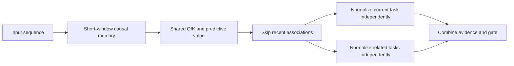
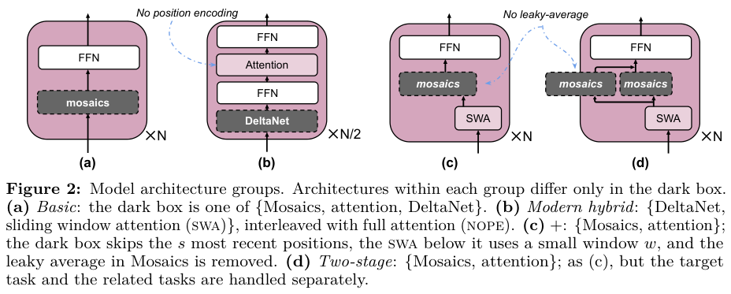

# Memory Mosaics+: Associative Memory for the Open World

<!-- source-sha256: 258eb7e1c4ae0da0a3d34f4af4971180c0e924069d7a59dea385284ee29e1bb6 -->

[简体中文](README.md) · English

## Paper information

| Field | Details |
| --- | --- |
| Paper | [arXiv 2610.20782](https://arxiv.org/abs/2610.20782); [v1 full text](https://arxiv.org/html/2610.20782v1) |
| Original title | Open-world AI: a Tale of Three Requirements |
| Affiliations | First author Jianyu Zhang: FAIR, Meta; Léon Bottou: Flatiron Institute. The paper states that the authors conducted the research in their personal capacity; it is not a Meta production deployment report. |
| First public release | 2026-10-14, `2026-10-14T18:28:16Z`; distinct from the 10-16 announcement |
| Authors' open-source code | [MemoryMosaics repository](https://github.com/facebookresearch/MemoryMosaics) releases Mosaics+ and two-stage configurations under the [Apache-2.0 license](https://github.com/facebookresearch/MemoryMosaics/blob/main/LICENSE.txt). Local code is independent and does not copy upstream source. |
| Adapter | `memory-mosaics-plus` (catalog key); `adapter: null`, no reproduction CLI or Evolve operator |
| Local implementation | `src/auto_research/foundation_models/memory_mosaics_plus.py`; `scripts/run_oct18_foundation_components.py` |
| Implementation status | `component_only`; L1 mechanism diagnostic; `diagnostic_only: true`, `promotion_eligible: false` |
| Full experiments | Above the cost budget and not reproduced (review complete); `not_reproduced_high_cost` |

## Original paper summary

### Background and main changes

IID generalization on a fixed task does not imply learning new tasks in an open world. The paper proposes three requirements: inference-time learning, rich representations, and predictive decoupling. Mosaics+ in §3.2 uses a short-term module for recent dependencies, then retrieves predictive associations with Gaussian-kernel long-term memory. The two-stage variant estimates current and related tasks separately. A single mixed pool could make accumulating irrelevant history harmful.



<!-- paper-figure:start -->
### Key figure from the paper

[](https://arxiv.org/pdf/2610.20782v1#page=6)

> **Figure 2 from the paper:** Comparison of basic, modern hybrid, Memory Mosaics+, and two-stage architectures. The short window, long-term memory, and separation of target/related tasks are part of the original designs. The figure comes from the [original paper](https://arxiv.org/abs/2610.20782), © the original authors. Select the image to see the source.
<!-- paper-figure:end -->

### Core equations

Unit-norm keys make the exponentiated dot product correspond to a Gaussian kernel. The position-dependent bandwidth is:

$$
\beta_t=\beta_1t^{\beta_2}+\beta_0,\quad
f_t=\frac{\sum_{i\leq t-s}\exp(\beta_t k_t^Tk_i)v_i}
{\sum_{i\leq t-s}\exp(\beta_t k_t^Tk_i)}.
$$

When the current document starts at $c$, the two-stage model computes the normalized mean separately for $i<c$ and $c\leq i\leq t-s$, then adds the results. A single pooled softmax is not equivalent. Values combine projections from positions $i$ and $i+1$ to make predictive associations. $s\geq1$ keeps the current query from reading the future.

### Reported offline and online results

The paper compares properties and trends, not a cross-model leaderboard. It asks whether architectures benefit reliably from accumulating related tasks, longer training contexts, and more groups. Results on SimpleWiki, GSM8K, and other tasks support the authors' qualitative argument, not blanket superiority to Transformers. No online A/B test was reported.

## Local reproduction

### Data protocol and execution

No public corpora or checkpoints were downloaded. The pinned procedural revision is `synthetic-memory-spatial-vision-recurrence-and-ode@oct18-foundation-mechanisms-v1`, using seeds 42/43/44. Each seed uses two random 8-token inputs of dimension 16 with explicit document boundaries. Short window 2 and skip 1 are reduced operator settings, not the paper's 256/64. Random targets check the training path, not task answers.

```bash
PYTHONPATH=src python scripts/run_oct18_foundation_components.py \
  --papers memory-mosaics-plus --device cpu --seeds 42,43,44 \
  --output runs/oct18-components/memory-mosaics-plus-cpu.json
```

Output cannot be overwritten and records per-seed results, source SHA-256, commit, actual device, and no-promotion flags. If `--device cuda` is unavailable, the runner errors rather than falling back to CPU.

### Results and independent comparisons

CPU targeted tests compare an independent loop over batch/head/token that computes both normalized means to the vectorized forward pass. Pooled softmax is a negative control. Perturbing inputs after each query checks causality. Actual SGD updates the key projection. Gradients are finite; an empty memory outputs zero without NaNs on backward.

All seeds 42/43/44 passed on a real NVIDIA A100. Maximum error against independently normalized equations was below $2.23\times10^{-16}$; all future-perturbation errors were 0. The key gradient norm was at least 0.05455 and the SGD update norm at least 0.0005455. The pooled negative-control error was 0.8338–0.9589, distinguishing the two estimates from incorrect pooling. See [diagnostic metrics](metrics/component-cuda-seeds42-44.json) and the [GPU receipt](../../gpu-validations/memory-mosaics-plus-a100-20261018.json) for per-seed data. This is L1 operator acceptance, not accuracy or improvement evidence for open-world capabilities.

### Code mapping and limits

`MemoryMosaicsPlus.components` applies short-term memory before forming long-term associations and returns partitions and audit tensors. `masked_average` explicitly handles empty partitions. Tests are in `tests/foundation_models/test_oct18_foundation_components.py`.

No full LM, corpus clustering, training-length sweep, or official-scale reproduction. Beta uses a small positive parameterization without claiming the authors' full hyperparameter setup. The original training uses 1.5B/8B models, 64–256 GPUs, and 4.19 million tokens per step. A single A100/A30 cannot support the full multi-arm training within budget. **It was not reproduced (review complete)**. This is not executable evidence of Evolve improvement.
