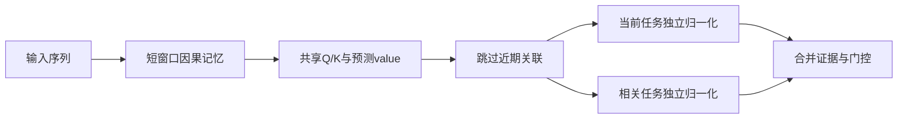
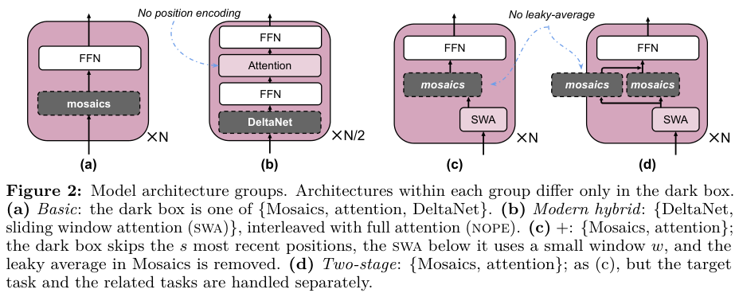

# Memory Mosaics+：面向开放世界的关联记忆

## 论文信息

| 字段 | 内容 |
| --- | --- |
| 论文链接 | [arXiv 2610.20782](https://arxiv.org/abs/2610.20782)；[v1 全文](https://arxiv.org/html/2610.20782v1) |
| 原文标题 | Open-world AI: a Tale of Three Requirements |
| 公司/机构 | 一作 Jianyu Zhang：FAIR, Meta；Léon Bottou：Flatiron Institute；论文注明作者以个人身份研究，不是 Meta 生产部署报告 |
| 首次公开日期 | 2026-10-14；`2026-10-14T18:28:16Z`，不同于 10-16 公告日 |
| 原文开源代码 | [原作者 MemoryMosaics 仓库](https://github.com/facebookresearch/MemoryMosaics)，已发布 Mosaics+ 和 two-stage 配置；[Apache-2.0 许可证](https://github.com/facebookresearch/MemoryMosaics/blob/main/LICENSE.txt)；本地独立实现，不复制上游源码 |
| Adapter | `memory-mosaics-plus`（目录键）；`adapter: null`，未注册 reproduction CLI/evolve operator |
| 本地复现代码目录 | `src/auto_research/foundation_models/memory_mosaics_plus.py`；`scripts/run_oct18_foundation_components.py` |
| 实现状态 | `component_only`；L1 机制诊断；`diagnostic_only: true`、`promotion_eligible: false` |
| 完整实验 | 成本过高，不复现（审查 DONE）；`not_reproduced_high_cost` |

## 原始论文总结

### 背景与主要改动

固定任务的 IID 泛化不等于在开放世界中学习新任务。论文提出推理时学习、丰富表示和预测性解耦三个要求。§3.2 的 Mosaics+ 用短期模块先处理近期依赖，再以 Gaussian-kernel 长期记忆检索预测关联；two-stage 版本分别估计当前任务与相关任务，避免一锅混池让不相关历史越多越有害。



<!-- paper-figure:start -->
### 原论文关键图

[](https://arxiv.org/pdf/2610.20782v1#page=6)

> **原论文 Figure 2（关键图）**：对比 basic、现代混合、Memory Mosaics+ 和 two-stage 架构；短期窗口、长期记忆与目标/相关任务分离为原论文结构。图片来自[原论文](https://arxiv.org/abs/2610.20782)，版权归原作者所有；点击图片可查看来源。
<!-- paper-figure:end -->

### 核心公式

单位范数 key 使点积指数对应 Gaussian kernel；位置相关带宽为

$$
\beta_t=\beta_1t^{\beta_2}+\beta_0,\quad
f_t=\frac{\sum_{i\leq t-s}\exp(\beta_t k_t^Tk_i)v_i}
{\sum_{i\leq t-s}\exp(\beta_t k_t^Tk_i)}.
$$

当前文档起点为 $c$ 时，two-stage 分别对 $i<c$ 与 $c\leq i\leq t-s$ 求上述归一化均值，再相加；不能替换为一次合并 softmax。value 融合位置 $i$ 与 $i+1$ 的投影，形成预测关联；$s\geq1$ 保证当前查询不读未来。

### 论文离线与线上效果

论文比较的是性质与趋势，而非跨模型排行榜：相关任务积累、训练上下文增长和分组数增多时，不同架构能否稳定受益。SimpleWiki 与 GSM8K 等结果支持作者的定性论证，不能改写为“全面超过 Transformer”。线上 A/B：未报告。

## 本地复现

### 数据协议与运行

不下载公开语料或 checkpoint。固定程序化 revision `synthetic-memory-spatial-vision-recurrence-and-ode@oct18-foundation-mechanisms-v1`，seeds42/43/44；每个 seed 使用2条8-token、16维随机输入和明确文档边界。短窗2、skip1 是缩小的算子配置，不等于原文256/64设定。随机目标只用于确认训练路径，不是任务测试答案。

```bash
PYTHONPATH=src python scripts/run_oct18_foundation_components.py \
  --papers memory-mosaics-plus --device cpu --seeds 42,43,44 \
  --output runs/oct18-components/memory-mosaics-plus-cpu.json
```

输出不可覆盖，记录逐 seed、源码 SHA-256、代码提交、实际设备和禁止晋级标志。`--device cuda` 不可用时失败，不回退 CPU。

### 结果与独立对照

CPU 定向测试已运行：逐 batch/head/token 的独立循环计算两个归一化均值，与向量化前向对比；合并 softmax 是负对照；扰动每个查询之后的输入检查因果边界。真实 SGD 更新 key 投影，同时检查有限梯度，空记忆输出零且反向不产生 NaN。

真实 NVIDIA A100 上 seeds42/43/44 全部通过：独立归一化公式最大误差为 $2.23\times10^{-16}$ 以下，未来扰动误差均为0；key 梯度范数至少0.05455、SGD更新范数至少0.0005455。混池负对照误差为0.8338–0.9589，表明确实区分了两个估计与错误的合并估计。完整逐 seed 数据见[诊断指标](metrics/component-cuda-seeds42-44.json)和[GPU 回执](../../gpu-validations/memory-mosaics-plus-a100-20261018.json)。这是 L1 算子验收，不提供开放世界能力准确率或提升结论。

### 代码映射与边界

`MemoryMosaicsPlus.components` 先做短期记忆再构造长期关联，返回分区与审计张量；`masked_average` 显式处理空分区。测试位于 `tests/foundation_models/test_oct18_foundation_components.py`。

没有完整 LM、语料聚类、训练长度扫描或官方规模复现；beta 使用正值小型参数化，未声称复刻作者全部超参。原实验训练1.5B/8B模型，64–256 GPU、每步419万token；单张 A100/A30 不适合完整多臂训练，**成本过高，不复现（审查 DONE）**。当前不是可执行 evolve 改善证据。
