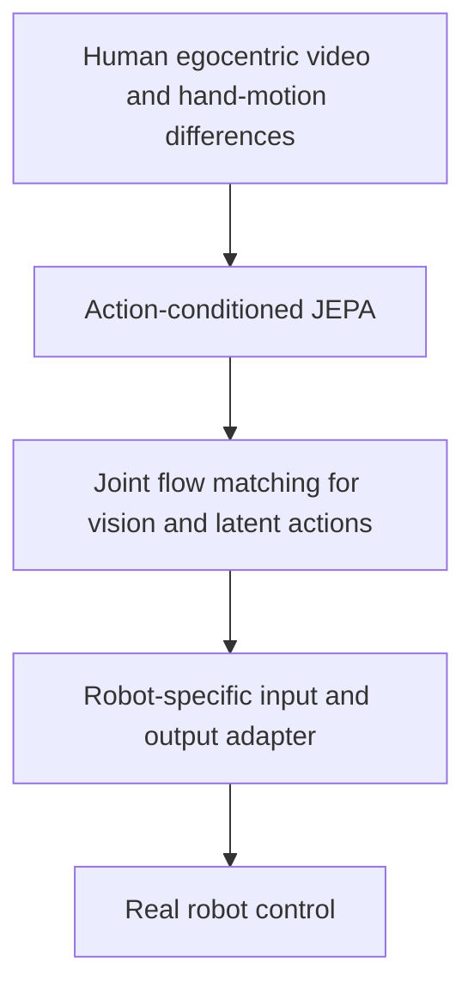
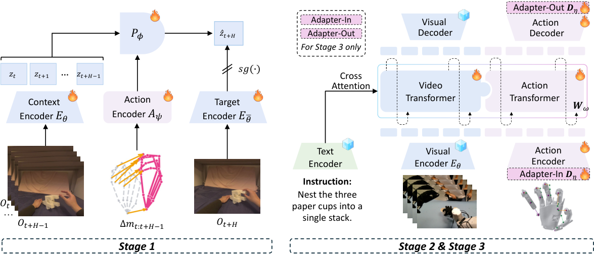

# EgoJEPA: Beyond Retargeting for Dexterous Manipulation from Egocentric Videos

<!-- source-sha256: f07af70d6f125bdc0b5d34d4fea57c7b3c54fc8618ffca42441b2757f9364d45 -->

[简体中文](README.md) · English

> Research reference only. **The experiments exceed the cost budget and were not reproduced (review complete).** No local capability metrics, training results, or executable Evolve operator.

## Paper information

| Field | Details |
| --- | --- |
| Paper | [arXiv 2610.20904](https://arxiv.org/abs/2610.20904); [pinned v1 full text](https://arxiv.org/html/2610.20904v1) |
| Affiliation | Mohamed bin Zayed University of Artificial Intelligence; first author Meng Cao |
| First public release | 2026-10-14 20:34:18 UTC (arXiv v1; announced October 16) |
| Authors' code | No verifiable author source repository was found. The GitHub button on the project page points to the paper, not a code release. |
| Local adapter / stable key | `egojepa` (reference key, no executable adapter) |
| Local implementation | No algorithm implementation; only this write-up and [catalog metadata](https://github.com/daiwk/auto-research/blob/main/src/auto_research/paper_specs/catalog/foundation-models/egojepa.json). |
| Acceptance status | Full experiments not reproduced, review complete; does not block other papers or enter an automatic retry queue. |

## Original paper summary

### Background and main changes

Hand movement in human first-person video need not be mapped with hand-written rules to each robot's actions. EgoJEPA first conditions JEPA on hand-motion differences to predict future visual representations, then jointly models vision and latent actions, and finally adapts only the target robot's input and output action interfaces.

### Architecture and data flow

<!-- paper-figure:start -->
### Key figure from the paper

> **Figure 2 from the paper:** Core architecture, main modules, and connections. The figure comes from the [original paper](https://arxiv.org/abs/2610.20904), © the original authors. Select the image to see the source.
<!-- paper-figure:end -->

### Core equations

This is shorthand for the paper's mechanism, not a local run result. See the [pinned v1 paper](https://arxiv.org/html/2610.20904v1) for full definitions and training details.

$$
\Delta m_i=m_{i+1}-m_i,\qquad\mathcal L_{\mathrm{JEPA}}=\|P_\phi(E_\theta(o_{t:t+H-1}),A_\psi(\Delta m))-\operatorname{sg}(E_{\bar\theta}(o_{t+H}))\|_1.
$$

### Reported offline and online results

Across five tasks and three embodiments, the paper reports 74% mean out-of-domain success versus 65% for retargeting. Cumulative wall-clock cost across embodiments fell from 743.2 to 392.7 hours. These are author experiments, not local results.

No randomized online A/B test on production user traffic was reported. System measurements, robot tasks, and language-model benchmarks are not online recommendation/search/advertising A/B tests.

## Local reproduction

This round records only the method, resource needs, public-code status, and original figure. It did not run the full experiments, download checkpoints, or create simulated capability scores.

### Cost decision

The paper uses 20.1k hours of video, 32–64 GPUs, and three real robots. Full training and cross-embodiment experiments exceed one A100, one A30, or local Mac capacity. This judgment is based on the paper's setup, not a local estimate measured by running it. Available resources are a single A100 or A30, or a local Mac; it does not assume multiple GPUs or simultaneous use of both GPU hosts.

**The full experiments were not reproduced (review complete).** Fixtures do not stand in for unsupported cluster or robotics results to bypass the cost threshold. No automatic retry.

## Reproduction limits

No local adapter, metric file, or GPU receipt, and no executable Evolve operator. The paper's results are reading material only. See the [implementation and review contract (Chinese)](../../research-audits/oct18-components/README.md).
