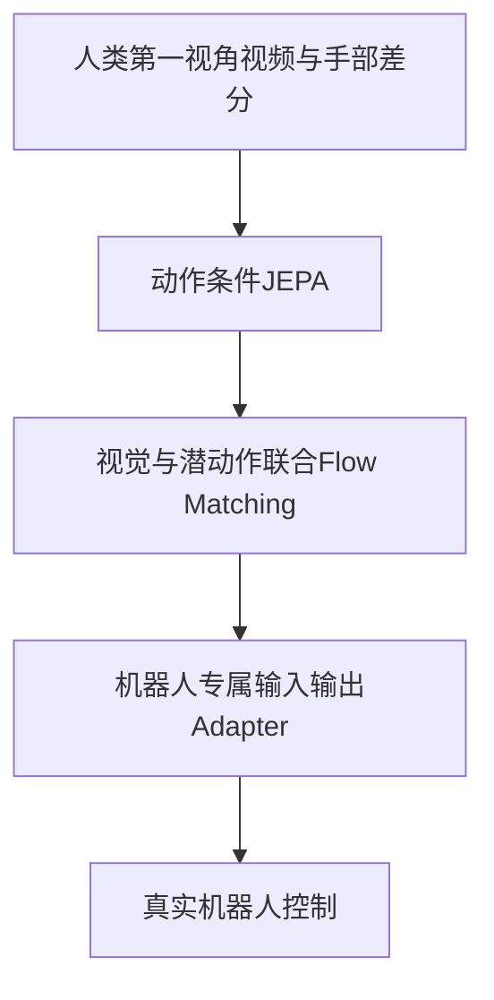
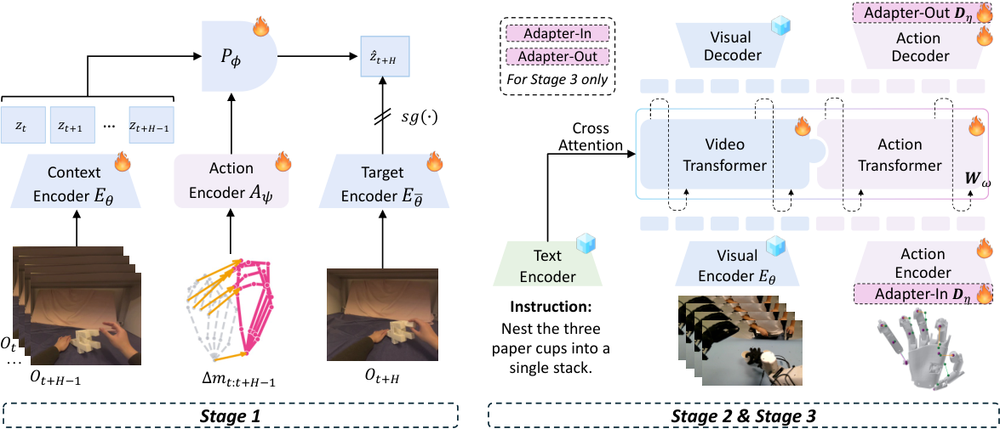

# EgoJEPA: Beyond Retargeting for Dexterous Manipulation from Egocentric Videos

> 仅研究资料；**成本过高，不复现（审查 DONE）**。无本地能力指标、训练结果或可执行 Evolve 算子。

## 论文信息

| 字段 | 内容 |
| --- | --- |
| 论文链接 | [arXiv 2610.20904](https://arxiv.org/abs/2610.20904)；[固定v1全文](https://arxiv.org/html/2610.20904v1) |
| 公司 / 机构 | Mohamed bin Zayed University of Artificial Intelligence；一作 Meng Cao |
| 首次公开日期 | 2026-10-14 20:34:18 UTC（arXiv v1；10月16日公告） |
| 原作者代码 | 未找到可核验的作者源代码仓库；项目页的 GitHub 按钮目前指向论文，不等同于代码发布 |
| 本地 adapter / 稳定键 | `egojepa`（资料键，无可执行 adapter） |
| 本地复现代码 | 无算法实现；仅本文及 [catalog元数据](https://github.com/daiwk/auto-research/blob/main/src/auto_research/paper_specs/catalog/foundation-models/egojepa.json) |
| 验收状态 | 完整实验不复现 / 审查 DONE；不阻塞其他论文，不进入自动重试队列 |

## 原始论文总结

### 背景与主要改动

人类第一视角视频中的手运动不需要经规则映射为每种机器人的动作。EgoJEPA先用手部运动差分条件JEPA预测未来视觉表示，再联合建模视觉与潜动作，最后仅适配目标机器人的输入输出动作接口。

### 架构与数据流

<!-- paper-figure:start -->
### 原论文关键图

> **原论文 Figure 2（关键图）**：展示原论文提出的核心架构、主要模块及其连接关系。图片来自[原论文](https://arxiv.org/abs/2610.20904)，版权归原作者所有；点击图片可查看来源。
<!-- paper-figure:end -->

### 核心公式

以下为原文机制的简写阅读记号，不是本地执行结果；完整定义和训练细节见[固定v1原文](https://arxiv.org/html/2610.20904v1)。

$$
\Delta m_i=m_{i+1}-m_i,\qquad\mathcal L_{\mathrm{JEPA}}=\|P_\phi(E_\theta(o_{t:t+H-1}),A_\psi(\Delta m))-\operatorname{sg}(E_{\bar\theta}(o_{t+H}))\|_1.
$$

### 论文离线与线上效果

原文五项任务、三种具身的域外平均成功率为74%，对照retargeting为65%；累计跨具身墙钟成本从743.2小时降至392.7小时。这些是作者实验，不是本地结果。

生产用户流量随机线上A/B：未报告。系统测量、机器人任务和语言模型benchmark不等同于搜广推用户A/B。

## 本地复现

本轮只完成方法、资源需求、公开代码状态及原图收录，没有运行完整实验、下载checkpoint或制造模拟能力分数。

### 成本判断

20.1k小时视频、32–64张GPU以及三种真实机器人；完整训练及跨具身实验超过单卡A100/A30和本地Mac预算。依据来自原文的实验配置，不是本机实测估算。可用资源为单张A100或A30、或本地Mac，不假设多卡或同时使用两台GPU机器。

结论：**成本过高，不复现（审查 DONE）**。不将不支持的集群/机器人收益替换为fixture来绕过成本门槛；不会自动重试。

## 复现边界

无本地adapter、指标文件或GPU回执，也不登记可执行Evolve算子。原论文结果仅作为阅读资料。范围见[本轮实现与审查合同](../../research-audits/oct18-components/README.md)。
