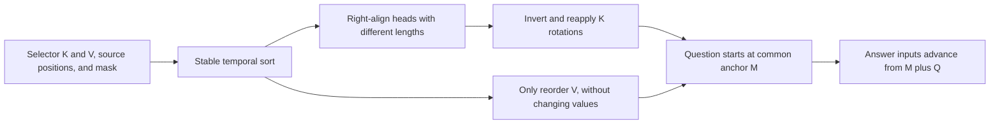
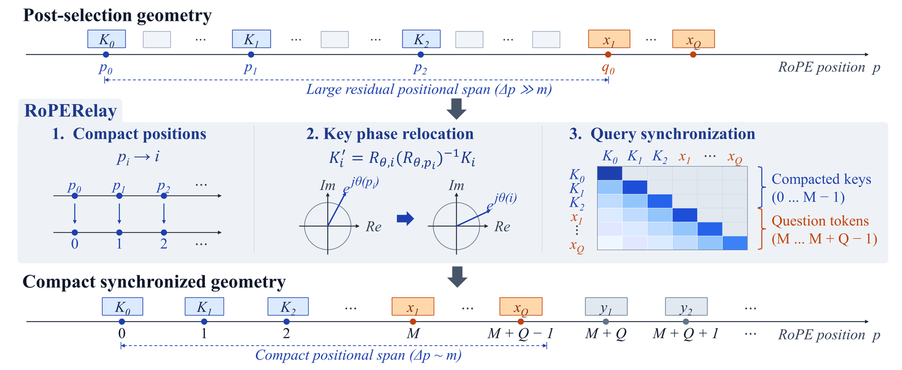

# RoPERelay: Positional Reconstruction for a Fixed Sparse KV Cache

<!-- source-sha256: 9d993b9f8deb136b8c7ffc2a4eef256daac2799bbe8cb3b259ad68ae673cf358 -->

[简体中文](README.md) · English

## Paper information

| Field | Details |
| --- | --- |
| Paper | [arXiv 2610.21126](https://arxiv.org/abs/2610.21126); [v1 full text](https://arxiv.org/html/2610.21126v1) |
| Original title | Compression Does Not End at Selection: Post-Selection Positional Geometry for Sparse KV Caches |
| Authors and affiliations | Wanyang Hong and Zhaoning Zhang; National University of Defense Technology, National Key Laboratory of Parallel and Distributed Computing / College of Computer Science and Technology |
| First public release | 2026-10-15 (arXiv v1); exact timestamp `2026-10-15T02:30:27Z` |
| Authors' open-source code | No released method repository was found. Appendix A.1 says implementations and configurations will be released in the future. Equations were implemented independently, with no vendored code. |
| Adapter | `rope-relay` (catalog key; no reproduction adapter, `adapter: null`) |
| Local implementation | `src/auto_research/foundation_models/rope_relay.py`; runner `scripts/run_oct16_foundation_components.py` |
| Implementation status | `component_only`; L1 mechanism diagnostic; `evolve_integrated: false` |
| Full experiments | Above the cost budget and not reproduced (review complete); `not_reproduced_high_cost` |

## Original paper summary

### Background and main changes

After a selector removes tokens, the keys still carry rotary phases from their old, sparse positions. RoPERelay does not reselect content or prefill the history again. It sorts retained states by their original timestamps, compacts the position coordinates, and synchronizes question and generation positions. The method follows §3, Algorithm 1 in Appendix A, and the numerical conventions in that appendix.



<!-- paper-figure:start -->
### Key figure from the paper

[](https://arxiv.org/html/2610.21126v1/main11.svg)

> Figure 2 shows positional reconstruction and synchronization, not local capability results. The figure comes from the [original paper](https://arxiv.org/abs/2610.21126), © the original authors.
<!-- paper-figure:end -->

### Core equations

Let each layer and physical head retain $m_{\ell h}$ states and $M=\max_{\ell h}m_{\ell h}$. After stable sorting, $p'_i=M-m_{\ell h}+i$. History reconstruction uses $K'_i=R_{p'_i}R_{p_i}^{-1}K_i$ and $V'_i=V_i$. The question uses $M,\ldots,M+Q-1$; when the first answer token is fed back as input, it uses $M+Q$. For scaled rotation factors $c=a\cos\phi,s=a\sin\phi$, the inverse must divide by $c^2+s^2$ rather than treating the transform as a unit rotation. Non-rotary dimensions are unchanged.

### Reported offline and online results

| Paper configuration | Original | RoPERelay |
| --- | --- | --- |
| Llama-3.1-8B / BM25 / LongMemEval-S | 23.60% | 35.40% |
| Llama-3.1-8B / SnapKV / LongMTBench+ | 28.41% | 22.73% |

Source: Table 1. Among 36 comparisons, 32 improve and 4 regress, so the positive cases must not be reported alone. The approximately 1–3% end-to-end request overhead in §5 comes from the paper's setup, not from local operator timing. No online A/B test was reported.

## Local reproduction

The cache operator preserves actual PyTorch gradients and supports scaled and partial RoPE, split-half and interleaved layouts, masks of different lengths, and a common continuation anchor. Synthetic fixed K/V tensors drive an independent complex-valued reference and attention/gradient diagnostics. No model or long-memory data was loaded.

### Data protocol and execution

Inputs are synthetic tensors for seeds 42/43/44 (`synthetic-formula-tensors@oct16-component-v1`), not a language-capability dataset. No checkpoint is used. Each seed uses 2 layers × 2 heads × 8 slots, with retention counts of 8/6/4/2. K/Q have 12 dimensions, of which 8 are rotary, with a scale amplitude of 1.3. The question length is 3, and subsequent answer positions are 11 and 12.

```bash
PYTHONPATH=src python scripts/run_oct16_foundation_components.py \
  --papers rope-relay --device cpu --seeds 42,43,44 \
  --output runs/oct16-foundation/rope-cpu.json
```

Set `--device cuda` explicitly to test the operator on a real GPU; it never silently falls back to CPU. The full acceptance process appends a GPU receipt. CPU evidence is not GPU validation.

### Results

The [CPU run](metrics/component-cpu-seeds42-44.json) recorded maximum absolute errors against the independent complex-valued reference of `4.7684e-7 / 4.7684e-7 / 2.3842e-7` by seed. V values, non-rotary tails, right alignment across different lengths, and question/answer synchronization all passed. Q/K/V gradients were finite and nonzero. A negative control that deliberately did not relocate the query had mean logit difference `5.9008622`. This is a numerical contract, not an accuracy gain.

### Code mapping and limits

| Interface or source | Local implementation or contract |
| --- | --- |
| Inputs from selector output | `relay_cache(K,V,source_positions,factors,valid_mask)`; does not modify the selector |
| Equations 3/4 and Algorithm 1 | Stable sorting, `relocate_keys`, and `apply_rotary` |
| Model rotary factors | `FactorProvider` takes model-provided c/s values. `rotary_factors` is only a static convenience function. |
| Question and decoding consumers | `RelayedCache.question_positions`, `answer_input_positions`, and `causal_mask`. The caller must apply the same coordinates to new Q/K. |
| Verification | `tests/foundation_models/test_rope_relay.py`: double-precision gradcheck, scaled inverse, partial dimensions, variable-length masks, and a query negative control |

There is no local selector comparison, real-model cache integration, or generator. A callable coordinate interface does not imply integration into a serving system. Content in cached K produced by the old context is not recovered or recomputed. V is only reordered with the originally selected items.

### Cost and work not reproduced

The full study spans two 7B/8B models × six selectors × three long-memory tasks (up to 128K), additional long-text experiments and ablations, and a 32B judge. Appendix B times the system using four RTX 3090s. This published multi-arm long-context configuration exceeds the low-cost budget of one A100, A30, or Mac. **The full experiments were not reproduced (review complete)**, and weights and large datasets were not downloaded. `adapter: null`, `diagnostic_only: true`, and `promotion_eligible: false`; not included in Evolve.
