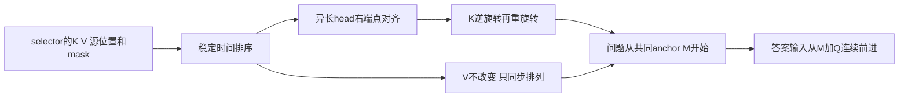
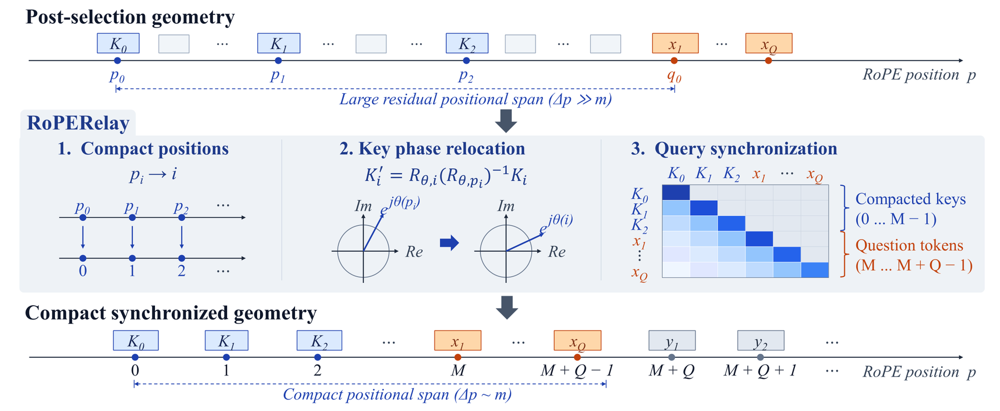

# RoPERelay：固定稀疏 KV 的位置重建组件

## 论文信息

| 字段 | 内容 |
| --- | --- |
| 论文链接 | [arXiv 2610.21126](https://arxiv.org/abs/2610.21126)；[v1 全文](https://arxiv.org/html/2610.21126v1) |
| 原文标题 | Compression Does Not End at Selection: Post-Selection Positional Geometry for Sparse KV Caches |
| 公司/机构 | Wanyang Hong、Zhaoning Zhang；National University of Defense Technology，National Key Laboratory of Parallel and Distributed Computing / College of Computer Science and Technology |
| 首次公开日期 | 2026-10-15（arXiv v1）；精确时间 `2026-10-15T02:30:27Z` |
| 原文开源代码 | 否：未找到已发布的方法仓库；附录 A.1 写明未来将发布实现与配置。公式独立实现，未 vendor |
| Adapter | `rope-relay`（目录键；无 reproduction adapter，`adapter: null`） |
| 本地复现代码目录 | `src/auto_research/foundation_models/rope_relay.py`；调用入口 `scripts/run_oct16_foundation_components.py` |
| 实现状态 | `component_only`；L1 机制诊断；`evolve_integrated: false` |
| 完整实验 | 成本过高，不复现（审查 DONE）；`not_reproduced_high_cost` |

## 原始论文总结

### 背景与主要改动

selector 删除 token 后，K 仍携带稀疏旧坐标的旋转相位。RoPERelay 不重选内容、不重新 prefill 历史，将选中状态按原始时间排序、压紧坐标，并同步问题及生成坐标。来源为 §3、附录 A 的 Algorithm 1 和数值约定。



<!-- paper-figure:start -->
### 原论文关键图

[](https://arxiv.org/html/2610.21126v1/main11.svg)

> 原文 Figure 2 的位置重建与同步流程；不是本地能力结果。图片来自[原论文](https://arxiv.org/abs/2610.21126)，版权归原作者所有。
<!-- paper-figure:end -->

### 核心公式

设各层/物理 head 保留 $m_{\ell h}$ 个状态，$M=\max_{\ell h}m_{\ell h}$；稳定排序后 $p'_i=M-m_{\ell h}+i$。历史重建为 $K'_i=R_{p'_i}R_{p_i}^{-1}K_i$、$V'_i=V_i$。问题使用 $M,\ldots,M+Q-1$；首个答案 token 被回送为输入时使用 $M+Q$。对缩放旋转因子 $c=a\cos\phi,s=a\sin\phi$，逆变换需除以 $c^2+s^2$，不能误当单位旋转；非 rotary 维度不变。

### 论文离线与线上效果

| 论文配置 | Original | RoPERelay |
| --- | --- | --- |
| Llama-3.1-8B / BM25 / LongMemEval-S | 23.60% | 35.40% |
| Llama-3.1-8B / SnapKV / LongMTBench+ | 28.41% | 22.73% |

来源：Table 1；36 个比较中 32 个提高、4 个退化，不能只宣传正例。§5 的约 1–3% 完整请求开销来自原论文配置，不是本地算子计时。线上 A/B：未报告。

## 本地复现

保留实数 Torch 梯度的 cache 算子，支持 scaled/partial RoPE、split-half/interleaved 两种布局、异长 mask、共同 continuation anchor。用合成固定 K/V 进行独立 complex 参考与 attention/梯度诊断，未加载模型或长记忆数据。

### 数据协议与运行

输入是 seeds 42/43/44 的合成张量（`synthetic-formula-tensors@oct16-component-v1`），不是语言能力评测集；无 checkpoint。每 seed 为 2 层×2 head×8 槽，保留数 8/6/4/2，12 维 K/Q，其中 8 维旋转，缩放幅度 1.3。问题长度 3，后续答案位置 11、12。

```bash
PYTHONPATH=src python scripts/run_oct16_foundation_components.py \
  --papers rope-relay --device cpu --seeds 42,43,44 \
  --output runs/oct16-foundation/rope-cpu.json
```

同一命令可显式 `--device cuda` 作真实设备算子验收，绝不静默回退 CPU；GPU receipt 由整体验收流程追加，CPU 记录不等于 GPU 验证。

### 结果

[CPU 实测](metrics/component-cpu-seeds42-44.json)：独立 complex 参考最大绝对误差各 seed 为 `4.7684e-7 / 4.7684e-7 / 2.3842e-7`；V 数值、非 rotary 尾部、异长右端点和问题/答案同步均通过。Q/K/V 梯度均有限且非零。故意不迁移 query 的负对照平均 logit 差为 `5.9008622`；这是数值合同，不是准确率收益。

### 代码映射与边界

| 上下游 | 本地位置/合同 |
| --- | --- |
| selector 输出输入 | `relay_cache(K,V,source_positions,factors,valid_mask)`；不修改 selector |
| 公式 3/4 与 Algorithm 1 | 稳定排序、`relocate_keys`、`apply_rotary` |
| 模型 rotary 因子 | `FactorProvider` 接收模型给定 c/s；`rotary_factors` 仅为静态便利函数 |
| 问题与 decode 消费者 | `RelayedCache.question_positions`、`answer_input_positions`、`causal_mask`；调用方须将相同坐标用于新 Q/K |
| 核验 | `tests/foundation_models/test_rope_relay.py`，双精度 gradcheck、scaled inverse、partial 维、异长 mask、query 负对照 |

本地没有 selector 效果比较、真实模型 cache 集成或生成器；坐标接口可调用不代表完成推理服务集成。cached K 中旧上下文产生的内容不被恢复或重算，V 只随原始选中项排列。

### 成本与未复现范围

完整研究含 7B/8B 两模型×6 selectors×3 长记忆任务（最长 128K）、额外长文本/消融及 32B judge；附录 B 的系统计时使用四张 RTX 3090。按该公开配置，完整多臂长上下文评测超出本轮单 A100/A30/Mac 的低成本预算，**成本过高，不复现（审查 DONE）**，不下载权重或大数据。`adapter: null`、`diagnostic_only: true`、`promotion_eligible: false`，不进入 evolve。
