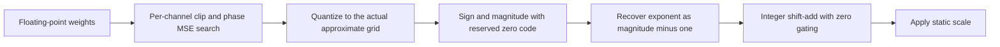
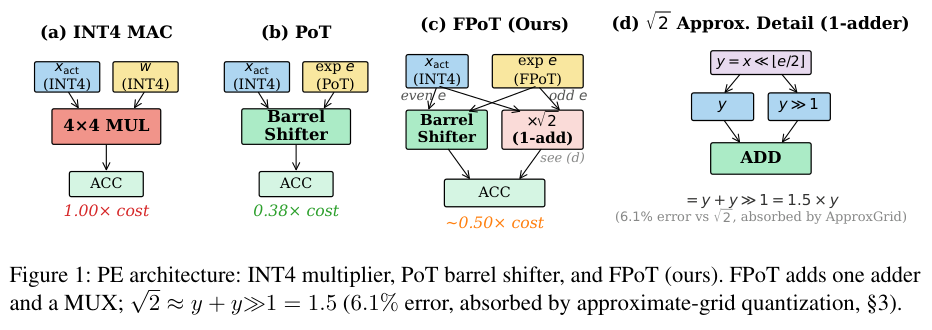

# FPoT: Half-octave weight quantization and integer shift-add

<!-- source-sha256: 0a2ef9bb796c956193fd82971c01982f4855db425813e3bedb0491c2e2fa86f0 -->

[简体中文](README.md)

## Paper information

| Field | Details |
|---|---|
| Paper | *Fractional Power-of-Two Quantization for Efficient and Effective Multiplier-Free LLM Inference*; [arXiv 2610.21257](https://arxiv.org/abs/2610.21257); [pinned v1 full text](https://arxiv.org/html/2610.21257v1). |
| Institution | First author Sunghyun Wee, Seoul National University and LG Electronics; co-first author Geunjae Choi, LG Electronics. |
| First public release | 2026-10-15 04:50:03 UTC. Recovered from the October 16 announcement overlap, not first released October 19. |
| Author code | No verified author repository or license was found; the abstract and full text did not list one. |
| Local adapter or method key | `fpot`; `adapter: null`; no CLI reproduction adapter or Evolve operator. |
| Local reproduction code | `src/auto_research/foundation_models/fpot.py`; runner `scripts/run_oct19_foundation_components.py`. |
| Implementation status | `component_only`; L1 operator diagnostic, `diagnostic_only: true`, `promotion_eligible: false`. |
| Full experiments | `not_reproduced_high_cost`; review complete. |

## Paper method and evidence

Power-of-two weight quantization uses a coarse grid. FPoT halves the exponent spacing for 4-bit weights, then approximates the square-root-of-two coefficient for odd exponents with 1.5 for shift-add execution. Calibration searches the actual approximate grid, avoiding the extra error from changing coefficients only after calibration.



[](https://arxiv.org/pdf/2610.21257v1#page=4)

Original Figure 1 retains the single-add path for odd exponents. Its hardware analysis is not a local GPU speed measurement. Copyright remains with the [paper](https://arxiv.org/abs/2610.21257) authors.

### Core equations

The exact grid is:

$$
Q(w)=\operatorname{sgn}(w)s2^{e/k},\qquad
e=\operatorname{clip}(\operatorname{round}(k\log_2|w/s|),0,2^{b-1}-2).
$$

If $|w/s|<2^{-1/(2k)}$, map to zero; default $k=2$. Nonzero magnitude $m=e+1$ reserves the zero code, so recover $e=m-1$ before splitting parity and shift. Phase search uses $s_g=s_{base}2^{g/G}$ and picks the least reconstruction MSE per channel.

Odd exponents use $1.5\cdot 2^{\lfloor e/2\rfloor}$; even exponents use $2^{e/2}$. Integer execution forms $u=x\ll\lfloor e/2\rfloor$, then uses $u+(u\gg1)$ for odd exponents. Arithmetic signed right shift retains rounding and is not exactly real-valued $1.5u$ for odd integers. Activations and KV caches stay on uniform integer grids.

### Reported results

On Llama-3-8B W4A4KV4, average zero-shot accuracy across nine tasks was 64.8% for FPoT, 65.2% for uniform INT, and 59.6% for standard PoT, under the same OSTQuant/GPTQ pipeline. Gate and energy analysis concerns processing-unit weight MACs, not end-to-end GPU energy. No production A/B was reported.

## Local reproduction

The pinned public synthetic recipe `synthetic-fpot-and-native-layer-kernel-features@oct19-foundation-mechanisms-v1` uses seeds 42/43/44, 6 × 16 weights, and 8 × 16 integer activations. No model or dataset download is needed. Choose a new immutable output path each time:

```bash
PYTHONPATH=src python scripts/run_oct19_foundation_components.py \
  --papers fpot --device cpu --seeds 42,43,44 \
  --output runs/oct19-components/fpot-cpu.json
```

Use `--device cuda` for CUDA; unavailable CUDA fails instead of falling back. Outputs record commit, source SHA-256, and per-seed metrics.

Three CPU seeds matched independent scalar exhaustive grid calibration, termwise signed shifts, and hand-derived linear STE gradients, with nonzero SGD updates. Negative controls omit `m-1` or calibrate on the exact grid and swap in approximate odd coefficients afterward. Differences and MSE are reported as observed, not expected to show paper-level gains on random weights.

On a single NVIDIA A100, seeds 42/43/44 passed at frozen commit `8c963f810e45ce3886e43b1b5da39980e41c95c0`. The three independent references for calibration, integer shift-add, and STE gradients had zero maximum error. Mean weight-gradient norm was 7.1781 (sample SD 0.7712), mean SGD-update norm 0.071781 (SD 0.007712). Mean reconstruction MSE difference versus exact-grid calibration followed by coefficient replacement was 0.001741; it describes the random tensor diagnostic only. See [A100 per-seed metrics](metrics/component-cuda-seeds42-44.json) and [GPU receipt](../../gpu-validations/fpot-a100-20261019.json).

`quantize_weights` performs actual-grid clip and phase search; `FPoTCodes` stores zero codes and scale; `integer_accumulate` is an int64 correctness simulation for CPU/CUDA with signed shift rounding and overflow checks; `straight_through_weights` quantizes forward and backpropagates the identity. FP16/BF16 inputs are promoted to FP32 before clip and scale to avoid underflow; scales and dequantized codes remain FP32. STE explicitly casts back to the input dtype on the forward path and retains identity gradients. Regression tests cover tiny weights, zero channels, and both half-precision gradients, not a full mixed-precision LLM.

**Not reproduced:** No OSTQuant rotation learning, GPTQ error propagation, KV quantization integration, fused Triton kernel, or dedicated RTL. The original matrix covers seven 1.5B–14B models, 400 OSTQuant calibration steps, GPTQ, nine downstream tasks, several bit widths, and multiple seeds. It was not reproduced due to cost and is not queued for automatic retry. The local component supports no model-accuracy, speed, energy, or Evolve promotion claim.
