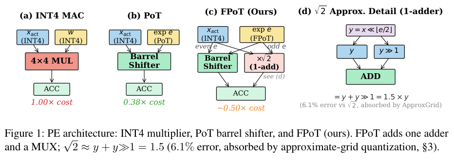

# FPoT：半八度权重量化与整数移位加法

## 论文信息

| 字段 | 内容 |
| --- | --- |
| 论文链接 | [arXiv 2610.21257](https://arxiv.org/abs/2610.21257)；[固定v1全文](https://arxiv.org/html/2610.21257v1) |
| 原文标题 | Fractional Power-of-Two Quantization for Efficient and Effective Multiplier-Free LLM Inference |
| 公司 / 机构 | 一作 Sunghyun Wee：Seoul National University，另列LG Electronics；共同一作Geunjae Choi：LG Electronics |
| 首次公开日期 | 2026-10-15 04:50:03 UTC；10月16日公告的重叠补漏，不是10月19日首发 |
| 原作者代码 | 摘要和全文未列作者代码链接；本轮未找到可核验的作者源代码仓库或许可证 |
| 本地 adapter / 稳定键 | `fpot`（目录键）；`adapter: null`，没有注册CLI reproduction或Evolve算子 |
| 本地复现代码目录 | `src/auto_research/foundation_models/fpot.py`；`scripts/run_oct19_foundation_components.py` |
| 实现状态 | `component_only`，L1算子诊断；`diagnostic_only: true`、`promotion_eligible: false` |
| 完整实验 | 成本过高，不复现（审查 DONE）；`not_reproduced_high_cost` |

## 原始论文总结

### 背景与主要改动

传统power-of-two权重网格较粗。FPoT将相邻指数间隔减半，兼顾4-bit量化误差与移位加法实现；对奇指数的平方根2系数使用1.5近似，并让校准直接适配这一实际网格，避免“先精确量化、部署时再替换系数”的额外误差。


<!-- paper-figure:start -->
### 原论文关键图

[](https://arxiv.org/pdf/2610.21257v1#page=4)

> **原论文 Figure 1（关键图）**：INT4 乘法器、PoT 移位器与 FPoT 处理单元对比；完整保留奇数指数路径的一次加法近似。硬件成本为论文分析，不是本地 GPU 加速测量。图片来自[原论文](https://arxiv.org/abs/2610.21257)，版权归原作者所有；点击图片可查看来源。
<!-- paper-figure:end -->

### 核心公式

精确网格为

$$
Q(w)=\operatorname{sgn}(w)s2^{e/k},\qquad
e=\operatorname{clip}(\operatorname{round}(k\log_2|w/s|),0,2^{b-1}-2).
$$

当 $|w/s|<2^{-1/(2k)}$ 时映射为零；默认 $k=2$。非零幅值码为 $m=e+1$，因此执行端须先恢复 $e=m-1$，再提取奇偶位和整数移位数。相位搜索使用 $s_g=s_{base}2^{g/G}$，按通道选择重构MSE最小值。

近似网格对奇指数使用 $1.5\cdot 2^{\lfloor e/2\rfloor}$，对偶指数使用 $2^{e/2}$。整数执行为 $u=x\ll\lfloor e/2\rfloor$，奇指数项为 $u+(u\gg1)$。有符号整数的算术右移保留舍入，奇整数时并不严格等于实数 $1.5u$。激活与KV-cache仍采用uniform INT，不把它们替换为FPoT网格。

### 论文离线与线上效果

原文Llama-3-8B W4A4KV4上，FPoT的九项零样本平均准确率64.8%，uniform INT为65.2%、标准PoT为59.6%；这些是相同OSTQuant/GPTQ流水线下的原文结果，不是本地测量。作者的能耗/门级结论限定在计算单元权重MAC，不等于端到端GPU能耗。线上A/B：未报告。

## 本地复现

### 数据协议与运行

固定公开合成recipe `synthetic-fpot-and-native-layer-kernel-features@oct19-foundation-mechanisms-v1`、seeds42/43/44。生成6×16权重与8×16整数激活；不下载模型或数据。每次只写新的不可变产物路径：

```bash
PYTHONPATH=src python scripts/run_oct19_foundation_components.py \
  --papers fpot --device cpu --seeds 42,43,44 \
  --output runs/oct19-components/fpot-cpu.json
```

CUDA运行将`--device cpu`改为`--device cuda`；无CUDA时拒绝执行，不静默退回CPU。产物记录代码commit、实际源码SHA256和逐seed指标。

### 结果与独立对照

CPU三seed已执行：逐通道近似网格校准与独立Python标量穷举一致，整数累加与逐项符号/移位参考一致，STE梯度与手写线性梯度一致，并发生非零SGD更新。负对照包括漏掉`m-1`、先精确校准后替换奇指数系数；差异和MSE均原样保留，不要求所有随机权重上都产生论文级精度收益。

真实单张NVIDIA A100上seeds42/43/44已通过，执行冻结commit为`8c963f810e45ce3886e43b1b5da39980e41c95c0`。近似网格校准、整数shift-add和STE梯度三个独立参考的最大误差均为0；权重梯度范数均值为7.1781（样本标准差0.7712），实际SGD更新范数均值为0.071781（标准差0.007712）。相对于先精确校准后替换系数的负对照，重构MSE差的三seed均值为0.001741；这只描述该随机小张量，不支撑模型精度、速度或能耗提升。完整数据见[实际A100逐seed诊断指标](metrics/component-cuda-seeds42-44.json)与[真实GPU验收回执](../../gpu-validations/fpot-a100-20261019.json)。

### 代码映射与边界

`quantize_weights`负责真实网格的clip/phase搜索；`FPoTCodes`保留零码和静态缩放；`integer_accumulate`是可在CPU/CUDA执行的int64正确性模拟，保留有符号右移舍入并检查溢出；`straight_through_weights`执行前向量化和恒等STE反向。

FP16/BF16输入在计算clip、scale与网格之前升至FP32，code中的缩放和反量化结果保留FP32，防止小权重的scale在半精度下溢为零；STE前向显式cast回原权重dtype，保留该dtype本身的舍入，反向梯度仍为恒等映射。小值/零通道及两种半精度梯度均有回归测试，这不等同完整混合精度大模型验收。

没有OSTQuant旋转学习、GPTQ误差传播、KV量化集成、融合Triton内核或专用RTL。小张量诊断不支撑“更快/更省电/大模型精度更好”，不接入Evolve晋级。

完整协议包含7个1.5B–14B模型、400步OSTQuant校准、GPTQ和9项下游任务，再跨多bit配置和seed；这一实验矩阵**成本过高，不复现（审查 DONE）**。不因某个小模型可加载就自动启动整套任务，也不进入待重试队列。
