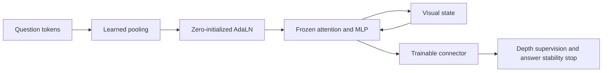
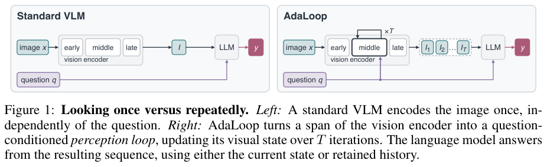

# AdaLoop: Question-conditioned recurrence in the vision encoder

<!-- source-sha256: 89ae8f64704875e311d05167d9f04a1cbcb5b18fac681839f595d6b1100df3ec -->

[简体中文](README.md)

## Paper information

| Field | Details |
|---|---|
| Paper | *AdaLoop: Thinking with the Vision Encoder*; [arXiv 2610.21323](https://arxiv.org/abs/2610.21323); [pinned v1 full text](https://arxiv.org/html/2610.21323v1). |
| Institution | First author Xinran Nicole Han, Harvard University; collaborators from Harvard and MIT. |
| First public release | 2026-10-15T06:14:16Z (UTC) |
| Author code | No verified author implementation or license was found. Code for other cited models is not AdaLoop source. |
| Local adapter or method key | `adaloop-vision`, distinct from audio AdaLoop; `adapter: null`; no Evolve operator. |
| Local reproduction code | `src/auto_research/foundation_models/adaloop_vision.py`; runner `scripts/run_oct18_foundation_components.py`. |
| Implementation status | `component_only`; L1 mechanism diagnostic, `diagnostic_only: true`, `promotion_eligible: false`. |
| Full experiments | `not_reproduced_high_cost`; review complete. |

## Paper method and evidence

A conventional VLM encodes each image once regardless of the question. AdaLoop freezes pretrained visual weights, pools question tokens to modulate shared visual blocks, and repeatedly updates the visual state. The question can change how many passes the model uses rather than leaving all reasoning to the language decoder.



[](https://arxiv.org/pdf/2610.21323v1#page=2)

Original Figure 1 retains both paths of the comparison. Copyright remains with the [paper](https://arxiv.org/abs/2610.21323) authors.

### Core equations

For each frozen sublayer $f$, apply question-conditioned modulation:

$$
h\leftarrow h+(1+\alpha_f)\odot f((1+\gamma_f)\odot\mathrm{LN}(h)+\beta_f).
$$

The loop shares weights, $z_t=\mathcal R(z_{t-1};q)$, and supervises the final answer at multiple depths:

$$
L=-\sum_t w_t\log p(y\mid\Pi_t),\quad w_t>0,\ \sum_tw_t=1.
$$

Prefix A reads only the current visual state; B accumulates visual states; C interleaves model drafts, a fixed separator, and later visual states. Stability stopping compares consecutive predictions without reading gold.

### Reported results

On VisRO-Core6 with Qwen2.5-VL, the trained single-pass question-conditioned AdaLN reached 60.0% ID versus 64.6% with recurrence; OOD scores were 30.2% and 32.4%. This does not show that simply looping an arbitrary frozen block improves it. No production A/B was reported.

## Local reproduction

The recipe `synthetic-memory-spatial-vision-recurrence-and-ode@oct18-foundation-mechanisms-v1` uses seeds 42/43/44, three random visual/question-token examples, width 16, two layers, and three loops. Attention, MLP, and normalization are frozen; only pooling, modulators, and connector train. A temporary linear classifier supports gradient checks and is not a substitute for an LLM.

```bash
PYTHONPATH=src python scripts/run_oct18_foundation_components.py \
  --papers adaloop-vision --device cpu --seeds 42,43,44 \
  --output runs/oct18-components/adaloop-vision-cpu.json
```

CPU checks use independent Q/K/V attention and depth-loss formulas, verify zero frozen-weight movement and real SGD updates, and substitute the question as a negative control. Tests preserve visual gradients in all three prefix paths. C requires detached draft embeddings from the caller and a fixed separator; the component does not generate drafts.

A real NVIDIA A100 passed all three seeds: independent frozen-block error below $4.45\times10^{-16}$, depth objective error below $2.23\times10^{-16}$, and zero backbone movement. Minimum modulator gradient and SGD-update norms were 0.4402 and 0.004402, respectively; replacing the question changed outputs by 0.00626–0.02179. See [per-seed metrics](metrics/component-cuda-seeds42-44.json) and [GPU receipt](../../gpu-validations/adaloop-vision-a100-20261018.json). These diagnostics are not visual-reasoning scores.

`FrozenModulatedBlock` combines frozen visual transforms with trainable AdaLN. `QuestionConditionedVisionLoop` shares the block and detaches input question embeddings while still training the pooler. `visual_prefix` implements A/B/C; `depth_supervised_loss` and `stability_stop` implement supervision and stopping.

**Not reproduced:** No real ViT/VLM, tokenizer, VisRO renderer, full dataset, depth-sampling training, or full generator is integrated. The original 3B/7B runs take 30–40k steps with batch 64 plus depth and budget ablations. The complete matrix exceeds a single GPU budget; this component is not eligible for Evolve promotion.
