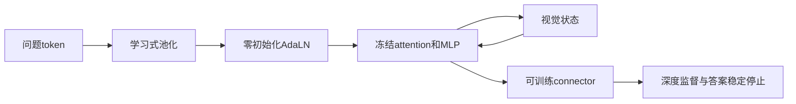
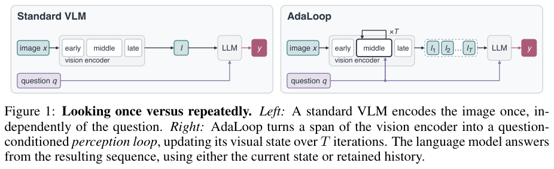

# 视觉 AdaLoop：问题条件化的视觉循环

## 论文信息

| 字段 | 内容 |
| --- | --- |
| 论文链接 | [arXiv 2610.21323](https://arxiv.org/abs/2610.21323)；[v1 全文](https://arxiv.org/html/2610.21323v1) |
| 原文标题 | AdaLoop: Thinking with the Vision Encoder |
| 公司/机构 | 一作 Xinran Nicole Han：Harvard University；合作作者来自 Harvard/MIT |
| 首次公开日期 | 2026-10-15；`2026-10-15T06:14:16Z` |
| 原文开源代码 | 本轮未找到可确认的原作者代码仓库或许可证；引用的其他模型代码不等于本方法代码 |
| Adapter | `adaloop-vision`（目录键）；与音频 AdaLoop 区分；`adapter: null`，不注册 evolve operator |
| 本地复现代码目录 | `src/auto_research/foundation_models/adaloop_vision.py`；`scripts/run_oct18_foundation_components.py` |
| 实现状态 | `component_only`；L1 机制诊断；`diagnostic_only: true`、`promotion_eligible: false` |
| 完整实验 | 成本过高，不复现（审查 DONE）；`not_reproduced_high_cost` |

## 原始论文总结

### 背景与主要改动

普通 VLM 对所有问题只编码图像一次。视觉 AdaLoop 保持预训练视觉权重冻结，以问题池化向量调制共享视觉块，再循环更新内部视觉状态。它将“看几次”与问题联系起来，而不是让语言模型独自承担全部推理。



<!-- paper-figure:start -->
### 原论文关键图

[](https://arxiv.org/pdf/2610.21323v1#page=2)

> **原论文 Figure 1（关键图）**：普通 VLM 一次视觉编码与 AdaLoop 问题条件视觉循环的结构对比；完整保留左右两条路径。图片来自[原论文](https://arxiv.org/abs/2610.21323)，版权归原作者所有；点击图片可查看来源。
<!-- paper-figure:end -->

### 核心公式

每个冻结 sublayer $f$ 用问题生成的调制量更新：

$$
h\leftarrow h+(1+\alpha_f)\odot f((1+\gamma_f)\odot\mathrm{LN}(h)+\beta_f).
$$

循环共享权重，$z_t=\mathcal R(z_{t-1};q)$。最终答案对各深度监督：

$$
L=-\sum_t w_t\log p(y\mid\Pi_t),\quad w_t>0,\ \sum_tw_t=1.
$$

A 只读当前视觉状态，B 累积视觉状态，C 交错模型草稿、固定 separator 和后续视觉状态。稳定停止只比较连续预测答案，不读取 gold。

### 论文离线与线上效果

VisRO-Core6 上，Qwen2.5-VL 的单次问题条件 AdaLN 为60.0% ID，加入循环后64.6%；OOD为30.2%与32.4%。这些是配套训练后的结果，不代表随意循环冻结块就有效。线上 A/B：未报告。

## 本地复现

### 数据协议与运行

seeds42/43/44；revision `synthetic-memory-spatial-vision-recurrence-and-ode@oct18-foundation-mechanisms-v1`。使用3条随机视觉/问题 token、16维、2层、3次循环；冻结 attention/MLP 与 normalization，只训练问题池化、调制器和 connector。临时线性分类器只供梯度诊断，不替代真实语言模型。

```bash
PYTHONPATH=src python scripts/run_oct18_foundation_components.py \
  --papers adaloop-vision --device cpu --seeds 42,43,44 \
  --output runs/oct18-components/adaloop-vision-cpu.json
```

### 结果与独立对照

CPU 已运行独立 Q/K/V attention 展开式、深度损失公式、冻结权重零变化、调制器真实 SGD 更新和问题替换负对照。A/B/C 的前缀接口测试保护视觉梯度；C 的草稿 embeddings 必须由调用方提供并 detach，固定 separator 不可省略。当前没有模型自动生成草稿。

真实 NVIDIA A100 上 seeds42/43/44 全部通过：冻结视觉块独立公式最大误差低于 $4.45\times10^{-16}$，深度目标公式误差低于 $2.23\times10^{-16}$；冻结骨干变化均为0。调制器梯度范数至少0.4402、SGD更新范数至少0.004402，问题替换造成的输出差异为0.00626–0.02179。完整逐 seed 数据见[诊断指标](metrics/component-cuda-seeds42-44.json)和[GPU 回执](../../gpu-validations/adaloop-vision-a100-20261018.json)。这是 L1 梯度与条件路径验收，不可把随机标签 loss 或三个诊断 seed 当成视觉推理效果。

### 代码映射与边界

`FrozenModulatedBlock` 保留冻结视觉变换、训练 AdaLN；`QuestionConditionedVisionLoop` 共享循环块，条件输入 question embeddings 按原文 detach，但学习式 pooler 正常反向；`visual_prefix` 实现三种序列接口；`depth_supervised_loss` 与 `stability_stop` 分别处理监督和预测停止。

未接入真实 ViT/VLM、tokenizer、VisRO renderer或完整数据集；未实现作者的深度采样训练或完整语言生成器。原文3B/7B多模型30–40k步、batch64，并有深度与预算消融；单卡完整多臂成本过高，**成本过高，不复现（审查 DONE）**。不是 evolve 可晋级算子。
