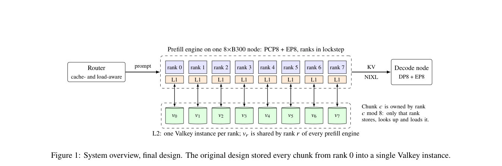

# When the KV Cache Is Slower Than the GPU: Scaling Remote KV Tiers for Context-Parallel Prefill

<!-- source-sha256: 5bddc7d9d0ee171bd32049d43ff4fb193c1cb71b7f6924b27b88014d048ae958 -->

[简体中文](README.md)

> Research reference only. **Not reproduced due to cost (review complete).** No local capability metrics, training results, or executable evolve operator.

## Paper information

| Field | Details |
| --- | --- |
| Paper | [arXiv 2610.21500](https://arxiv.org/abs/2610.21500); [pinned v1 full text](https://arxiv.org/html/2610.21500v1) |
| Organization | Multiverse Computing; first author Muhammad Ibrahim |
| First public release | October 15, 2026 at 08:37:22 UTC (arXiv v1; announced October 16) |
| Authors' code | [Public author/upstream code](https://github.com/LMCache/LMCache). Relevant implementations are public as the authors' upstream LMCache PRs. Public PRs do not establish that all changes are merged or that the entire cluster experiment is available to reproduce. |
| Local adapter / stable key | `remote-kv-tiers` (reference key, not an executable adapter) |
| Local reproduction code | No algorithm implementation; this page and [catalog metadata](https://github.com/daiwk/auto-research/blob/main/src/auto_research/paper_specs/catalog/foundation-models/remote-kv-tiers.json) only |
| Review status | Full experiments not reproduced; review complete. This does not block other papers or enter the automatic retry queue. |

## Original paper

### Motivation and method

A cache hit is not always faster than recomputation. The work first calculates the break-even bandwidth and fixed overhead for loading versus recomputing. It then shards the MLA KV cache by PCP rank and uses a separate remote instance for each rank plus asynchronous loading to eliminate head-of-line blocking.

### Architecture and data flow

~~~mermaid
flowchart TD
  Q[Long-context request] --> C{Is loading faster than recomputing?}
  C -->|Load| S[KV cache sharded by PCP rank]
  S --> A[Separate remote instances and asynchronous loading]
  C -->|Recompute| P[Prefill]
  A --> P
~~~

<!-- paper-figure:start -->
### Key figure from the paper

> **Figure 1:** Overview of the paper's design and components. From the [original paper](https://arxiv.org/abs/2610.21500); copyright remains with the authors. Click the figure to see the source.
<!-- paper-figure:end -->

### Core equations

The following is shorthand for the mechanism, not a result from a local run. See the [pinned v1 paper](https://arxiv.org/html/2610.21500v1) for full definitions and details.

$$
T_{\mathrm{load}}(n)=T_0+\frac{sn}{B},\qquad T_{\mathrm{compute}}(n)=\frac nR,\qquad B^*=sR.
$$

### Paper results

The authors report that p99 latency on a cache-hit-heavy request stream falls from 83.32 seconds to 0.67 seconds, with remote GET bandwidth 6.3× higher. The end-to-end comparison changes both parallelization and node layout. The paper explicitly distinguishes this comparison from a single-variable cache ablation.

The paper reports no randomized online A/B test on production users. System measurements, robotics tasks, and language-model benchmarks are not equivalent to user A/B tests in search, ads, or recommendation.

## Local reproduction

The review documents the method, resource requirements, public-code status, and original figure. No full experiment was run, no checkpoint was downloaded, and no synthetic capability score was substituted.

### Cost assessment

The setup uses GLM-5.3 FP8 MoE and eight B300s per node. The end-to-end 4P+1D configuration needs five nodes. A single A100 or A30 cannot faithfully validate the distributed gains. This assessment comes from the paper's experiment configuration rather than local measurement. The available environment is a single A100, a single A30, or a Mac; it does not assume multi-GPU access or concurrent use of both GPU hosts.

**Not reproduced due to cost (review complete).** A single-host fixture would not reproduce cross-node KV transfer or distributed serving gains. This work will not be retried automatically.

## Reproduction boundary

There is no local adapter, metrics file, GPU receipt, or executable evolve operator. Original results are provided as research reference only. See the [implementation and review contract for this batch](../../research-audits/oct18-components/README.md).
