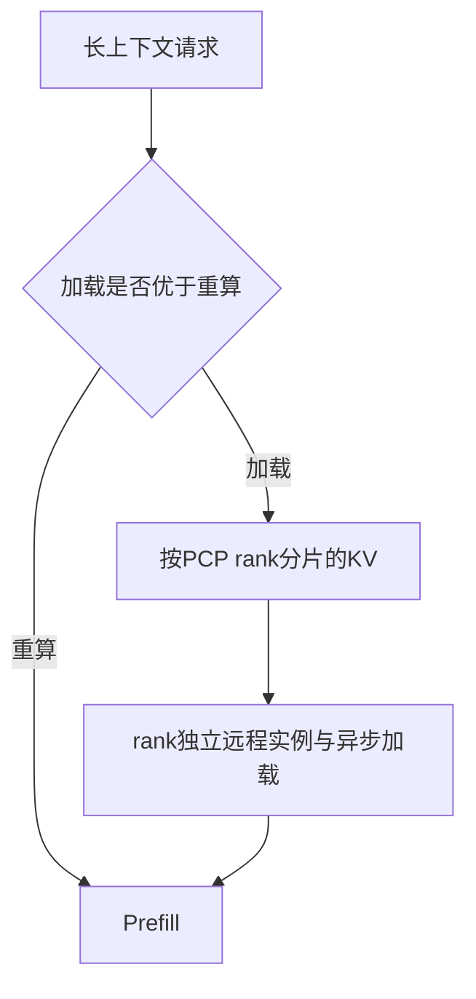
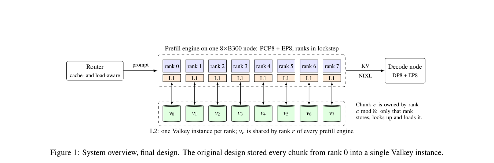

# When the KV Cache Is Slower Than the GPU: Scaling Remote KV Tiers for Context-Parallel Prefill

> 仅研究资料；**成本过高，不复现（审查 DONE）**。无本地能力指标、训练结果或可执行 Evolve 算子。

## 论文信息

| 字段 | 内容 |
| --- | --- |
| 论文链接 | [arXiv 2610.21500](https://arxiv.org/abs/2610.21500)；[固定v1全文](https://arxiv.org/html/2610.21500v1) |
| 公司 / 机构 | Multiverse Computing；一作 Muhammad Ibrahim |
| 首次公开日期 | 2026-10-15 08:37:22 UTC（arXiv v1；10月16日公告） |
| 原作者代码 | [作者/上游公开代码](https://github.com/LMCache/LMCache)；相关实现以作者提交的LMCache上游PR公开；不将PR公开等同于全部已合入或完整集群复现实验可用 |
| 本地 adapter / 稳定键 | `remote-kv-tiers`（资料键，无可执行 adapter） |
| 本地复现代码 | 无算法实现；仅本文及 [catalog元数据](https://github.com/daiwk/auto-research/blob/main/src/auto_research/paper_specs/catalog/foundation-models/remote-kv-tiers.json) |
| 验收状态 | 完整实验不复现 / 审查 DONE；不阻塞其他论文，不进入自动重试队列 |

## 原始论文总结

### 背景与主要改动

缓存命中不一定更快。该工作先计算加载与重算的盈亏平衡带宽和固定开销，再把MLA KV缓存按PCP rank分片，并使用rank独立远程实例和异步加载消除队首阻塞。

### 架构与数据流

<!-- paper-figure:start -->
### 原论文关键图

> **原论文 Figure 1（关键图）**：展示原论文方法的总体设计和关键组成。图片来自[原论文](https://arxiv.org/abs/2610.21500)，版权归原作者所有；点击图片可查看来源。
<!-- paper-figure:end -->

### 核心公式

以下为原文机制的简写阅读记号，不是本地执行结果；完整定义和训练细节见[固定v1原文](https://arxiv.org/html/2610.21500v1)。

$$
T_{\mathrm{load}}(n)=T_0+\frac{sn}{B},\qquad T_{\mathrm{compute}}(n)=\frac nR,\qquad B^*=sR.
$$

### 论文离线与线上效果

作者命中密集请求流的p99从83.32秒降至0.67秒，远程GET带宽提升6.3倍；端到端部署对比同时改变并行策略与节点布局，原文明确不是单一缓存技术消融。

生产用户流量随机线上A/B：未报告。系统测量、机器人任务和语言模型benchmark不等同于搜广推用户A/B。

## 本地复现

本轮只完成方法、资源需求、公开代码状态及原图收录，没有运行完整实验、下载checkpoint或制造模拟能力分数。

### 成本判断

GLM-5.3 FP8 MoE、每节点8张B300，端到端4P+1D配置需5个节点；无法在现有单卡A100/A30上忠实验证分布式收益。依据来自原文的实验配置，不是本机实测估算。可用资源为单张A100或A30、或本地Mac，不假设多卡或同时使用两台GPU机器。

结论：**成本过高，不复现（审查 DONE）**。不以单机fixture冒充跨节点KV传输和分布式服务收益；不会自动重试。

## 复现边界

无本地adapter、指标文件或GPU回执，也不登记可执行Evolve算子。原论文结果仅作为阅读资料。范围见[本轮实现与审查合同](../../research-audits/oct18-components/README.md)。
