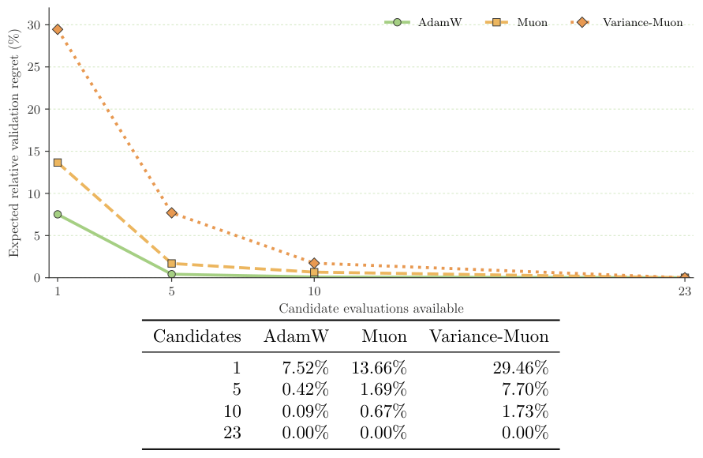

# Muon paired-budget: fair comparisons under data, time, and tuning budgets

<!-- source-sha256: 28f49cad898a59825697f0c3e06a76a64f8ebccafdb730539f1aabdcb852fea0 -->

[简体中文](README.md)

## Paper information

| Field | Details |
| --- | --- |
| Paper | [arXiv 2610.21555](https://arxiv.org/abs/2610.21555); [v1 PDF](https://arxiv.org/pdf/2610.21555v1) |
| Original title | When Does Muon Actually Win? A Paired Data-, Time-, and Tuning-Budget Benchmark |
| Organization | First author Mushir Akhtar. The paper's first page gives a personal email but no affiliation; collaborators' affiliations, including HBKU, do not establish the first author's affiliation. |
| First public release | October 15, 2026; `2026-10-15T09:15:49Z` |
| Authors' code | No verifiable repository or license for the authors' experiments was found during this review. Citing upstream Muon is not a release of this experiment's code. |
| Adapter | `muon-paired-budget` (directory key); `adapter: null`. Not a training adapter or executable evolve operator. |
| Local reproduction code | `src/auto_research/foundation_models/muon_paired_budget.py`; `scripts/run_oct17_supplement_protocols.py` |
| Implementation status | `evaluation_protocol_interface`; fixed-trajectory evaluation only, L1 mechanism diagnostic, not eligible for promotion |
| Full experiments | Not reproduced due to cost (review complete); `not_reproduced_high_cost` |

## Original paper

### Motivation and method

An optimizer that performs better per step may not perform better in equal wall time or be easier to tune. On one A100, the paper aligns initialization, data order, and the number of development candidates, then compares three budgets separately: data processed, training time, and a frozen tuning pool. Its main contribution is the separation of these comparison protocols, not a new Muon update equation. The test set is evaluated only once, after tuning and trajectory analysis are frozen.

~~~mermaid
flowchart LR
  V[Development-seed validation trajectories] --> S[Select by equal-data AUC]
  S --> F[Freeze configurations and protocol]
  F --> P[Match confirmation seeds pairwise]
  P --> D[Equal-data and equal-time AUC on common support]
  P --> B[Paired bootstrap by seed]
  V --> R[Random-access regret over the frozen candidate pool]
~~~

<!-- paper-figure:start -->
### Key figure from the paper

> **Figure 3:** Overall design and key components of the comparison. From the [original paper](https://arxiv.org/abs/2610.21555); copyright remains with the authors. Click the figure to see the source.
<!-- paper-figure:end -->

### Core equations

Linearly interpolate recorded validation loss against either data processed or elapsed training seconds. Compare over the common measured domain $[0,H]$:

$$
\operatorname{AUC}_o(H)=\frac1H\int_0^H L_o(x)\,dx,
\qquad
\operatorname{gain}=1-\frac{\operatorname{AUC}_{\mathrm{alternative}}}{\operatorname{AUC}_{\mathrm{reference}}}.
$$

Development selection ranks candidates by data AUC, then final validation loss, then run ID. It does not reselect configurations for the time comparison. The stable crossover is the first observed point from which every subsequent observation is at least 1% better than the control. Paired bootstrap samples use the same seed indices for both strategies. Random-access regret over the frozen candidate pool is:

$$
\operatorname{regret}(b)=\frac{\min_{i\leq b}A_{\pi_i}-\min_i A_i}{|\min_i A_i|}.
$$

The paper averages over 10,000 random permutations. This is not prospective adaptive HPO and does not mean equal tuning time. The training clock must exclude validation, serialization, and logging. Muon timing includes its auxiliary AdamW updates, not only orthogonalization.

### Paper results

The 17.7M and 33.6M causal LMs train on FineWeb-Edu; the 2.70M ViT uses balanced and 100:1 CIFAR-100. After 23 development candidates, the paper runs five matched confirmation seeds. Muon improves equal-data AUC by 3.25–22.44%. At equal time it wins by 19.68–22.31% on vision, while AdamW wins by 3.38–6.96% on language. These findings are specific to the reference kernels, small models, fixed tasks, and candidate pools. They do not establish results for 8B models or optimized distributed kernels. No online A/B test is reported.

## Local reproduction

### Data protocol and run instructions

The diagnostic trains neither Muon nor AdamW and downloads neither FineWeb nor CIFAR. Its fixed synthetic trajectory revision is `synthetic-agent-cards-and-validation-trajectories@oct17-supplement-protocols-v1`, with seeds 42, 43, and 44. Each seed constructs piecewise-linear validation curves with analytic solutions, a slower alternative that wins on equal data, three synthetic paired replication IDs, and 23 fixed candidate AUCs. Three seeds test protocol randomness, not stability of model improvement.

~~~bash
PYTHONPATH=src python scripts/run_oct17_supplement_protocols.py \
  --papers muon-paired-budget --seeds 42,43,44 \
  --output runs/oct17-supplement/muon-budget-cpu.json
~~~

### Results and independent controls

The three-seed CPU diagnostic and targeted tests passed. At seed 42, the maximum analytic AUC error was zero. The same synthetic traces gave an equal-data gain of 0.15975 and an equal-time gain of −0.18729, preserving the reversal. Paired bootstrap error was approximately `1.67e-16` on an analytic example with a fixed 0.8 ratio. Regret at the full budget of 23 candidates was zero. Mismatched seeds, NaN, repeated budget values, and points beyond the measured domain are rejected; negative cases are not discarded. Zero actual models were trained. The [CPU diagnostic record](metrics/component-cpu-seeds42-44.json) does not substitute paper results for local measurements.

### Code mapping and limits

`ValidationTrajectory` accepts only validation losses and budgets. `select_by_validation_data_auc` requires unique candidates, one development seed, and equal data horizons, preventing short failed runs from being counted as fair candidates. `paired_budget_comparison`, `stable_data_crossover`, `paired_relative_gain_interval`, and `frozen_pool_regret` implement common-domain comparison, observed crossover, paired resampling, and frozen-pool audit, respectively. Tests in `tests/foundation_models/test_muon_paired_budget.py` include exhaustive permutations on a small pool.

This is not connected to the evolve controller or a training-clock collector and does not automatically change model selection. The full paper covers 12 workload–strategy cells × 23 development candidates, plus 5,000-step LM runs, 100-epoch ViT runs, multi-seed confirmation, and extra audits. **The full experiments exceed the available single-GPU budget and were not reproduced (review complete).** The standard-library evaluation interface needs no CUDA and is not GPU acceptance evidence for Muon training.
