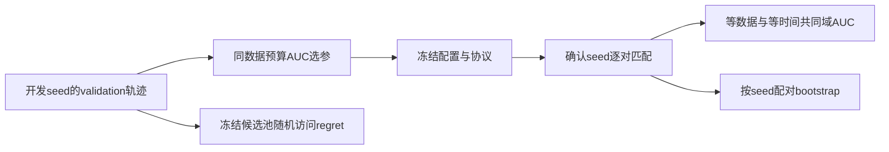
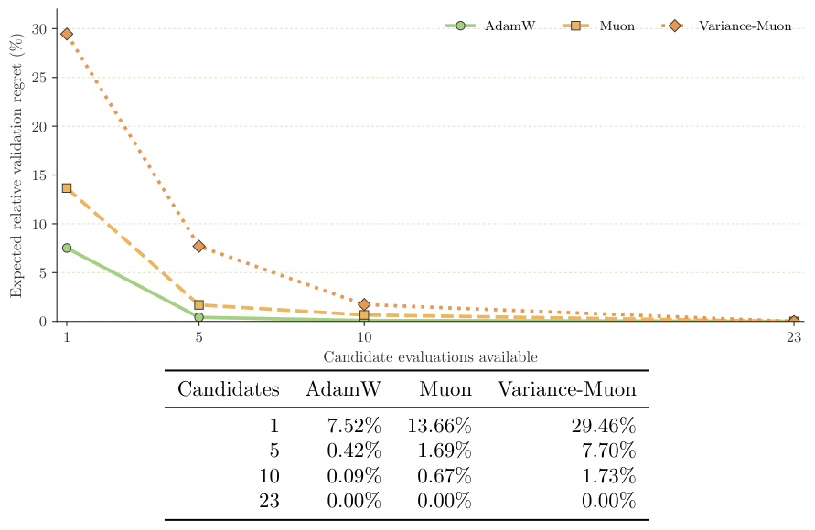

# Muon paired-budget：数据、时间与调参预算的公平比较

## 论文信息

| 字段 | 内容 |
| --- | --- |
| 论文链接 | [arXiv 2610.21555](https://arxiv.org/abs/2610.21555)；[v1 PDF](https://arxiv.org/pdf/2610.21555v1) |
| 原文标题 | When Does Muon Actually Win? A Paired Data-, Time-, and Tuning-Budget Benchmark |
| 公司/机构 | 一作 Mushir Akhtar：原文首页仅列个人邮箱，未列机构；不得用合作者的HBKU等单位替代一作机构 |
| 首次公开日期 | 2026-10-15；`2026-10-15T09:15:49Z` |
| 原文开源代码 | 本轮未找到可确认的原作者实验仓库或许可证；论文引用Muon上游不等于本实验代码发布 |
| Adapter | `muon-paired-budget`（目录键）；`adapter: null`，非训练adapter或可执行evolve operator |
| 本地复现代码目录 | `src/auto_research/foundation_models/muon_paired_budget.py`；`scripts/run_oct17_supplement_protocols.py` |
| 实现状态 | `evaluation_protocol_interface`，仅固定轨迹评测；L1机制诊断；不可晋级 |
| 完整实验 | 成本过高，不复现（审查 DONE）；`not_reproduced_high_cost` |

## 原始论文总结

### 背景与主要改动

优化器每步效果更好不等于同时间更好，也不意味着更容易调参。论文在单A100上对齐初始化、数据顺序和开发候选数，分别比较数据、训练时间、冻结调参池三种预算。它不是新的Muon优化公式，主要贡献是谨慎分离比较口径。测试数据在选参和轨迹分析冻结后只评一次。



<!-- paper-figure:start -->
### 原论文关键图

[](https://arxiv.org/pdf/2610.21555v1#page=6)

> **原论文 Figure 3（关键图）**：展示原论文方法的总体设计和关键组成。图片来自[原论文](https://arxiv.org/abs/2610.21555)，版权归原作者所有；点击图片可查看来源。
<!-- paper-figure:end -->

### 核心公式

以记录的验证损失对已处理数据或实际训练秒数作线性插值，在共同测量域 $[0,H]$ 比较：

$$
\operatorname{AUC}_o(H)=\frac1H\int_0^H L_o(x)\,dx,
\qquad
\operatorname{gain}=1-\frac{\operatorname{AUC}_{\mathrm{alternative}}}{\operatorname{AUC}_{\mathrm{reference}}}.
$$

开发阶段只按data-AUC、最终validation loss、run ID依次选参；不能为时间比较重新挑最优配置。稳定交叉点为首个观测点，其后全部观测点均至少优于对照1%。配对bootstrap必须在两策略中抽相同seed索引。冻结候选池随机访问的regret为：

$$
\operatorname{regret}(b)=\frac{\min_{i\leq b}A_{\pi_i}-\min_i A_i}{|\min_i A_i|}.
$$

原文平均10,000个随机排列；这不是前瞻自适应HPO，也不等价于相同调参时间。训练时钟须先扣除validation、序列化和日志；Muon计时必须包含辅助AdamW更新，不只算正交化。

### 论文离线与线上效果

原文17.7M/33.6M因果LM用FineWeb-Edu，2.70M ViT用balanced和100:1 CIFAR-100。23个开发候选后做五个匹配确认seed。等数据AUC的Muon提升3.25–22.44%；等时间AUC在视觉好19.68–22.31%，语言反而AdamW好3.38–6.96%。这些结果仅适用于参考kernel、小模型、固定任务和候选池，不可外推8B或优化分布式kernel。线上 A/B：未报告。

## 本地复现

### 数据协议与运行

不训练Muon/AdamW、不下载FineWeb/CIFAR。固定合成轨迹revision `synthetic-agent-cards-and-validation-trajectories@oct17-supplement-protocols-v1`，seeds42/43/44；每seed构造可手算的分段线性validation曲线、较慢但等数据更优的替代策略、三个合成配对replication IDs，以及23个固定候选AUC。三种子是协议随机性诊断，不是模型稳定提升。

```bash
PYTHONPATH=src python scripts/run_oct17_supplement_protocols.py \
  --papers muon-paired-budget --seeds 42,43,44 \
  --output runs/oct17-supplement/muon-budget-cpu.json
```

### 结果与独立对照

CPU三种子与定向测试通过。seed42解析AUC最大误差0；同一组合成轨迹的等数据gain为0.15975、等时间gain为−0.18729，正确保留口径反转。配对bootstrap在固定0.8比例的解析例上误差约`1.67e-16`；23候选全预算regret为0；错配seed、NaN、重复预算和超出测量域均拒绝。负例不被丢弃。实际模型训练数为0。[CPU诊断记录](metrics/component-cpu-seeds42-44.json)不包含论文成绩移植。

### 代码映射与边界

`ValidationTrajectory` 只接收validation loss和预算；`select_by_validation_data_auc` 要求唯一候选、一个开发seed和等data horizon，防止短失败任务被当公平候选。`paired_budget_comparison`、`stable_data_crossover`、`paired_relative_gain_interval`、`frozen_pool_regret` 分别执行共同域比较、观测交叉、配对重采样及冻结池审计。测试在 `tests/foundation_models/test_muon_paired_budget.py`，含小候选池穷举排列对照。

尚未连接evolve控制器或训练时钟采集器，不自动改变模型选择。完整论文含12个workload–strategy cell×23个开发候选，再加LM 5,000步、ViT100epochs、多种子确认与附加审计；按可用单卡预算，**完整实验成本过高，不复现（审查 DONE）**。这里的标准库评测接口无需CUDA，不能拿它作为Muon训练的GPU验收。
