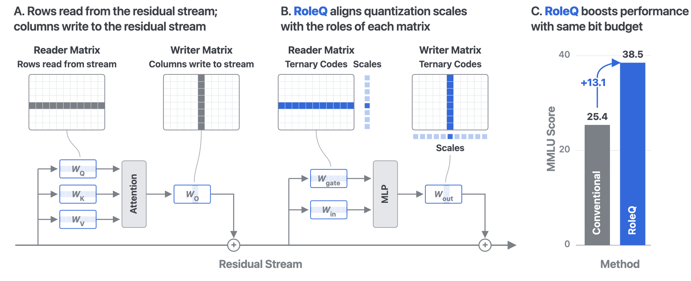

# RoleQ: role-aligned axes, exact vector ternarization, and actual storage accounting

<!-- source-sha256: 969b553419ecd76abdb616cdc4ff5259bdce3254bb6543533de000645e6b7d6e -->

[简体中文](README.md)

## Paper information

| Field | Details |
| --- | --- |
| Paper | [arXiv 2610.21808](https://arxiv.org/abs/2610.21808); [v1 full text](https://arxiv.org/html/2610.21808v1) |
| Original title | RoleQ: Role-Aligned Scales for Converting Language Models to Ternary |
| Organization | First author Johannes Knittel, Harvard University; collaborators include Georgia Tech |
| First public release | October 15, 2026; `2026-10-15T12:56:57Z` |
| Authors' code | No author-released method implementation or verifiable license was found. The local component independently implements the paper's equations. |
| Adapter | `roleq` (directory key); `adapter: null` |
| Local reproduction code | `src/auto_research/foundation_models/roleq.py`; `scripts/run_oct17_foundation_components.py` |
| Implementation status | `component_only`, L1 mechanism diagnostic; not integrated into evolve |
| Full experiments | Not reproduced due to cost (review complete); `not_reproduced_high_cost` |

## Original paper

### Motivation and method

Always using per-row scales based on matrix layout mixes distinct functional units that write to the residual stream. RoleQ chooses the axis according to function: readers (Q/K/V and the MLP input) use one scale per output unit; writers (O and the MLP output) use one scale per input unit. Full RoleQ-T additionally needs rotation, GPTQ, distillation, and an optional Fisher two-plane method. A standalone quantization function does not replace that pipeline.

~~~mermaid
flowchart LR
  A[Declare reader or writer explicitly] --> B[Extract functional row or column vectors]
  B --> C[Search all prefixes by descending absolute weight]
  C --> D[Exact support, scale and ternary codes]
  D --> E[Pack five trits per byte]
  E --> F[Reconstruct and account for actual storage]
~~~

<!-- paper-figure:start -->
### Key figure from the paper

> **Figure 1:** Overview of the method and its principal components. From the [original paper](https://arxiv.org/abs/2610.21808); copyright remains with the authors. Click the figure to see the source.
<!-- paper-figure:end -->

### Core equations

For a vector $w$, let $S$ range over nonempty prefixes ordered by decreasing $|w|$:

$$
S^*=\arg\max_S\frac{(\sum_{i\in S}|w_i|)^2}{|S|},\quad a^*=\frac{\sum_{i\in S^*}|w_i|}{|S^*|},\quad t_i=\operatorname{sign}(w_i)\mathbf1[i\in S^*].
$$

Reader reconstruction is $\operatorname{diag}(a)T$; writer reconstruction is $T\operatorname{diag}(a)$. An all-zero vector yields a zero scale and zero codes. The solution is exact for the independent, unweighted vector objective; neither the overall GPTQ procedure nor the resulting model is claimed to be globally optimal.

### Paper results

The paper compares WikiText2 perplexity, seven zero-shot tasks, and MMLU. Perplexity alone can miss loss of knowledge, and the resident bit count must include required metadata such as scales. Converting a full 8B model takes hours. No complete-model results were rerun locally, and no online A/B test is reported.

## Local reproduction

### Data protocol and run instructions

Seeds are fixed at 42, 43, and 44. The synthetic formula revision is `synthetic-formula-and-bit-patterns@oct17-foundation-components-v1`; there is no pretrained model or capability dataset. To independently verify the optimum, the runner enumerates all 81 ternary code vectors of length 4; the unit test enumerates 243 at length 5. A 7×11 matrix tests the role axis and packing/unpacking.

~~~bash
PYTHONPATH=src python scripts/run_oct17_foundation_components.py \
  --papers roleq --device cpu --seeds 42,43,44 \
  --output runs/oct17-foundation/roleq-cpu.json
~~~

### Results and independent control

Targeted CPU tests passed, and the diagnostic ran on a real NVIDIA A100 for three seeds. At GPU seed 42, the exact solution and exhaustive search had identical loss, and the writer and transposed-reader reconstructions had a maximum error of zero. The exact solution's loss was `0.861729`, compared with `1.109967` for a threshold fixed at 0.7 times the mean. The threshold rule is not presented as an exact solver.

The example uses FP64 scales. For 77 weights it stores 16 bytes of packed codes and 56 bytes of scales, or `7.48052 bits/weight`. The final three trits are padding. This is **not a full model at 1.59 bits per weight**. `log2(3)` is listed separately as an information-theoretic lower bound, not actual storage. The [CUDA diagnostic](metrics/component-cuda-seeds42-44.json) and [real GPU receipt](../../gpu-validations/roleq-a100-20261017.json) record the device, seeds, measurements, and source identity.

### Code mapping and limits

`exact_ternary_fit` implements the Equation 1 prefix search. `quantize_by_role` implements the explicit role axis in Equation 2 and rejects unknown roles. `RoleQuantized` stores only the five-trits-per-byte payload, scales in their actual dtype, the shape, and the role; it materializes the codes only on decode. `bit_accounting` includes the actual payload, scales, and padding, but explicitly excludes Python shape/role header overhead. It is not total process memory.

Rotation, Hessian/GPTQ compensation, reader-scale refitting, scale distillation, Fisher two-plane quantization, real model conversion, and low-bit GEMM are not implemented. This component cannot be used to claim an improvement in evolve. The paper's 8B conversion takes 3–4 A100 hours and its two-plane stage takes under 10 hours. **Full experiments were not reproduced due to cost (review complete).** `diagnostic_only: true` and `promotion_eligible: false`.
