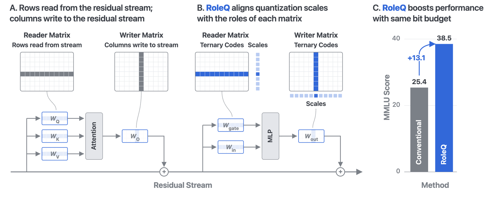

# RoleQ：角色轴、精确三值单向量解与实际存储记账

## 论文信息

| 字段 | 内容 |
| --- | --- |
| 论文链接 | [arXiv 2610.21808](https://arxiv.org/abs/2610.21808)；[v1 全文](https://arxiv.org/html/2610.21808v1) |
| 原文标题 | RoleQ: Role-Aligned Scales for Converting Language Models to Ternary |
| 公司/机构 | 一作 Johannes Knittel：Harvard University；协作含 Georgia Tech |
| 首次公开日期 | 2026-10-15；`2026-10-15T12:56:57Z` |
| 原文开源代码 | 未找到作者发布的方法实现或可核验许可证；本地按原文公式独立实现 |
| Adapter | `roleq`（目录键）；`adapter: null` |
| 本地复现代码目录 | `src/auto_research/foundation_models/roleq.py`；`scripts/run_oct17_foundation_components.py` |
| 实现状态 | `component_only`、L1 机制诊断；不接入 evolve |
| 完整实验 | 成本过高，不复现（审查 DONE）；`not_reproduced_high_cost` |

## 原始论文总结

### 背景与主要改动

按矩阵布局统一逐行放scale，会把写入残差流的不同功能单元混在一起。RoleQ按功能角色选轴：reader（Q/K/V与MLP输入）每输出单元一scale，writer（O与MLP输出）每输入单元一scale。完整RoleQ-T还需要旋转、GPTQ、蒸馏及可选Fisher二平面，不能以单个量化函数替代。


<!-- paper-figure:start -->
### 原论文关键图

[](https://arxiv.org/html/2610.21808v1/figures/roleq-teaser.png)

> **原论文 Figure 1（关键图）**：展示原论文方法的总体设计和关键组成。图片来自[原论文](https://arxiv.org/abs/2610.21808)，版权归原作者所有；点击图片可查看来源。
<!-- paper-figure:end -->

### 核心公式

对向量 $w$，令 $S$ 遍历按 $|w|$ 降序的非空前缀：

$$
S^*=\arg\max_S\frac{(\sum_{i\in S}|w_i|)^2}{|S|},\quad a^*=\frac{\sum_{i\in S^*}|w_i|}{|S^*|},\quad t_i=\operatorname{sign}(w_i)\mathbf1[i\in S^*].
$$

reader重建为 $\operatorname{diag}(a)T$，writer为 $T\operatorname{diag}(a)$。全零向量输出零scale/零码。这里精确的是独立向量未加权目标，不声称整体GPTQ或量化后的模型是全局最优。

### 论文离线与线上效果

论文在WikiText2 perplexity、七任务zero-shot和MMLU比较，强调只看perplexity会漏掉知识损失，且resident bits必须包含必要scale等metadata。8B整套转换为小时级；这些完整模型数字没有在本地重测。线上A/B：未报告。

## 本地复现

### 数据协议与运行

固定seeds42/43/44；合成公式revision `synthetic-formula-and-bit-patterns@oct17-foundation-components-v1`，无预训练模型或能力数据。runner用长度4向量全部81种三值码独立穷举全局最优；单测长度5、243码。7×11矩阵用于角色轴与pack/unpack。

```bash
PYTHONPATH=src python scripts/run_oct17_foundation_components.py \
  --papers roleq --device cpu --seeds 42,43,44 \
  --output runs/oct17-foundation/roleq-cpu.json
```

### 结果与独立对照

CPU定向测试通过，并已在真实 NVIDIA A100 上执行三个种子。GPU seed42精确解与穷举loss差0，writer等于转置后reader的重建最大误差0；精确loss `0.861729`，固定0.7均值阈值对照loss `1.109967`。没有用阈值法冒充精确solver。

示例使用FP64 scales，77权重需要16 bytes实际打包码和56 bytes scale，共 `7.48052 bits/weight`；最后3个trits是padding。它**不是1.59 bpw整模型**。`log2(3)`仅作为信息下界另列，不充当实际存储。[CUDA诊断记录](metrics/component-cuda-seeds42-44.json) 与[真实GPU回执](../../gpu-validations/roleq-a100-20261017.json) 保存设备、种子、真实测量与源码身份。

### 代码映射与边界

`exact_ternary_fit` 为公式1前缀搜索；`quantize_by_role` 为公式2显式角色轴，未知角色拒绝；`RoleQuantized` 只保存5trits/byte payload、实际dtype scales、shape及role，解码后才物化码。`bit_accounting` 包含真实payload、scale及padding，明确排除Python shape/role header开销，不是总进程内存。

未实现旋转、Hessian/GPTQ补偿、reader scale refit、scale distillation、Fisher二平面、真实模型转换或低bit GEMM；不能把本组件挂入evolve宣称提升。原文8B转换3–4 A100小时、二平面阶段不足10小时，完整实验**成本过高，不复现（审查 DONE）**。`diagnostic_only: true`、`promotion_eligible: false`。
