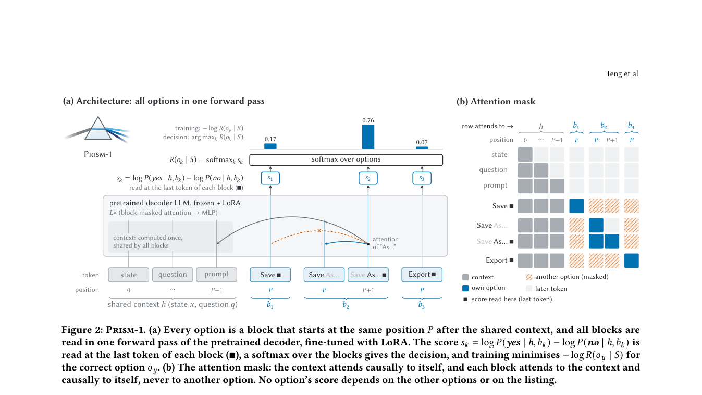

# Prism-1: Single-step decisions with isolated options

<!-- source-sha256: 29cbdd61c3845f2ebf28f3e915ae88661fb0799dff4596d434699d6e95e6ed1f -->

[简体中文](README.md)

## Paper information

| Field | Details |
| --- | --- |
| Paper links | [arXiv 2610.22066](https://arxiv.org/abs/2610.22066); [v1 full text](https://arxiv.org/html/2610.22066v1) |
| Original title | Prism-1: Position- and Rival-Independent Scoring for System One Models |
| Company / institution | First author Yao Long Teng: Nanyang Technological University; Jianguo Huang is co-first author |
| First public release | 2026-10-15; `2026-10-15T15:28:30Z`, distinct from the October 16 announcement |
| Author code | No verifiable author repository or license found. Repositories of other cited models are not Prism-1 code. |
| Adapter | Catalog key `prism-1`; `adapter: null`, no reproduction CLI or Evolve operator |
| Local implementation | `src/auto_research/foundation_models/prism_one.py`; `scripts/run_oct17_supplement_foundation.py` |
| Implementation status | `component_only`, L1 diagnostic; `diagnostic_only: true`, `promotion_eligible: false` |
| Full experiment | Reviewed and not reproduced because of cost; `not_reproduced_high_cost` |

## Paper summary

### Background and main changes

JEV/System One models aim to select a tool, intent, or interface element in one forward pass. Ordinary multiple-choice prompts can depend on order and irrelevant options. Sections 2–4 derive from Luce's choice axiom that each score depends only on shared state, question, and the option itself. A softmax combines independent scores. Softmax alone cannot guarantee this without attention isolation and position reset.

~~~mermaid
flowchart LR
  H[Shared state and question] --> B[Independent causal block per option]
  B --> P[Same starting positions for all blocks]
  P --> Y[Final-token yes/no log odds]
  Y --> S[Softmax across options]
~~~

<!-- paper-figure:start -->
### Original paper figure

> **Paper Figure 2:** Shared context, option-isolating attention mask, reset positions, and yes/no odds. From the [original paper](https://arxiv.org/abs/2610.22066); copyright remains with the authors. Click the image to open its source.
<!-- paper-figure:end -->

### Core equations

Relative odds among existing options do not change when other options are added:

$$
R(o_k\mid x,q,S)=\frac{\exp s(x,q,o_k)}{\sum_{j\in S}\exp s(x,q,o_j)}.
$$

Each block uses left-to-right attention and can see shared context but no other option. All blocks start at the same position index. Read the last token of each block:

$$
s(o_k)=\log P(\mathrm{yes}\mid h,b_k)-\log P(\mathrm{no}\mid h,b_k).
$$

Train cross-entropy on the choice distribution; inference produces no chain of thought. Adding an option can change the denominator or winner, but should not swap ranks of existing options. The axiom does not suit tasks such as “none of the above” that require comparisons and does not protect shared context from injection.

### Offline and online results reported in the paper

Qwen3-8B and Gemma 4 12B use Banking20, 20 Newsgroups, BEV, Typed Decisions, and held-out JevBench. The same 9,100 training examples compare SCQ, order/rotation readers, and Set-LLM. Prism-1 is within about one point of trained SCQ in original order, with a 2–4 point improvement under reordering stability, but is 3.6/4.1 points worse than SCQ on held-out JevBench. Report this transfer negative alongside invariance. No online A/B is reported.

## Local reproduction

### Data protocol and execution

No data or weights downloaded. Revision `synthetic-packed-options-and-noisy-tokens@oct17-supplement-foundation-v1`, seeds 42/43/44. A randomly initialized real Transformer uses shared absolute positional embeddings, two layers, width 24, and three heads, with three integer-token options of different lengths. One arbitrary-label cross-entropy update checks gradients, not test answers or capability.

~~~bash
PYTHONPATH=src python scripts/run_oct17_supplement_foundation.py \
  --papers prism-1 --device cpu --seeds 42,43,44 \
  --output runs/oct17-supplement/prism-1-cpu.json
~~~

`--device cuda` fails if unavailable; no CPU fallback. Output cannot be overwritten and records per-seed metrics, source SHA-256, commit, and actual device. This does not run author 8B/12B models.

### Results and independent comparison

Targeted CPU tests and real A100 seeds 42/43/44 passed. Packed forward is compared with a separate ordinary causal Transformer pass per option. Reordering and adding options preserve original scores. An ordinary concatenated causal mask leaks other options as a negative control. No task accuracy was evaluated. See [diagnostics](metrics/component-cuda-seeds42-44.json) and [GPU receipt](../../gpu-validations/prism-1-supplement-a100-20261017.json) for device, commit, and source hashes.

### Code mapping and limits

`pack_options` builds inputs, shared positions, block masks, and final-token indices. `PrismOneScorer` executes a trainable Transformer; `choice_diagnostics` compares conditional distributions without gold. Tests are in `tests/foundation_models/test_oct17_supplement_foundation.py`.

No tokenizer, Qwen/Gemma LoRA, public benchmark accuracy, or vLLM serving. The paper uses two to three seeds per model/method and 50–85 minutes per H100 run. The full multi-arm study is outside the budget and **was reviewed and not reproduced because of cost**. No Evolve integration, and three diagnostic seeds are not model-effect evidence.
