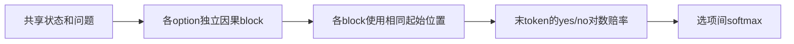
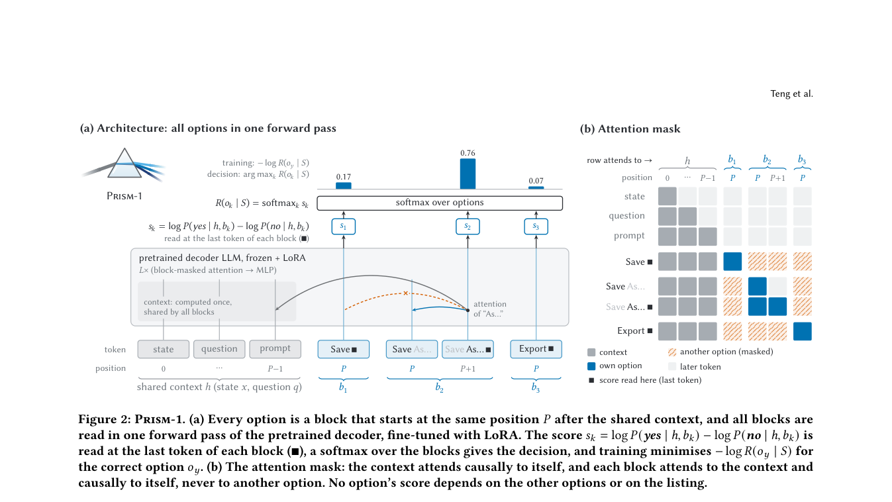

# Prism-1：隔离选项的单步决策组件

## 论文信息

| 字段 | 内容 |
| --- | --- |
| 论文链接 | [arXiv 2610.22066](https://arxiv.org/abs/2610.22066)；[v1 全文](https://arxiv.org/html/2610.22066v1) |
| 原文标题 | Prism-1: Position- and Rival-Independent Scoring for System One Models |
| 公司/机构 | 一作 Yao Long Teng：Nanyang Technological University；Jianguo Huang 为共同一作 |
| 首次公开日期 | 2026-10-15；`2026-10-15T15:28:30Z`，不同于 10-16 公告日 |
| 原文开源代码 | 本轮未找到可确认的原作者方法仓库或代码许可证；论文引用的其他模型仓库不等于 Prism-1 代码 |
| Adapter | `prism-1`（目录键）；`adapter: null`，没有注册 reproduction CLI 或 evolve operator |
| 本地复现代码目录 | `src/auto_research/foundation_models/prism_one.py`；`scripts/run_oct17_supplement_foundation.py` |
| 实现状态 | `component_only`；L1 机制诊断；`diagnostic_only: true`、`promotion_eligible: false` |
| 完整实验 | 成本过高，不复现（审查 DONE）；`not_reproduced_high_cost` |

## 原始论文总结

### 背景与主要改动

JEV/System One 选择模型希望在一次前向中选出工具、意图或界面元素。普通多选提示会让答案依赖选项顺序和无关选项。§2–4 由 Luce 选择公理推导：每个选项的分数只能看共享状态、问题和该选项本身；最后对独立分数做 softmax。只在输出层加 softmax、不隔离 attention 或不重置位置，都不能保证这一性质。



<!-- paper-figure:start -->
### 原论文关键图

[](https://arxiv.org/pdf/2610.22066#page=4)

> **原论文 Figure 2（关键图）**：共享 context、选项隔离 attention mask、重置位置及 yes/no 赔率读出。图片来自[原论文](https://arxiv.org/abs/2610.22066)，版权归原作者所有；点击图片可查看来源。
<!-- paper-figure:end -->

### 核心公式

选项间的相对赔率不随加入其他选项而变化：

$$
R(o_k\mid x,q,S)=\frac{\exp s(x,q,o_k)}{\sum_{j\in S}\exp s(x,q,o_j)}.
$$

每个选项仅在自己的 block 内作普通从左到右 attention，能看共享 context，但不能看任何其他选项。各 block 从相同位置编号开始。分数读取该 block 最后一个 token：

$$
s(o_k)=\log P(\mathrm{yes}\mid h,b_k)-\log P(\mathrm{no}\mid h,b_k).
$$

训练对选项分布作交叉熵；推理不生成思维链。新增选项可以改变总分母或成为新赢家，但不应让原选项互换排名。该公理不适合“以上皆非”等必须跨选项比较的任务，也不保护共享状态中的注入。

### 论文离线与线上效果

原文在 Qwen3-8B、Gemma 4 12B 上，使用 Banking20、20 Newsgroups、BEV、Typed Decisions 与 held-out JevBench，同一9,100条训练数据比较 SCQ、排序/轮换读法和 Set-LLM。Prism-1 在来源顺序准确率上与训练 SCQ 相差约1点以内，重排稳定口径好2–4点；但 held-out JevBench 比 SCQ 低3.6/4.1点。不能只报告不变性而隐去迁移负结果。线上 A/B：未报告。

## 本地复现

### 数据协议与运行

不下载数据或权重。固定 revision `synthetic-packed-options-and-noisy-tokens@oct17-supplement-foundation-v1`；seeds42/43/44。真实微型 Transformer 用随机初始化、共享绝对位置嵌入、2层、24维、3 heads；三个不同长度的整数 token 选项。一次任意标签交叉熵更新只检查梯度，不是测试答案或任务能力评估。

```bash
PYTHONPATH=src python scripts/run_oct17_supplement_foundation.py \
  --papers prism-1 --device cpu --seeds 42,43,44 \
  --output runs/oct17-supplement/prism-1-cpu.json
```

`--device cuda` 不可用时明确失败，无 CPU 回退。输出不可覆盖，保存逐 seed 指标、源码 SHA-256、提交和实际设备；不是直接运行8B/12B作者模型。

### 结果与独立对照

定向 CPU 测试及真实 NVIDIA A100 的 seeds42/43/44 机制验收通过：packed 前向与“每个选项单独跑普通因果 Transformer”比较；重排选项、新增选项均保持原分数；改成普通拼接因果 mask 后会泄漏其他选项，作为负对照。实际任务正确率未评估。[诊断指标](metrics/component-cuda-seeds42-44.json)与[GPU回执](../../gpu-validations/prism-1-supplement-a100-20261017.json)保存实际设备、提交与执行源码哈希。

### 代码映射与边界

`pack_options` 构造输入、共享位置、block mask 和末token索引；`PrismOneScorer` 实际执行可训练 Transformer；`choice_diagnostics` 比较原选项条件分布，不接触 gold。测试位于 `tests/foundation_models/test_oct17_supplement_foundation.py`。

没有 tokenizer、Qwen/Gemma LoRA、公开 benchmark 准确率或 vLLM serving。作者每模型/方法使用2–3种子，单次 H100 50–85分钟，完整多臂训练和评估超出本轮预算，**成本过高，不复现（审查 DONE）**。未接入 evolve；三个诊断种子不构成模型效果证据。
