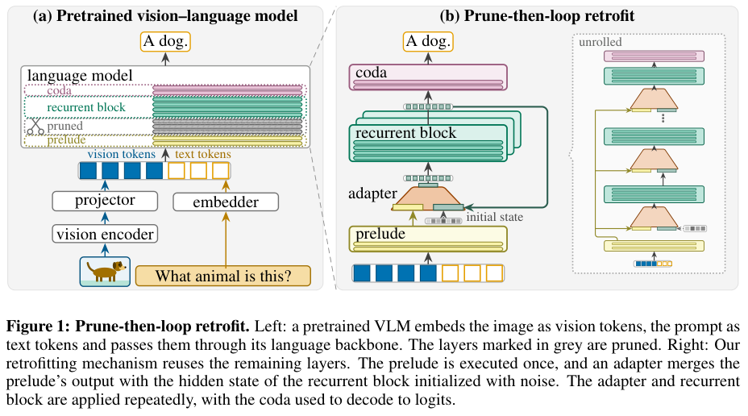

# RR-VLM: Prune-then-loop retrofitting and staged recovery

<!-- source-sha256: 0f3ece4656f4e84850beb70e4a3f9daf49619738cec5f8a44fc9e475c3d0339b -->

[简体中文](README.md)

## Paper information

| Field | Details |
| --- | --- |
| Paper links | [arXiv 2610.22075](https://arxiv.org/abs/2610.22075); [v1 full text](https://arxiv.org/html/2610.22075v1) |
| Original title | Retrofitting Recurrent Vision-Language Models from Pretrained Backbones |
| Company / institution | First author Madhav Iyengar: University of Tübingen / Tübingen AI Center; collaboration with KE:SAI |
| First public release | 2026-10-15; `2026-10-15T15:34:27Z` |
| Author code | [Official project page](https://madhavesdios.github.io/recurrent-vlms/) says Code (coming soon). No verifiable implementation or license found at review. |
| Adapter | Catalog key `rr-vlm`; `adapter: null`, no reproduction CLI or Evolve operator |
| Local implementation | `src/auto_research/foundation_models/rr_vlm.py`; `scripts/run_oct18_foundation_components.py` |
| Implementation status | `component_only`, L1 diagnostic; `diagnostic_only: true`, `promotion_eligible: false` |
| Full experiment | Reviewed and not reproduced because of cost; `not_reproduced_high_cost` |

## Paper summary

### Background and main changes

One can remove a span of language layers from a pretrained VLM and loop a retained shared block, but direct surgery disrupts language and image-text alignment. RR-VLM fuses prelude context and recurrent state with a linear adapter, then performs text recovery, projector alignment, and full-model instruction recovery. Text and final recovery also distill from the original unpruned teacher.

~~~mermaid
flowchart LR
  X[Text and visual projections] --> P[Prelude]
  P --> A[Concatenate context and recurrent state]
  A --> R[Linear adapter and shared core]
  R --> A
  R --> C[Coda and vocabulary output]
  T[Frozen unpruned teacher] --> D[CE plus KL recovery]
  C --> D
~~~

<!-- paper-figure:start -->
### Original paper figure

> **Paper Figure 1:** Original versus retrofitted VLM, with contiguous pruning, prelude, adapter, shared loop, coda, and unrolling. From the [original paper](https://arxiv.org/abs/2610.22075); copyright remains with the authors. Click the image to open its source.
<!-- paper-figure:end -->

### Core equations

$$
h=P(u),\quad s_0\sim\mathcal N(0,\sigma^2I),\quad
s_k=B(W[s_{k-1};h]),\quad y=C(s_r).
$$

Traversal depth is $p+rb+c$ with only $p+b+c$ unique stored layers. Recovery loss is

$$
L=(1-\lambda)L_{CE}+\lambda T^2\mathrm{KL}(\mathrm{softmax}(F/T)\|\mathrm{softmax}(F^r/T)).
$$

The teacher is frozen and detached. Projector alignment omits KD. The full paper also discusses sharing KV across loops; that incremental-inference feature is not implemented locally.

### Offline and online results reported in the paper

Pruning and looping TinyLLaVA-1.4B removes 23.3% of language parameters. Main-table aggregate score is 58.13 versus 55.80 for the unpruned baseline with the same recovery data. Parameter compression is not fewer inference FLOPs; recurrence can increase compute and KV cost. No online A/B is reported.

## Local reproduction

### Data protocol and execution

Seeds 42/43/44, revision `synthetic-memory-spatial-vision-recurrence-and-ode@oct18-foundation-mechanisms-v1`. A random six-layer width-16 causal Transformer loses two contiguous layers and keeps a 1/2/1 prelude/core/coda, with three core loops. Two synthetic text and visual inputs test structure and optimization, not capability.

~~~bash
PYTHONPATH=src python scripts/run_oct18_foundation_components.py \
  --papers rr-vlm --device cpu --seeds 42,43,44 \
  --output runs/oct18-components/rr-vlm-cpu.json
~~~

### Results and independent comparison

CPU confirms manual unroll equals forward, the same core is called the requested times, and one-loop negative control differs. Three actual SGD stages update language adapter, visual projector, then language adapter. Stage 0 has no vision; Stage 1 omits KD. Teacher embedding, projector, every original layer, and output are independent frozen copies; outputs do not change after the three steps.

All real A100 seeds 42/43/44 passed, with zero maximum manual-unroll error and teacher change. Every stage updated at every seed. Across stages and seeds, gradient norm is at least 0.9336 and update norm at least 0.009336. Single-loop output differs by 1.0528–1.4660 from three loops. See [per-seed diagnostics](metrics/component-cuda-seeds42-44.json) and [GPU receipt](../../gpu-validations/rr-vlm-a100-20261018.json). This is L1 execution and gradient evidence, not a vision benchmark.

### Code mapping and limits

`RetrofittedRecurrentVLM` performs contiguous surgery and shared looping; `configure_stage` selects trainable parameters; `teacher_logits` runs the full teacher without gradients; `recovery_loss` implements temperature-scaled CE/KL. No TinyLLaVA, pretrained visual tower, real image/text data, author Muon, alternating vision-language data ratio, or cache sharing.

The full paper uses 60B text recovery tokens, 493K alignment and 660K instruction examples. Even if a 1.4B model fits on one card, full recovery remains expensive. **Reviewed and not reproduced because of cost.** No Evolve promotion.
