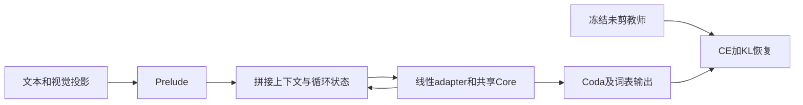
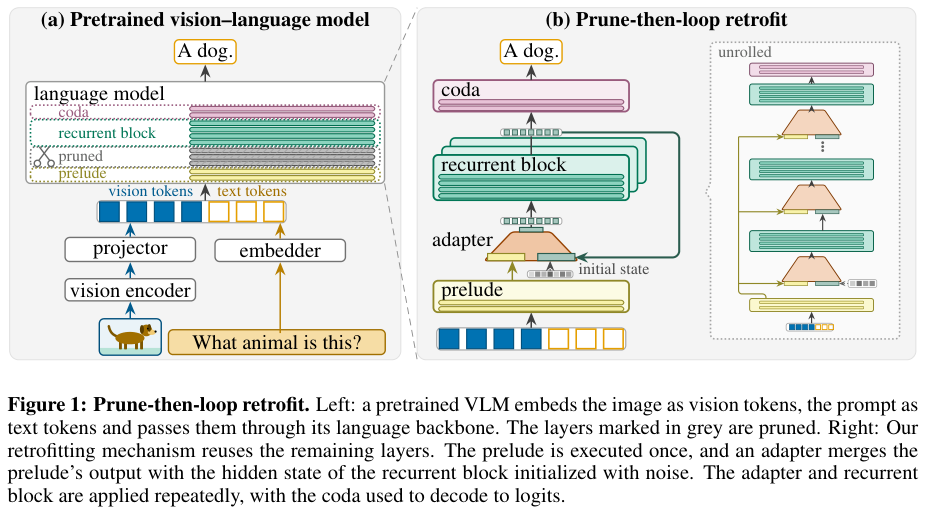

# RR-VLM：剪枝后循环与分阶段恢复

## 论文信息

| 字段 | 内容 |
| --- | --- |
| 论文链接 | [arXiv 2610.22075](https://arxiv.org/abs/2610.22075)；[v1 全文](https://arxiv.org/html/2610.22075v1) |
| 原文标题 | Retrofitting Recurrent Vision-Language Models from Pretrained Backbones |
| 公司/机构 | 一作 Madhav Iyengar：University of Tübingen / Tübingen AI Center；合作 KE:SAI |
| 首次公开日期 | 2026-10-15；`2026-10-15T15:34:27Z` |
| 原文开源代码 | [官方项目页](https://madhavesdios.github.io/recurrent-vlms/)明确标注 Code (coming soon)；本轮未发布可核验的方法代码或许可证 |
| Adapter | `rr-vlm`（目录键）；`adapter: null`，未注册 reproduction CLI/evolve operator |
| 本地复现代码目录 | `src/auto_research/foundation_models/rr_vlm.py`；`scripts/run_oct18_foundation_components.py` |
| 实现状态 | `component_only`；L1 机制诊断；`diagnostic_only: true`、`promotion_eligible: false` |
| 完整实验 | 成本过高，不复现（审查 DONE）；`not_reproduced_high_cost` |

## 原始论文总结

### 背景与主要改动

预训练 VLM 的语言层可以剪掉一段，再共享循环保留核心块；但直接手术会破坏语言能力及图文对齐。RR-VLM 用一个线性 adapter 融合 prelude 上下文与循环状态，并依次执行文本恢复、projector 对齐、全模型指令恢复；文本和最终阶段加入原始未剪模型蒸馏。



<!-- paper-figure:start -->
### 原论文关键图

[](https://arxiv.org/pdf/2610.22075v1#page=2)

> **原论文 Figure 1（关键图）**：原始 VLM 与 prune-then-loop retrofit 架构对比，完整保留连续剪枝、prelude、adapter、共享循环核心、coda 和展开路径。图片来自[原论文](https://arxiv.org/abs/2610.22075)，版权归原作者所有；点击图片可查看来源。
<!-- paper-figure:end -->

### 核心公式

$$
h=P(u),\quad s_0\sim\mathcal N(0,\sigma^2I),\quad
s_k=B(W[s_{k-1};h]),\quad y=C(s_r).
$$

遍历深度为 $p+rb+c$，只储存 $p+b+c$ 个不同层。恢复损失为

$$
L=(1-\lambda)L_{CE}+\lambda T^2\mathrm{KL}(\mathrm{softmax}(F/T)\|\mathrm{softmax}(F^r/T)).
$$

教师冻结且停止梯度；projector 对齐阶段不加 KD。完整论文另讨论循环间 KV sharing，本地未实现该增量推理功能。

### 论文离线与线上效果

TinyLLaVA-1.4B 剪枝并循环后，语言参数减少23.3%；主表聚合分数58.13，对同恢复数据的未剪基线55.80。参数压缩不等于推理 FLOPs 降低，循环还会增加计算与 KV 负担。线上 A/B：未报告。

## 本地复现

### 数据协议与运行

seeds42/43/44；revision `synthetic-memory-spatial-vision-recurrence-and-ode@oct18-foundation-mechanisms-v1`。随机6层、16维因果 Transformer，连续删除2层，保留1/2/1的 prelude/core/coda，核心循环3次。2条随机文本与视觉特征只检查结构和优化路径，不是模型能力数据。

```bash
PYTHONPATH=src python scripts/run_oct18_foundation_components.py \
  --papers rr-vlm --device cpu --seeds 42,43,44 \
  --output runs/oct18-components/rr-vlm-cpu.json
```

### 结果与独立对照

CPU 已核对手工展开 recurrence 与模型前向等价、同一核心模块按循环次数被调用、单次展开负对照不同。三阶段真实 SGD 分别更新语言adapter、视觉projector和语言adapter；stage0严格无视觉输入，stage1不使用KD。教师 embedding/projector/全部原始层/output 均有独立冻结副本，三次更新后教师输出不变。

真实 NVIDIA A100 上 seeds42/43/44 全部通过：手工展开循环的最大误差和冻结教师变化均为0。每个 seed 的三阶段都实际完成更新；跨三种子和三个阶段，梯度范数至少0.9336、更新范数至少0.009336。单次展开负对照与三次循环的输出差异为1.0528–1.4660。完整逐 seed 数据见[诊断指标](metrics/component-cuda-seeds42-44.json)和[GPU 回执](../../gpu-validations/rr-vlm-a100-20261018.json)。这些是 L1 执行与梯度证据，不支持原论文视觉 benchmark 分数。

### 代码映射与边界

`RetrofittedRecurrentVLM` 实施连续层手术及共享循环；`configure_stage` 控制可训练参数；`teacher_logits` 无梯度执行完整教师；`recovery_loss` 实现温度缩放 CE/KL。未加载 TinyLLaVA、预训练视觉塔、实际图文数据，也未实现作者 Muon 优化器、视觉语言交替数据比例和缓存共享。

原文文本恢复60B token，加493k对齐及660k指令样本；即使1.4B模型能放入单卡，完整恢复仍过重，**成本过高，不复现（审查 DONE）**。不接入 evolve 晋级。
