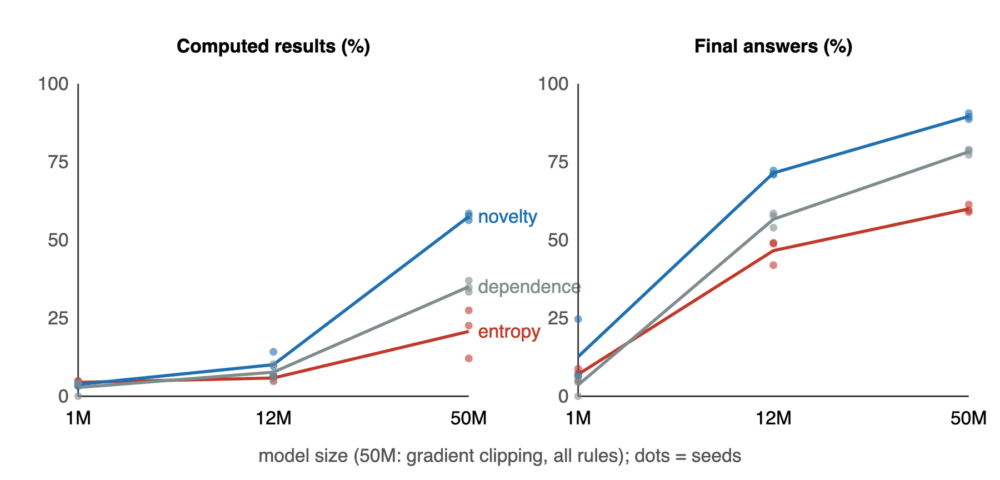

# Novelty Patching: A strictly causal two-byte boundary table

<!-- source-sha256: 8bc18ba338c4ead6d41cc9a243c5289e8afa03f8de0a6b261bff0fd538bd21eb -->

[简体中文](README.md)

## Paper information

| Field | Details |
| --- | --- |
| Paper links | [arXiv 2610.22100](https://arxiv.org/abs/2610.22100); [v1 full text](https://arxiv.org/html/2610.22100v1) |
| Original title | Patch where the text is new: a compression view of where byte-level models should spend compute |
| Company / institution | Nicolás Vera Zúñiga, independent researcher, Chile |
| First public release | 2026-10-15 (arXiv v1), precisely `2026-10-15T15:47:08Z`, not the announcement date |
| Author code | [nicoveraz/segresearch](https://github.com/nicoveraz/segresearch), MIT. The paper points to `paper2/` and `scale/`. |
| Adapter | Catalog key `novelty-patching`; no reproduction adapter, `adapter: null` |
| Local implementation | `src/auto_research/foundation_models/novelty_patching.py`; runner `scripts/run_oct16_foundation_components.py` |
| Implementation status | `component_only`, L1 mechanism diagnostic; `evolve_integrated: false` |
| Full experiment | Reviewed and not reproduced because of cost; `not_reproduced_high_cost` |

## Paper summary

### Background and main changes

A byte-level model calls its global model per patch. The paper predicts recent repetitiveness rather than setting boundaries from entropy alone. It computes match labels offline and looks up only the two preceding bytes online. Sources are Section 3 for method, Sections 4–7 for results and negatives, Section 8 for limits, and Code and data.

~~~mermaid
flowchart LR
  A[Public training bytes] --> B[Future match labels from 128-byte history]
  B --> C[Two-byte averages and low-frequency fallback]
  A --> D[Calibrate threshold on training]
  C --> D
  E[Two already-generated bytes] --> F[Lookup and compare to frozen threshold]
  D --> F
  F --> G[Patch start]
~~~

<!-- paper-figure:start -->
### Original paper figure

> **Paper Figure 1:** Results across scales, not local training. From the [original paper](https://arxiv.org/abs/2610.22100); copyright remains with the authors.
<!-- paper-figure:end -->

### Core equation

Let $m_t=\max\{\ell\le16:b_{t:t+\ell}=b_{j:j+\ell},\ t-128\le j<t\}$, with 0 for no match. The training target is $n_t=-m_t$; LZ matches may overlap. Store $T(a,b)=\mathbb E[n_t\mid b_{t-2}=a,b_{t-1}=b]$. With fewer than 20 observations, fall back to the one-byte mean, then global mean. The boundary is $\mathbf1[T(b_{t-2},b_{t-1})>\tau]$, where $\tau$ is calibrated only on training bytes.

### Offline and online results reported in the paper

| Paper configuration | Entropy baseline | Novelty |
| --- | --- | --- |
| 50M, computed-result exact match, 3 seeds | 20.7±7.9% | 57.5±1.1% |
| 50M, final-answer exact match, 3 seeds | 59.9±1.3% | 89.5±1.0% |

Source: Table 1. This is span evaluation given the true prefix, not end-to-end generation capability. Code/execution traces show no consistent gain and rule replacement can degrade. No online A/B is reported.

## Local reproduction

Only training labels, two-level low-frequency fallback, training threshold, and causal boundaries are implemented. The paper fits on 4 MB; this run uses 262,144 bytes of existing public training text. No BLT training or answer accuracy.

### Data protocol

Use official `openai/grade-school-math` train, revision `3101c7d5072418e28b9008a6636bde82a006892c`. Existing deterministic subset SHA-256: `6b8672439c8cf6f6b6e65bf5f0e515fbf4c497c9066eefb62a6a6a61ced158e3`. Take the first 262,144 UTF-8 bytes of question+answer in file order across 494 documents, resetting history between documents. Training-byte fingerprint: `5013c15d47f45f5995d01b099cce48f2844c16fa0487d68dcb94a42165658782`. No validation/test read. Answer text is unlabeled training corpus; no evaluated agent.

~~~bash
PYTHONPATH=src python scripts/run_oct16_foundation_components.py \
  --papers novelty-patching --device cpu --seeds 42 \
  --corpus-path .cache/oct12-public/gsm8k-holdout/train.jsonl \
  --corpus-sha256 6b8672439c8cf6f6b6e65bf5f0e515fbf4c497c9066eefb62a6a6a61ced158e3 \
  --corpus-id openai/grade-school-math \
  --corpus-revision 3101c7d5072418e28b9008a6636bde82a006892c \
  --corpus-format gsm8k-jsonl --corpus-max-bytes 262144 \
  --output runs/oct16-foundation/novelty-cpu.json
~~~

### Results

[Measured CPU output](metrics/component-cpu.json): training patch rate `0.1002960205078125` versus target `0.1`, frozen threshold `-2.1822660098522166`, and 755 frequent two-byte contexts. Ties make the target rate potentially unattainable, so calibration picks the nearest reachable value without random tie-breaking or future-byte padding. Prefix causality and measured rate consistency passed. Deterministic fitting is not a three-seed capability comparison.

### Code mapping and limits

| Stage | Local implementation / contract |
| --- | --- |
| Section 3 training labels | `novelty_targets`; only this stage sees future bytes |
| Conditional averages and fallback | `fit_novelty_table` |
| Calibration | `calibrate_threshold` returns training fingerprint and target/actual rates |
| Online consumer | `NoveltyTable.next_score(past)` and `boundaries`; no upper-level BLT integration |
| Checks | `tests/foundation_models/test_novelty_patching.py`: independent brute force, window/overlap, future-perturbation invariance, closest reachable threshold |

### Cost and unreproduced scope

The full study uses a 1.9 GB corpus, 1M/12M/50M models, multiple rules and seeds, 1.5B training bytes for the 50M Section 3 setup, and BLT-1B inference. This exceeds the single A100/A30 or Mac budget. **Reviewed and not reproduced because of cost.** No data/weight download or probe for the full experiment. Sub-second local table fitting is not the full cost. No adapter/Evolve registration or capability promotion. `diagnostic_only: true`, `promotion_eligible: false`.
