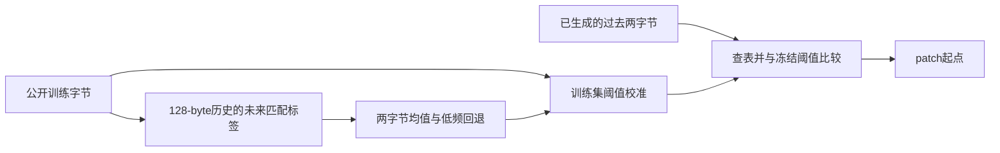
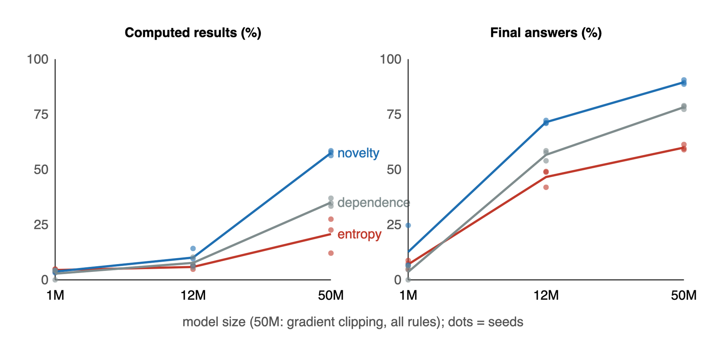

# Novelty Patching：严格因果的两字节边界表

## 论文信息

| 字段 | 内容 |
| --- | --- |
| 论文链接 | [arXiv 2610.22100](https://arxiv.org/abs/2610.22100)；[v1 全文](https://arxiv.org/html/2610.22100v1) |
| 原文标题 | Patch where the text is new: a compression view of where byte-level models should spend compute |
| 公司/机构 | Nicolás Vera Zúñiga；Independent Researcher, Chile |
| 首次公开日期 | 2026-10-15（arXiv v1）；精确时间 `2026-10-15T15:47:08Z`，非公告日期 |
| 原文开源代码 | 是：[nicoveraz/segresearch](https://github.com/nicoveraz/segresearch)，MIT；原文指向 `paper2/`、`scale/` |
| Adapter | `novelty-patching`（目录键；无 reproduction adapter，`adapter: null`） |
| 本地复现代码目录 | `src/auto_research/foundation_models/novelty_patching.py`；调用入口 `scripts/run_oct16_foundation_components.py` |
| 实现状态 | `component_only`；L1 机制诊断；`evolve_integrated: false` |
| 完整实验 | 成本过高，不复现（审查 DONE）；`not_reproduced_high_cost` |

## 原始论文总结

### 背景与主要改动

Byte-level 模型按 patch 调用全局模型。本文用近期重复程度预测替代纯熵边界；离线计算匹配标签，在线只查前两字节。主源位置为 §3 方法、§4-7 结果及负结果、§8 限制和 Code and data。



<!-- paper-figure:start -->
### 原论文关键图

[](https://arxiv.org/html/2610.22100v1/figures/fig1_scale.png)

> 原文 Figure 1 的跨规模结果；不是本地训练结果。图片来自[原论文](https://arxiv.org/abs/2610.22100)，版权归原作者所有。
<!-- paper-figure:end -->

### 核心公式

令 $m_t=\max\{\ell\le16:b_{t:t+\ell}=b_{j:j+\ell},\ t-128\le j<t\}$，不存在匹配时为 0。训练目标 $n_t=-m_t$；LZ 匹配允许重叠。表存储 $T(a,b)=\mathbb E[n_t\mid b_{t-2}=a,b_{t-1}=b]$，计数小于 20 时依次回退至一字节均值、全局均值。边界为 $\mathbf1[T(b_{t-2},b_{t-1})>\tau]$，$\tau$ 仅在训练字节上校准。

### 论文离线与线上效果

| 论文配置 | 熵基线 | Novelty |
| --- | --- | --- |
| 50M，computed-result exact match，3 seeds | 20.7±7.9% | 57.5±1.1% |
| 50M，final-answer exact match，3 seeds | 59.9±1.3% | 89.5±1.0% |

来源：原文 Table 1。这是给真实前缀的 span 评测，不能称端到端生成能力；代码/执行轨迹没有一致收益，规则替换还可能退化。线上 A/B：未报告。

## 本地复现

仅实现训练标签、两级低频回退、训练集阈值和严格因果边界。原文 4 MB 拟表在本次缩为 262,144 byte 的已有公开训练文本；不训练 BLT、不评测答案准确率。

### 数据协议

复用 `openai/grade-school-math` 官方 train，revision `3101c7d5072418e28b9008a6636bde82a006892c`；已有确定性训练子集文件 SHA-256 `6b8672439c8cf6f6b6e65bf5f0e515fbf4c497c9066eefb62a6a6a61ced158e3`。从 question+answer 的 UTF-8 字节按文件顺序取前 262,144 bytes，494 个文档，文档间重置历史；训练字节 fingerprint 为 `5013c15d47f45f5995d01b099cce48f2844c16fa0487d68dcb94a42165658782`。没有读取 validation/test；答案文本仅作为无标签训练语料，不存在被评测 agent。

```bash
PYTHONPATH=src python scripts/run_oct16_foundation_components.py \
  --papers novelty-patching --device cpu --seeds 42 \
  --corpus-path .cache/oct12-public/gsm8k-holdout/train.jsonl \
  --corpus-sha256 6b8672439c8cf6f6b6e65bf5f0e515fbf4c497c9066eefb62a6a6a61ced158e3 \
  --corpus-id openai/grade-school-math \
  --corpus-revision 3101c7d5072418e28b9008a6636bde82a006892c \
  --corpus-format gsm8k-jsonl --corpus-max-bytes 262144 \
  --output runs/oct16-foundation/novelty-cpu.json
```

### 结果

[CPU 实测](metrics/component-cpu.json)：训练 patch rate `0.1002960205078125`，目标为 `0.1`；冻结阈值 `-2.1822660098522166`，755 个高频两字节 context。表值并列使目标未必精确可达，校准选择最近可实现 rate；没有用随机打破并列或未来字节补齐。前缀因果性与实跑 rate 一致性检查通过。拟表完全确定性，不伪装成三 seed 能力比较。

### 代码映射与边界

| 上下游 | 本地位置/合同 |
| --- | --- |
| 原文 §3 训练标签 | `novelty_targets`，未来字节仅此处可见 |
| 条件均值与回退 | `fit_novelty_table` |
| 校准 | `calibrate_threshold`，返回训练 fingerprint、目标与实际 rate |
| 在线消费者 | `NoveltyTable.next_score(past)` / `boundaries`；上层 BLT 未接入 |
| 核验 | `tests/foundation_models/test_novelty_patching.py`，独立暴力参考、窗口/重叠、未来扰动不变、最近可达阈值 |

### 成本与未复现范围

完整研究使用 1.9 GB 语料、1M/12M/50M 模型、多规则与多 seeds；§3 的 50M 配置训练 1.5B bytes，还包括 BLT-1B 推理。这一多臂完整链路超出单张 A100/A30 或 Mac 的本轮低成本预算，故**成本过高，不复现（审查 DONE）**。没有下载数据/权重或探跑完整实验；表拟合的亚秒量级本地计时不能代表完整训练成本。没有 adapter/evolve 注册，`diagnostic_only: true`、`promotion_eligible: false`，不用于能力晋级。
