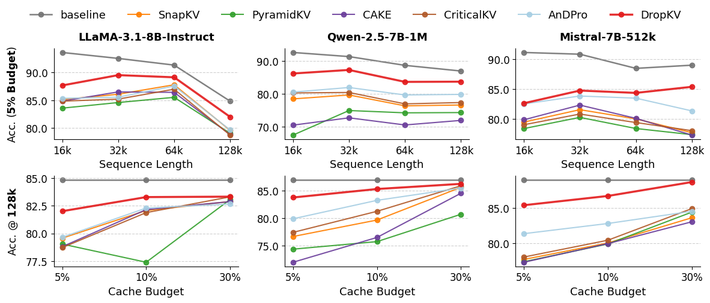

# DropKV: Exact single-entry output-perturbation scoring

<!-- source-sha256: ae63dc1bfe00cb27d7b8d214da72e1a19f6d0eb1e68c9d17730c605428f6eef3 -->

[简体中文](README.md)

## Paper information

| Field | Details |
| --- | --- |
| Paper links | [arXiv 2610.22130](https://arxiv.org/abs/2610.22130); [v1 full text](https://arxiv.org/html/2610.22130v1) |
| Original title | DropKV: Decoupling Residual-Output Perturbation for Near-Optimal KV-Cache Eviction |
| Company / institution | First author Aozhong Zhang: University at Albany, SUNY; coauthors include IBM and Northwestern University |
| First public release | 2026-10-15; `2026-10-15T16:05:17Z`, not the October 16 announcement |
| Author code | [AozhongZhang/DropKV](https://github.com/AozhongZhang/DropKV), Apache-2.0, also integrated in NVIDIA kvpress. Local implementation independently follows the formulas. |
| Adapter | Catalog key `drop-kv`; `adapter: null`, no reproduction CLI adapter |
| Local implementation | `src/auto_research/foundation_models/drop_kv.py`; `scripts/run_oct17_foundation_components.py` |
| Implementation status | `component_only`, L1 mechanism diagnostic, no Evolve |
| Full experiment | Reviewed and not reproduced because of cost; `not_reproduced_high_cost` |

## Paper summary

### Background and main changes

Eviction by attention weight alone ignores values. DropKV approximates combinatorial eviction with single-token output perturbations, accumulates across an observation window, pools scores, and protects recent tokens. Section 3 and Algorithm 1 define scoring. Section 4's guarantees are conditional, not global optimality for arbitrary inputs.

~~~mermaid
flowchart LR
  A[Tail query window and full KV] --> B[Causal attention output]
  B --> C[Squared single-token output perturbation]
  C --> D[Accumulate queries and combine heads]
  D --> E[Max pooling and recent-token protection]
  E --> F[Evict lowest scores]
~~~

<!-- paper-figure:start -->
### Original paper figure

> **Paper Figure 2:** RULER accuracy versus sequence length and KV-cache budget. Paper curves, not an architecture diagram or local measurement. From the [original paper](https://arxiv.org/abs/2610.22130); copyright remains with the authors. Click the image to open its source.
<!-- paper-figure:end -->

### Core equation

For $p=\operatorname{softmax}(Kq/\sqrt d)$ and $a=\sum_jp_jv_j$, removing entry $j$ changes the output by

$$
\Delta_j=\frac{p_j}{1-p_j}(a-v_j),\qquad s_j=\sum_{t\in\mathcal Q}\left\|\Delta_j^{(t)}\right\|_2^2.
$$

Algorithm 1 applies MaxPool1D, sets the recent observation-window scores to positive infinity, and evicts the smallest scores. Local GQA averages scores of query heads sharing a physical KV head. A probability rounded to 1 makes exact removal singular and is rejected rather than changing the formula with epsilon.

### Offline and online results reported in the paper

RULER and LongBench comparisons match cache budgets. Section 5.4's A100-80GB 128K scoring speedup of up to 19.8× compares fused Triton with a naive operator, not complete generation. No online A/B is reported. No capability or throughput number is reproduced locally.

## Local reproduction

### Data protocol and execution

No dataset or model download. Synthetic Q/K/V, seeds 42/43/44, revision `synthetic-formula-and-bit-patterns@oct17-foundation-components-v1`. Per seed: one batch, four query heads, two KV heads, 19 history slots, three queries, width 8, and seven evictions. This is not a benchmark and accesses no train/validation/test answers.

~~~bash
PYTHONPATH=src python scripts/run_oct17_foundation_components.py \
  --papers drop-kv --device cpu --seeds 42,43,44 \
  --output runs/oct17-foundation/drop-kv-cpu.json
~~~

Explicit `--device cuda` runs the same reference and fails without CUDA. Existing output cannot be overwritten. An export can use `--code-commit` to bind a controlled commit and per-file SHA-256.

### Results and independent comparison

Targeted CPU tests and real A100 seeds 42/43/44 passed. GPU seed 42 differs by at most `5.55e-16` from actual deletion followed by independent softmax recomputation. Q/K/V gradients are finite and nonzero, and recent slots are protected. Attention-only scores differ by `0.26233` from normalized perturbation scores; this negative control establishes a distinct rule, not better capability. See [CUDA diagnostics](metrics/component-cuda-seeds42-44.json) and the [GPU receipt](../../gpu-validations/drop-kv-a100-20261017.json).

### Code mapping and limits

`drop_kv_scores` implements tail-aligned causality, GQA, exact perturbation, pooling, and protection. `DropKVResult` returns scores and eviction indices for physical KV heads plus query attention/output. `tests/foundation_models/test_oct17_foundation_components.py` covers actual removal, pooling, gradients, and singular inputs.

This Torch reference materializes intermediates. No efficient Triton, real model cache, chunked generation, or serving. Multiple full 7B/8B models, 4K–128K contexts, multiple budgets and benchmarks exceed the single-A100/A30 low-cost scope. **Reviewed and not reproduced because of cost.** `diagnostic_only: true`, `promotion_eligible: false`; three seeds do not establish model capability.
